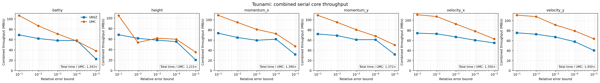

# UNSZ

UNSZ是一个主要面向多time step点云数据的误差有界有损压缩研究原型，不同time step应共享同一套公共点坐标。只有一个time step的数据同样可以压缩。UNSZ不依赖mesh connectivity，而是根据公共点坐标建立kd-tree、生成可由压缩端和解压端共同复现的预测DAG，再对预测残差进行量化、Huffman编码和Zstd压缩。

# 1. 使用方法

## 1.1. 输入格式

当前命令行程序使用float32坐标和float32数据。一个数据目录至少包含：

| 文件 | 内容 |
|---|---|
| `coords.dat` | 按点连续保存的坐标，每个点包含`dim`个float32数值 |
| `<variable>.dat.<time_step>` | 对应time step的float32 field，每个点一个数值 |

例如三维、31个time step的temperature数据可以组织为：

```text
Ocean/
├── coords.dat
├── temperature.dat.0
├── temperature.dat.1
├── ...
└── temperature.dat.30
```

所有field文件的点数必须与`coords.dat`一致。二维数据通过`-dim 2`指定。程序读取float32坐标后会根据坐标跨度判断距离计算是否需要升级为double，但不会改变磁盘输入格式。

## 1.2. 安装

需要CMake、支持C++17和AVX2的C++编译器以及Python 3。C++依赖的Zstd和参数解析库均作为submodule提供；Python坐标变换训练需要NumPy和SciPy，绘图脚本还需要PyVista。

克隆项目并初始化submodule：

```bash
git clone --recurse-submodules git@github.com:ZizheJian/unsz.git
cd unsz
```

如果项目已经克隆：

```bash
git submodule update --init --recursive
```

构建并安装压缩与解压程序：

```bash
cmake -S c_codes -B build -DCMAKE_INSTALL_PREFIX="$PWD/install" -DCODE_NAME=s1_compress
cmake --build build --parallel 8
cmake --install build
```

生成的程序位于`install/bin/s1_compress`和`install/bin/s1_decompress`。

Python环境可以这样准备：

```bash
python3 -m venv unsz_env
source unsz_env/bin/activate
python -m pip install --upgrade pip
python -m pip install numpy scipy pyvista
```

## 1.3. 压缩与解压

最基本的REL error bound压缩命令为：

```bash
install/bin/s1_compress -data-dir /path/to/Ocean -variable temperature -time-step '[0,30]' -dim 3 -M REL 1e-3
```

对应的解压命令为：

```bash
install/bin/s1_decompress -data-dir /path/to/Ocean -variable temperature -time-step '[0,30]' -dim 3 -M REL 1e-3
```

ABS error bound使用：

```bash
install/bin/s1_compress -data-dir /path/to/data -variable field -time-step '[0,9]' -dim 3 -M ABS 1e-4
```

`-time-step`支持闭区间`[a,b]`、右开区间`[a,b)`和显式列表`{a1,a2,...}`。例如`[0,31)`和`{0,3,7}`分别处理0至30以及0、3、7号time step。包含括号或花括号的表达式建议使用引号，避免被shell解释。

普通流程把压缩文件写到原数据旁边，名称为`<variable>.dat.<time_step>.unsz`；解压结果为`<variable>.dat.<time_step>.unsz.bin`。联合时空流程把全部time step写入单个`<variable>.joint.unsz`，解压时仍拆成各个`<variable>.dat.<time_step>.unsz.bin`。程序打印总BR、PSNR、最大误差比例以及预处理、核心压缩和核心解压时间。

当前bitstream不保存用户error bound、坐标变换矩阵、预测参数或实验开关。解压时必须提供与压缩时完全相同的参数；参数不一致通常会导致解码失败或误差检查失败。

本地空间预测DAG缓存默认启用，但不会把DAG写入每个压缩文件。不指定路径时，压缩和解压自动使用`<data-dir>/.unsz_cache/<variable>.dag`：缓存不存在时生成并写入，存在时直接读取；`-dag-cache <path>`用于覆盖默认路径，`-no-dag-cache`用于关闭缓存并每次重新生成DAG，这两个选项不能同时使用。当前缓存文件较大，不作为必须随压缩数据传输的元数据，也不计入`.unsz`码流；缓存必须由相同坐标变换和预测参数生成，同一field测试不同配置时必须为它们指定不同路径。

## 1.4. 自定义有序点集

不传`-point-set-config`时，程序把全部数据作为一个点集，使用命令行`-predictor`和`-M`来指定使用的预测器和误差上限。使用`-point-set-config`并传入JSON配置文件时，文件可以定义一个或多个点集；命令行中即使同时出现`-predictor`或`-M`也会被忽略。压缩和解压必须传入相同的配置文件：

UNSZ目前只支持一个或两个点集。压缩入口依次执行`main`→`unsz::parse_args_and_select_types`→`unsz::parse_args`→初始化并选择`T_coord/T_data`→`unsz::compress`，再按配置中的点集数量进入`unsz::one_point_set::compress`或`unsz::two_point_sets::compress`。单点集入口继续按整体流程和预测器进入`unsz::one_point_set::<流程>::<idw或rbf>::compress`；六种流程与两个预测器组合成12个独立入口。解压端也在time step循环前确定一个点集还是两个点集；联合时空流程则在循环外一次解码整个码流。分派依据不是当前time step实际出现的点集数量；因此，两点集field即使某一步只出现一个点集，也仍走两点集路径。单点集路径不读取分类文件、不执行分类规则，也不在数值预测循环中逐点读取点集编号。当前输入文件的坐标和值都是`float32`，所以实际只会根据坐标跨度把`T_coord`从`float`升级为`double`，`T_data`仍为`float`；联合时空流程也会把时间坐标跨度计入该判断。

```bash
install/bin/s1_compress -data-dir /path/to/Katrina -variable attr0 -time-step '[0,161]' -dim 3 -point-set-config point_set_configs/Katrina_attr0_rel_1e-2.json
install/bin/s1_decompress -data-dir /path/to/Katrina -variable attr0 -time-step '[0,161]' -dim 3 -point-set-config point_set_configs/Katrina_attr0_rel_1e-2.json
```

`rule_type`为`ordered`时，`labels`数组下标就是点集编号。程序按顺序测试除最后一个label外的`condition`，第一条成立的条件决定label；全部不成立时属于最后一个label。比较符直接使用`<`、`<=`、`>`、`>=`、`==`或`!=`。下面是Katrina的两点集配置，其中点集1使用自身值域上的REL EB，点集2由固定fill value组成并使用常量编码：

```json
{
  "version":1,
  "rule_type":"ordered",
  "labels":[
    {"method":"inverse_proportion","eb_mode":"REL","eb_value":0.01,"condition":{"operator":">=","value":-1000}},
    {"method":"constant"}
  ]
}
```

最后一个label是默认兜底类型，因此省略`condition`（同时省略eb信息是因为`method=constant`，不需要eb）；配置文件只有一个label时同样不写`condition`。每个非常量label必须显式配置`eb_mode`和`eb_value`，模式为`REL`或`ABS`；`constant`省略这两个字段。当前可用method为`inverse_proportion`、`rbf_fitting`和`constant`。旧的`fitting`、`hybrid_loo`和`quadratic_fitting`实现已归档到`c_codes/trash/point_set_with_legacy_fitting_predictors.tpp`，不再属于当前接口。

分类逻辑很复杂时，用户可以为每个time step提供一个`uint8`点集编号文件，再把`rule_type`设为`label_file`。路径必须包含`{time_step}`，相对路径以JSON文件所在目录为基准：

```json
{
  "version":1,
  "rule_type":"label_file",
  "label_file":{"path":"point_set_id.dat.{time_step}","dtype":"uint8"},
  "labels":[
    {"method":"rbf_fitting","eb_mode":"REL","eb_value":0.001},
    {"method":"inverse_proportion","eb_mode":"ABS","eb_value":0.0001},
    {"method":"constant"}
  ]
}
```

每个标签文件必须恰好包含`point_num`个字节，编号范围为`0`到`labels`数量减1。`label_file`模式仍然是多点集配置：每个label都必须记录`method`，每个非常量label还必须记录自己的`eb_mode`和`eb_value`，只是所有label均不需要`condition`。完整示例位于`point_set_configs/`。由于EB不写入bitstream，解压时仍必须使用与压缩时相同的配置。

## 1.5. 批量实验与脚本

| 脚本 | 功能 |
|---|---|
| `t0_start_single_c_code.py` | 构建并运行一个C++入口，适合单次小实验 |
| `t1_start_c_code.py` | 正式实验统一入口，只接受`-data`和`-field`，例如`./unsz_env/bin/python t1_start_c_code.py -data ocean -field temperature`。每个field采用的时间方案、空间预测器、参考点数、排序、adjust coord、DAG缓存及UNSZ/UMC参数均冻结在脚本内；固定运行REL`1e-1～1e-5`五点曲线。UNSZ程序缺失时自动编译；不会编译UMC，UMC需要提前手动编译。 |
| `t2_adjust_coord.py` | 训练坐标变换矩阵。命令行只接受`-data`和`-field`，并从`t1_start_c_code.py`读取该field的路径、维数、time step数、预测器和矩阵文件名；Python函数`train_adjust_coord()`仍可调整loss、采样、优化器、预测器、训练参考点数和输出路径。 |
| `t3_visualize.py` | 使用当前矩阵生成Katrina attr0与Ocean temperature坐标变换前后的field图像 |
| `py_codes/prepare_datasets.py` | 统一把Tpost20、E3SM、ADCIRC Haiyan、Tsunami、TAPS和Ocean-large发布数据转换为UNSZ/UMC共用的平坦二进制基准输入 |
| `py_codes/run_spatial_field_benchmark.slurm` | 以Slurm array并发运行同一数据集的不同field |
| `py_codes/plot_dataset_rd.py` | 为一个数据集的各field分别绘制UNSZ/UMC空间RD与核心吞吐率，并计算同PSNR下的平均BR变化 |

统一可视化程序默认生成Katrina attr0与Ocean temperature的变换前、变换后图像，也可以只选择一个数据集：

```bash
./unsz_env/bin/python t3_visualize.py
./unsz_env/bin/python t3_visualize.py -dataset katrina
./unsz_env/bin/python t3_visualize.py -dataset ocean-temperature
```

# 2. 方案描述

## 2.1. 整体流程

UNSZ目前实现了六种压缩流程：

<table class="fixed-layout-table" style="display:table!important;width:100%!important;table-layout:fixed!important;overflow-wrap:anywhere!important;word-break:break-word!important">
  <colgroup>
    <col style="width:25%!important">
    <col style="width:10%!important">
    <col style="width:65%!important">
  </colgroup>
  <thead>
    <tr>
      <th>流程</th>
      <th>当前状态</th>
      <th>含义</th>
    </tr>
  </thead>
  <tbody>
    <tr>
      <td>纯空间</td>
      <td>可选</td>
      <td>读取公共坐标，可选地训练并应用空间变换矩阵。然后在变换后的坐标上建立kd-tree并生成预测DAG，最后在每个文件上完成数值预测、量化和无损压缩。</td>
    </tr>
    <tr>
      <td>时间零阶外插预测</td>
      <td>可选</td>
      <td>先用纯空间方案压缩第一个文件，再不断用上一个文件的重建值预测下一个文件。</td>
    </tr>
    <tr>
      <td>时间一阶内插预测</td>
      <td>可选</td>
      <td>先用纯空间方案压缩第一个和最后一个文件，再按照类似SZ3的层次顺序处理其余文件。若提供time step坐标文件，层次中点按实际坐标选择，插值权重也按实际坐标计算；否则把time step编号当作等间距坐标。</td>
    </tr>
    <tr>
      <td>时间零阶外插预测＋空间补偿</td>
      <td>可选</td>
      <td>先用上一文件的重建值预测当前值，再使用当前文件中已经重建的空间邻点预测时间残差，最后量化剩余残差。</td>
    </tr>
    <tr>
      <td>时间一阶内插预测＋空间补偿</td>
      <td>可选</td>
      <td>先用左右两个已重建time step线性预测当前值，再使用当前文件中已经重建的空间邻点预测时间残差，最后量化剩余残差。</td>
    </tr>
    <tr>
      <td>联合时空压缩</td>
      <td>放弃</td>
      <td>C++读取一次空间坐标，在末尾增加时间坐标并为每个time step复制一份；全局点编号为<code>time_id×N+spatial_id</code>。随后把各文件的值按相同编号连接起来，作为一个高维单点集调用纯空间预测；解压单个联合码流后再按每步<code>N</code>个点拆回原文件。在所有已有的数据上，总能找到比它好的方案，而且预处理耗时较长，因此不进入常规自动选择。</td>
    </tr>
    <tr>
      <td>时间一阶内插预测中，最后一个文件使用来自第一个文件零阶外插预测</td>
      <td>尚未测试</td>
      <td></td>
    </tr>
    <tr>
      <td>空间预测＋时间补偿</td>
      <td>尚未测试</td>
      <td>先使用空间预测来得到预测值，然后使用某种时间预测来压缩预测误差。</td>
    </tr>
  </tbody>
</table>

对于单点集field，`t1_start_c_code.py`记录所选流程，并把它传给压缩器和解压器；C++两端再结合本次实际传入的time step数量选择对称的专用函数。只有1步时固定使用纯空间；有2步时，一阶内插退化为零阶外插，“一阶内插＋空间补偿”相应退化为“零阶外插＋空间补偿”；至少有3步时才会进入一阶内插函数。六种流程各有独立入口，并使用编译期固定的预测模式，因此单点集的逐点数值循环不再反复判断当前属于哪种时间流程。

时间一阶内插可通过`-time-step-coordinate-file <path>`读取一维float64原始数组，第`i`个数是time step `i`的实际坐标。压缩和解压必须读取同一文件；不传该参数时保持原有的等间距假设。`t1`的field配置使用`time_step_coordinate_file`记录文件名并同时传给两端，普通等时间间隔数据不需要记录这一项。

联合时空流程在普通命令后增加`-cross-time-spatial-point-num-experimental <N>`，其中`N`必须等于`coords.dat`中的空间点数。输入仍是原始空间坐标和逐time step的field文件，不需要由Python预先生成升维坐标或拼接field；时间坐标同样由`-time-step-coordinate-file`提供，不传时直接使用time step编号。

## 2.2. 生成坐标变换矩阵

UNSZ根据点之间的距离选择参考点，但原始坐标中的距离不一定能反映数据是否容易互相预测。例如Katrina的z轴被严重拉伸，坐标上最近的点不一定是数值上最接近的点。Adjust coord用少量训练文件提前学习一个下三角矩阵`C`，以后只根据公共坐标和这个矩阵生成预测关系和计算距离。需要注意的是，并不是所有数据都应该生成坐标变换矩阵，并且没有一个优化目标能够精确指出哪个矩阵更好。

待验证的简化方案是只学习或扫描各坐标轴的缩放比例，不使用轴间混合，并在相同预测器、排序和PSNR下比较BR。不能先认定Katrina现有矩阵等价于纯z缩放：当前矩阵中z到x、y的系数约为`-0.00534/-0.00258`，乘上原始z跨度后，对x、y距离的影响可能与这两轴自身跨度同量级。轴向缩放若仍用于生成顺序、选择参考点和计算RBF权重，压缩端与解压端必须使用相同的缩放比例。

正式训练入口只选择dataset和field。例如：

```bash
./unsz_env/bin/python t2_adjust_coord.py -data tsunami -field bathy
```

`-data`统一使用小写；`-field`必须使用`t1_start_c_code.py`中记录的变量名及大小写。`t2`从`t1`读取数据路径、维数、time step数和最终数值预测器；即使该field尚未启用坐标变换，也可以先训练候选矩阵，以便实测后再决定是否写入`t1`。已有正式矩阵名时覆盖该文件名，否则默认写入`adjust_coord_matrices/<dataset>_<field>_spatial.txt`。命令行不提供单独的训练参数，避免正式矩阵使用不同协议。需要做消融时，可以在Python中调用`t2_adjust_coord.train_adjust_coord()`，通过关键字参数覆盖统一训练配置；更底层的`adjust_coord()`也保留完整参数接口。

坐标按照`c'=cC`变换，训练希望两个点的数值差与它们在新坐标中的距离接近：

```text
|v1-v2|≈||(c1-c2)C||₂
```

这个过程是迭代式的，迭代数由`t1`按field记录。默认使用4轮；Katrina的码长loss在第3轮后明显退化，因此固定使用2轮。

训练不需要读取所有time step，而是在整个时间范围内等间隔选择`sample_file_num`个文件，默认选择3个。例如Katrina共有162个文件时，会读取第27、80和134个文件。随后，每轮迭代中依次执行采样、训练和后处理。

### 2.2.1. 采样

每轮迭代要做两次采样。第一次采样决定用哪些点建立近邻树，主要控制建树和查询的规模；第二次采样只从树上的点中挑选一部分作为目标，主要控制交给优化器的点对数量。具体过程如下：

1. 从全部坐标中无放回地随机选择`ceil(point_num×first_sample_ratio)`个点，默认使用25%。选出的编号会排序，因此没有重复且保持原始点编号顺序。第一次采样不能太稀疏，否则树上的“最近点”会离目标太远，无法代表完整点云中的局部关系。
2. 对每个训练文件分别删除这批点中的异常值。当前Python版本只通过`is_abnormal()`把点分为正常和异常两类，并且不让异常点参与训练。由于异常点的位置会随time step改变，每个文件最终留下的点可能不同。
3. 从每个文件剩余的点中再次无放回地随机选择目标，也就是训练点对的第一个点。`t2`默认每轮固定选择10000个目标，并尽量平均分给各训练文件，从而不让点数或time step数量改变优化器的输入规模；field可以在`t1`中覆盖该数值，Katrina当前使用100000个目标。Python函数可以通过`second_sample_num`调整固定数量；只有显式设为0时才改用`ceil(第一次采样点数×训练文件数×second_sample_ratio)`。
4. 对每个文件单独建立一棵`cKDTree`。树上的坐标先经过当前`C`变换；查询时选择`actual_ref_num`个近邻作为点对的第二个点。正式`t2`从`t1`读取实际预测器的参考点数，因此当前Tsunami配置中每个目标使用10个近邻；Python函数仍可显式覆盖该数值。
5. 对每个点对记录数值差`Δv`和未经变换的原始坐标差`Δc`。

采样相关方案如下：

<table class="fixed-layout-table" style="display:table!important;width:100%!important;table-layout:fixed!important;overflow-wrap:anywhere!important;word-break:break-word!important">
  <colgroup>
    <col style="width:20%!important">
    <col style="width:10%!important">
    <col style="width:42%!important">
    <col style="width:28%!important">
  </colgroup>
  <thead>
    <tr>
      <th>优化方案</th>
      <th>当前状态</th>
      <th>已有结论</th>
      <th>下一步</th>
    </tr>
  </thead>
  <tbody>
    <tr>
      <td>第一次采样密度和第二次目标数量</td>
      <td>待验证</td>
      <td>降低第一次采样率会减少建树、近邻查询的时间和内存，但树中点变稀疏，查询到的近邻会比完整点云中的真实近邻更远，可能使训练矩阵失真，目前使用25%。第二次采样只控制作为训练目标的点数，基本上决定adjust coord的速度。Katrina码长loss从10000增加到31324、60000和100000个目标时实际BR持续改善，当前固定为100000；其他field仍默认10000。</td>
      <td>新field先使用10000个目标；只有实际压缩验证表明扩样有效时再增加</td>
    </tr>
    <tr>
      <td>随机选定矩形区域作为样本</td>
      <td>放弃</td>
      <td>没有表现出稳定优势。在LES velocity_x上，固定采样点数并估算区域大小时，使用2或4个区域只让BR降低约<code>0.30%</code>，使用1或8个区域却分别使BR增加<code>27.88%/0.49%</code>。旧Ocean velocityZonal实验中的四维4区域方案曾比零阶外插降低<code>8.920%</code> BD-rate，但该实验同时改用了联合四维预测，无法证明收益来自区域采样；联合四维方案本身也已被更好的时间预测方案取代。因此现有结果不支持继续使用矩形区域采样</td>
      <td>不再作为训练候选；只在trash中保留历史实现和结果用于复现</td>
    </tr>
    <tr>
      <td>训练使用与实际压缩相同的参考点数</td>
      <td>已采纳</td>
      <td>训练与实际压缩使用相同的预测器参数，包括参考点数。此前固定使用4个训练近邻的结果只保留为历史消融，不再作为正式矩阵</td>
      <td>每次修改field的预测参考点数后重新训练并复测矩阵</td>
    </tr>
  </tbody>
</table>

### 2.2.2. 训练

汇总所有样本点对的数值差和原始坐标差后，程序训练一个公共的下三角矩阵`C`。当前`t2`默认使用离散量化区间码长loss `prediction_ggd_bit`，不使用`prediction_ggd_differential_entropy`微分熵loss。它从`t1`读取该field最终采用的IDW或RBF预测器及其参考点数、power、kernel、shape、nugget和多项式次数，再在真实数据上生成预测误差。作为消融基线的二次方loss定义为：

$$ L(C)=\sum_i\left(\lvert\Delta v_i\rvert-\lVert\Delta c_iC\rVert_2\right)^2 $$

除了首轮以外，训练会以历史`C`作为初值。

训练目标和优化器相关方案如下：

<table class="fixed-layout-table" style="display:table!important;width:100%!important;table-layout:fixed!important;overflow-wrap:anywhere!important;word-break:break-word!important">
  <colgroup>
    <col style="width:20%!important">
    <col style="width:10%!important">
    <col style="width:42%!important">
    <col style="width:28%!important">
  </colgroup>
  <thead>
    <tr>
      <th>优化方案</th>
      <th>当前状态</th>
      <th>已有结论</th>
      <th>下一步</th>
    </tr>
  </thead>
  <tbody>
    <tr>
      <td>量化区间码长loss</td>
      <td>Katrina已采纳</td>
      <td>这是当前<code>prediction_ggd_bit</code>的实现。使用预测器生成误差，闭式估计最大似然的GGD尺度参数（固定中心为0、形状参数为0.5），通过CDF之差估计每个误差附近的量化区间概率，并最小化累计估计码长。该方法依赖EB，而且没有先生成离散量化索引，因此只是量化码长的连续近似。Katrina使用100000个目标、训练REL EB <code>1e-3</code>和第2轮矩阵后，同PSNR BR比可复现的旧二次方loss矩阵降低<code>4.733%</code>。</td>
      <td>在其他启用坐标变换的field上分别验证</td>
    </tr>
    <tr>
      <td>GGD微分熵loss</td>
      <td>已实现，待比较</td>
      <td>这是最初设想的码长loss。设预测误差为<code>e_i(C)</code>，固定GGD中心为0、形状参数<code>β=0.5</code>，先闭式估计尺度参数：$$ \alpha(C)=\left(\frac{\beta}{n}\sum_i\lvert e_i(C)\rvert^\beta\right)^{1/\beta}. $$ 然后直接最小化微分熵：$$ h(C)=\frac{1/\beta+\ln\left(2\alpha(C)\Gamma(1/\beta)/\beta\right)}{\ln 2}. $$ 当<code>β=0.5</code>时，$$ h(C)=\frac{2+\ln(4\alpha(C))}{\ln 2}. $$ 它不量化预测误差，也不依赖EB。当前实现对IDW和零次多项式RBF提供解析梯度，并使用L-BFGS；在函数接口中传入<code>loss_function_name="prediction_ggd_differential_entropy"</code>即可选择，若希望`t2`命令行采用它，则在`t1`的field配置中记录<code>adjust_coord_loss</code>和<code>adjust_coord_optimizer="lbfgs"</code>。</td>
      <td>与量化区间码长loss及二次方loss比较BR和训练时间</td>
    </tr>
    <tr>
      <td>二次方loss</td>
      <td>待验证</td>
      <td>$$ L(C)=\sum_i\left(\lvert\Delta v_i\rvert-\lVert\Delta c_iC\rVert_2\right)^2 $$
      比四次loss和对数loss要好（在稳定性和能够达到的最优压缩效果上），但疑似不如码长loss。另外速度也疑似比码长loss慢。
      </td>
      <td>需要和码长loss比较</td>
    </tr>
    <tr>
      <td>新矩阵吸收率</td>
      <td>按field选择</td>
      <td>默认值仍为<code>0.5</code>。Katrina在100000样本、训练REL EB <code>1e-3</code>的第2轮比较<code>0.25/0.5/0.75/1.0</code>后选择<code>0.75</code></td>
      <td>新field先使用默认值，只在实际BR对吸收率敏感时调节</td>
    </tr>
    <tr>
      <td>外层训练迭代数</td>
      <td>按field选择</td>
      <td>默认值为4轮。Katrina码长loss逐轮实测后选择第2轮；第3和第4轮即使训练loss变化不大，实际BR也明显退化</td>
      <td>保存并验证每一轮矩阵，不按训练loss自动选择</td>
    </tr>
    <tr>
      <td>直接优化<code>M=CCᵀ</code></td>
      <td>放弃</td>
      <td>当前直接优化<code>C</code>会自动得到半正定的<code>CCᵀ</code>，列符号歧义也已通过统一正对角线解决。直接优化<code>M</code>时，平方loss仍包含<code>sqrt(ΔcMΔcᵀ)</code>，不会变成简单的线性最小二乘，反而还要额外施加半正定约束或进行投影</td>
      <td></td>
    </tr>
    <tr>
      <td>手写Gauss–Newton快速迭代</td>
      <td>需要更新并重新验证</td>
      <td>当前版本针对的是二次方loss，有明显的加速效果，只带来非常微小的br损失。</td>
      <td>需要实现针对码长loss的版本，并验证</td>
    </tr>
    <tr>
      <td>二次差分loss</td>
      <td>放弃</td>
      <td>定义依赖近似共线三点，适用范围和预期收益都较弱</td>
      <td></td>
    </tr>
    <tr>
      <td>随坐标变化的变换矩阵</td>
      <td>待验证</td>
      <td></td>
      <td></td>
    </tr>
  </tbody>
</table>

### 2.2.3. 后处理

一次训练结束后会得到原始下三角矩阵`C_new`，随后按以下顺序处理：

1. **检查优化结果。** 程序首先确认`C_new`的所有元素和loss残差均为有限值。出现NaN或Inf说明优化已经失效，继续建树会传播错误，因此立即终止。
2. **统一列符号。** 把`C_new`中负对角元素对应的整列取反。同一个度量可以由列符号不同的多个`C`表示，因为任意对角元素为`±1`的`D`都满足`(CD)(CD)ᵀ=CCᵀ`；统一为正对角线可以避免等价因子在后续平均时相互抵消，而且列取反本身不改变任何距离。
3. **分离矩阵形状和整体倍率。** 将统一符号后的矩阵写成`C_new=sC_norm`，其中`||C_norm||_F²=dim`。倍率`s`可以理解为数值差相对于坐标差的总体尺度，归一化矩阵`C_norm`表示真正影响近邻顺序和IDW权重的度量形状。
4. **缓冲。** 归一化后的变换矩阵和历史上的归一化矩阵加权算数平均，默认新矩阵的权重是0.5，随后再次归一化。倍率`s`和历史倍率加权几何平均，默认新倍率的权重是0.9，实验表明这个倍率权重不会影响最终归一化矩阵、BR或训练时间。

矩阵后处理相关方案如下：

<table class="fixed-layout-table" style="display:table!important;width:100%!important;table-layout:fixed!important;overflow-wrap:anywhere!important;word-break:break-word!important">
  <colgroup>
    <col style="width:20%!important">
    <col style="width:10%!important">
    <col style="width:42%!important">
    <col style="width:28%!important">
  </colgroup>
  <thead>
    <tr>
      <th>优化方案</th>
      <th>状态</th>
      <th>已有结论</th>
      <th>下一步</th>
    </tr>
  </thead>
  <tbody>
    <tr>
      <td>在<code>M=CCᵀ</code>上混合新旧训练结果</td>
      <td>放弃</td>
      <td><code>M</code>混合表示平均平方距离，不符合当前“平均新旧变换后坐标”的缓冲定义。另外在katrina上效果略差。</td>
      <td></td>
    </tr>
    <tr>
      <td>分离矩阵形状和整体倍率</td>
      <td>已采纳，待验证</td>
      <td>原方案每轮归一化<code>C</code>并丢弃整体倍率，新方案分别缓冲归一化矩阵<code>C</code>和倍率<code>s</code>。平方loss下，固定矩阵形状后的倍率只是一个容易求解的一维最小二乘问题，优化器能迅速重新找到合适倍率；近邻选择又只由归一化矩阵形状决定，因此两种方案在Katrina上完全一样，报错耗时和结果。只是新方案不会无故丢弃倍率，算法定义更合理，因此暂时采纳</td>
      <td>在其他数据和码长loss上验证</td>
    </tr>
    <tr>
      <td><code>s</code>的采纳率</td>
      <td>暂时固定</td>
      <td>平方loss下，固定矩阵形状后只剩一个一维尺度最小二乘问题，优化器可以迅速重新得到合适倍率。采纳率<code>0.7/0.9/1.0</code>得到相同的归一化矩阵和<code>6/7/6/6</code>轮内层评估次数，对BR与时间均无可见影响</td>
      <td>默认固定为<code>0.9</code>。如果发现“分离矩阵形状和整体倍率”在其他数据上也没有性能影响，则这一项也不需要调整了。</td>
    </tr>
  </tbody>
</table>

### 2.2.4. 其他优化方案

<table class="fixed-layout-table" style="display:table!important;width:100%!important;table-layout:fixed!important;overflow-wrap:anywhere!important;word-break:break-word!important">
  <colgroup>
    <col style="width:20%!important">
    <col style="width:10%!important">
    <col style="width:42%!important">
    <col style="width:28%!important">
  </colgroup>
  <thead>
    <tr>
      <th>优化方案</th>
      <th>当前状态</th>
      <th>已有结论</th>
      <th>下一步</th>
    </tr>
  </thead>
  <tbody>
    <tr>
      <td>让adjust coord训练读取用户定义多点集配置</td>
      <td>待实现</td>
      <td>C++压缩端已经支持多个点集、各点集独立的预测方法和误差界以及<code>n-1</code>个标签通道；Python训练端没有读取点集JSON，仍只把<code>is_abnormal()</code>筛出的所有正常值视为一个点集，并为每个文件使用一个公共误差界</td>
      <td>让训练端读取压缩所用的同一份JSON。非constant点集分别按自身预测方法和误差界计算码长loss，再合并成一个公共矩阵的目标；constant点集不产生数值码长loss。标签码流是否计入目标需单独验证</td>
    </tr>
    <tr>
      <td>预先把各坐标维度scale到相同范围</td>
      <td>放弃</td>
      <td>Katrina重新训练后相对原坐标adjust退化<code>22.848%</code> BD-rate</td>
      <td></td>
    </tr>
  </tbody>
</table>

### 2.2.5. 使用训练好的矩阵

推荐通过矩阵文件使用训练结果。压缩和解压必须提供同一个文件：

```bash
install/bin/s1_compress -data-dir /path/to/Katrina -variable attr0 -time-step '[0,9]' -dim 3 -M REL 1e-3 -adjust-coord-matrix-file adjust_coord_matrices/Katrina_attr0_spatial.txt
install/bin/s1_decompress -data-dir /path/to/Katrina -variable attr0 -time-step '[0,9]' -dim 3 -M REL 1e-3 -adjust-coord-matrix-file adjust_coord_matrices/Katrina_attr0_spatial.txt
```

矩阵文件记录数据集、field、维数、下三角元素和训练类型。`training_type=spatial`表示只使用空间坐标训练；`training_type=spatiotemporal`表示把time step作为额外坐标维度进行联合时空训练。当前选定矩阵集中保存在`adjust_coord_matrices/`，格式和文件索引见其中的`README.md`。

## 2.3. 生成DAG

预测前需要根据公共坐标生成一套所有time step都能复用的有向无环图（DAG）。整体分为三步：

1. 使用经过adjust coord变换的坐标生成kd-tree。
2. 对所有点生成一个预测目标的顺序。
3. 根据这个顺序，对每个预测目标寻找合适的参考点。

### 2.3.1. 生成kd-tree

程序在变换后的坐标上建立一棵公共kd-tree。这个树包含所有点，无论它的标签是什么。

当前kd-tree的每个叶节点可以保存至多32个点，并按树内点编号连续存储坐标。树还维护一个有效点计数，可以用来表达各种含义，比如“在指定block、指定标签的点中已经被压缩的点的数量”，有效点计数含义不同的树可以共用树的结构，只要维护自己的有效点计数数组就行了。

<table class="fixed-layout-table" style="display:table!important;width:100%!important;table-layout:fixed!important;overflow-wrap:anywhere!important;word-break:break-word!important">
  <colgroup>
    <col style="width:20%!important">
    <col style="width:10%!important">
    <col style="width:42%!important">
    <col style="width:28%!important">
  </colgroup>
  <thead>
    <tr>
      <th>优化方案</th>
      <th>状态</th>
      <th>已有结论</th>
      <th>下一步</th>
    </tr>
  </thead>
  <tbody>
    <tr>
      <td>树上每个叶节点可以保存多个点</td>
      <td>已采纳</td>
      <td>不改变DAG和压缩效果，但是可以加速</td>
      <td></td>
    </tr>
    <tr>
      <td>进一步优化kd-tree查询</td>
      <td>待实现</td>
      <td>当前查询仍使用递归，并在完整树中区分有效目标；尚未测试显式栈和只包含当前目标点的紧凑树</td>
      <td>只有kd-tree查询重新成为瓶颈时再实现并比较遍历时间</td>
    </tr>
  </tbody>
</table>

### 2.3.2. 预测目标排序

考虑到在多time step、多标签情况下，不同time step可能有不同的标签分布，对预测目标排序时往往不会考虑到标签。

<table class="fixed-layout-table" style="display:table!important;width:100%!important;table-layout:fixed!important;overflow-wrap:anywhere!important;word-break:break-word!important">
  <colgroup>
    <col style="width:20%!important">
    <col style="width:10%!important">
    <col style="width:42%!important">
    <col style="width:28%!important">
  </colgroup>
  <thead>
    <tr>
      <th>优化方案</th>
      <th>当前状态</th>
      <th>已有结论</th>
      <th>下一步</th>
    </tr>
  </thead>
  <tbody>
    <tr>
      <td>直接对所有点进行排序</td>
      <td>已采纳</td>
      <td></td>
      <td></td>
    </tr>
    <tr>
      <td>先把数据随机的、按照一定比例分成多轮，每轮内部进行排序</td>
      <td>待验证</td>
      <td>略微降低压缩效果，略微加速。但是预处理时间没有那么重要。</td>
      <td></td>
    </tr>
    <tr>
      <td>反向剔除</td>
      <td>已采纳</td>
      <td>先假定所有点都已经被预测，然后依次去掉最好预测的点。比正向添加更好。</td>
      <td></td>
    </tr>
    <tr>
      <td>仅在近邻点内寻找下一个预测目标</td>
      <td>已验证</td>
      <td>如果每次都从所有未处理点中寻找下一个目标，时间复杂度是O(N²)的，因此当前只从刚选中目标附近的固定数量点中选择下一个目标。候选数较小会减少DAG生成时的耗时，但也会改变最终DAG。<br>
      当候选数量较少的时候，对压缩性能的影响并不固定。随着候选数量不断变大，更有可能选到和上一预测目标距离较远的点，并影响无损压缩的连续性，进而降低压缩比。<br>
      另一方面来说，候选数量较少时，很容易出现当前目标依赖上一目标的情况，导致压缩过程有大量的串行依赖，进而降低压缩速度。随着候选数量不断增大，压缩耗时不断下降，但收益越来越小。Tsunami RBF10扫描中，4和8候选都形成覆盖全部点的依赖链，总时间反而是16候选的1.292和1.208倍；16～32候选的核心时间只再缩短约5%。</td>
      <td>Tsunami六个field统一采用16候选；在其他网格上仍需检查速度与BR的拐点是否变化。</td>
    </tr>
    <tr>
      <td>缓存参考点并延迟重新查询</td>
      <td>待验证</td>
      <td>为每个候选目标缓存一组用于评分的参考点。每次评分时，先去掉已经被剔除的参考点，然后如果剩余参考点数量不小于阈值，就只使用缓存中剩余的参考点，否则才重新查询kd-tree并补满缓存。略微增加br，但大幅加速。</td>
      <td>可以缺少的参考点数量和最大参考点数量有关，需要重新验证。</td>
    </tr>
    <tr>
      <td>根据平均平方距离<code>MSD</code>生成预测顺序</td>
      <td>已采纳</td>
      <td>不依赖数据，因此可以不存储DAG，但压缩能力弱于参考数据辅助顺序</td>
      <td></td>
    </tr>
    <tr>
      <td>根据预测目标相对参考数据云的位置<code>S2</code>生成预测顺序</td>
      <td>弃用</td>
      <td>$$ D=\frac{1}{k}\sum_{i=1}^{k}\lVert c-c_i\rVert_2^2 $$
      $$ R=\frac{2}{k(k-1)}\sum_{1\le i\lt j\le k}\lVert c_i-c_j\rVert_2^2 $$
      $$ S_2=\frac{2D}{R} $$
      其中<code>c</code>是预测目标坐标，<code>c_i</code>是第<code>i</code>个参考点坐标，<code>k</code>是参考点数；<code>D</code>是目标到参考点的平均平方距离，<code>R</code>是参考点两两之间的平均平方距离。<code>S2</code>衡量目标相对参考点云的偏离程度，实验效果不如MSD</td>
      <td></td>
    </tr>
    <tr>
      <td>根据预测误差生成预测顺序</td>
      <td>可选</td>
      <td>在多time step时，使用少量文件作为参考数据，用实际使用的预测器在原始数据上估算出预测误差，然后根据预测误差排序。或者在单time step时，直接使用数据本身作为参考数据。通常比<code>msD</code>好一些，但是必须存储DAG，另外耗时和实际使用的预测器有关。在多time step时也有可能不存储DAG，方法是先用其他不需要DAG的排序方式来压缩并解压参考数据吗，然后使用有损参考数据来排序剩余的数据，但因为要生成两次DAG，收益可能比不上耗时。
      关于在多time step下使用的参考文件数量，目前使用3个。</td>
      <td>暂时不采用，除非在特定数据上发现MSD不够好，并且这个方案有很大提升。</td>
    </tr>
    <tr>
      <td>生成参考数据辅助顺序时，暂时少用几个参考点</td>
      <td>放弃</td>
      <td>生成顺序的过程中，一些缓存参考点会逐渐变得不可用。继续用剩下的参考点评分可以减少kd-tree查询，但会生成更差的顺序，最终增加BR</td>
      <td></td>
    </tr>
    <tr>
      <td>在根据预测误差排序时，允许参考不可用的点</td>
      <td>放弃</td>
      <td>首次预处理约快<code>2.18～2.27</code>倍，但相对动态分数在Katrina和Ocean temperature增加BD-rate <code>6.336%/42.165%</code></td>
      <td></td>
    </tr>
    <tr>
      <td>在先分轮再排序的方案中，对于最后几轮，根据kd tree对空间进行划分，然后在排序的时候，排完一个区域所有的点，再处理下一个区域。</td>
      <td>放弃</td>
      <td>预期是略微增加br，但增加缓存命中率，所以会有一定的加速。实际上略微减小br，并且变慢。</td>
      <td></td>
    </tr>
    <tr>
      <td>生成预测顺序后，把数据按照预测顺序重排</td>
      <td>按field选择</td>
      <td>只改变数据在内存中的排列，不改变预测关系、BR、PSNR或码流。Ocean-large的核心循环从中受益；Katrina因为多点集标签和顺序转换而变慢。Tsunami momentum_x的核心计算快约<code>3.5%</code>，但计入压缩端输入重排和解压端恢复原顺序后，压缩与解压总时间增加约<code>7.7%</code></td>
      <td>只在计入两端顺序转换后总时间下降的field上启用</td>
    </tr>
    <tr>
      <td>联合使用多种排序标准</td>
      <td>待验证</td>
      <td>疑似MSD+S2不如纯粹的MSD</td>
      <td>如果之后打算使用预测误差来排序，可以重新尝试这个方案</td>
    </tr>
  </tbody>
</table>

### 2.3.3. 生成DAG

得到预测目标的顺序后，程序按这个次序逐点选择参考点。每个目标只能引用已经恢复的点。

全局反向剔除且排序候选数不少于预测参考点数时，不必为最终参考点再做一轮kd-tree查询：剔除当前点之后，下一次以它为中心查询的附近未剔除点，正好就是正向预测时它能引用的点。程序从该查询结果保存最近的参考点；距离并列时，取16个候选再截取前10个可能与单独查询10点的参考编号略有不同，当前不为此重新查询。先分轮后排序及独立partition仍保留原参考点生成路径。

<table class="fixed-layout-table" style="display:table!important;width:100%!important;table-layout:fixed!important;overflow-wrap:anywhere!important;word-break:break-word!important">
  <colgroup>
    <col style="width:20%!important">
    <col style="width:10%!important">
    <col style="width:42%!important">
    <col style="width:28%!important">
  </colgroup>
  <thead>
    <tr>
      <th>优化方案</th>
      <th>状态</th>
      <th>已有结论</th>
      <th>下一步</th>
    </tr>
  </thead>
  <tbody>
    <tr>
      <td>在先分轮后排序的方案中，每选择完整一轮后再更新可用参考点</td>
      <td>放弃</td>
      <td>该方案禁止同轮内依赖，Katrina attr0前3步BR恶化约<code>20.3%</code>，速度没有明显改善</td>
      <td></td>
    </tr>
    <tr>
      <td>使用连续数组保存参考边和权重</td>
      <td>已采纳</td>
      <td>减少小对象、内存分配和指针跳转，并保持预测DAG和BR不变</td>
      <td></td>
    </tr>
    <tr>
      <td>把公共预测DAG压缩为适合传输的元数据</td>
      <td>待实现</td>
      <td>当前本地DAG cache已经可以保存和读取完整DAG，但文件很大；这里尚未实现的是把它压缩到适合随数据传输的大小。</td>
      <td></td>
    </tr>
  </tbody>
</table>

## 2.4. 数值预测、量化与无损编码

当前数值预测主要使用IDW（权重反比例与距离的某次方）和RBF。以下统一把预测目标的坐标和值记为`c`和`v`，把第`i`个参考点的坐标和值记为`cᵢ`和`vᵢ`。IDW定义为：

```text
dᵢ²=||c-cᵢ||₂²
v̂_IDW=Σᵢ(vᵢ·(dᵢ²)^(-p/2))/Σᵢ(dᵢ²)^(-p/2)
```

其中`p`由`-inverse-distance-power`指定。程序保存的是欧氏距离的平方，因此`(dᵢ²)^(-p/2)`等价于使用`dᵢ^(-p)`；3.3.1节的高速IDW配置固定使用`p=2`。

RBF的思路是：先根据坐标计算目标与各参考点、参考点彼此之间的相似度，再求出一组与这些相似度匹配的权重，最后对参考值加权求和。首先用目标到参考点的均方距离统一缩放当前局部邻域：

```text
s²=(1/k)Σᵢ||c-cᵢ||₂²
```

当前采用Matérn-3/2核。用`κ(c₁,c₂)`表示坐标`c₁`和`c₂`之间的相似度：

```text
z(c₁,c₂)=√3·ε·||c₁-c₂||₂/s
κ(c₁,c₂)=(1+z(c₁,c₂))·exp(-z(c₁,c₂))
```

其中`ε`是shape。随后求解权重`w₁,...,wₖ`和一个辅助量`μ`，使每个参考点`cᵢ`都满足：

```text
Σⱼwⱼ·κ(cᵢ,cⱼ)+λwᵢ+μ=κ(cᵢ,c)    i=1,...,k
Σⱼwⱼ=1
```

`λ`是nugget；最后一个约束保证常量field仍能被精确预测。得到权重后：

```text
v̂_RBF=Σᵢwᵢ·vᵢ
```

这就是当前0阶趋势RBF的完整计算。在相同参考点数量的情况下，RBF预测器的速度其实和IDW一样，因为最终的压缩还是加权平均。但RBF需要更多的参考点才能预测，并且预处理阶段生成权重需要更长的时间。另一方面来说，在参考点较多时，RBF提供更准确的预测。

<table class="fixed-layout-table" style="display:table!important;width:100%!important;table-layout:fixed!important;overflow-wrap:anywhere!important;word-break:break-word!important">
  <colgroup>
    <col style="width:20%!important">
    <col style="width:10%!important">
    <col style="width:42%!important">
    <col style="width:28%!important">
  </colgroup>
  <thead>
    <tr>
      <th>优化方案</th>
      <th>状态</th>
      <th>已有结论</th>
      <th>下一步</th>
    </tr>
  </thead>
  <tbody>
    <tr>
      <td>在IDW预测器中，权重反比于<code>d^2</code>、最多使用4个参考点、最少使用3个</td>
      <td>可选</td>
      <td>IDW预测器允许使用非常少量的参考点，几乎不影响BR，但是大幅加速。</td>
      <td></td>
    </tr>
    <tr>
      <td>局部线性拟合预测器</td>
      <td>待验证</td>
      <td>压缩比IDW慢很多，但是在部分field上相对于IDW明显提升压缩比。但当时还没有引入时间预测和RBF。另外，虽然4个参考点足以计算出参数，但并不稳定，需要更多参考点。</td>
      <td>需要和各种新的预测方法比较。</td>
    </tr>
    <tr>
      <td>局部二次拟合预测器</td>
      <td>待验证</td>
      <td>明显比局部线性拟合更好，但压缩更慢。</td>
      <td>需要和各种新的预测方法比较。</td>
    </tr>
    <tr>
      <td>RBF预测器</td>
      <td>已采纳</td>
      <td>RBF通常需要比IDW更多的参考点。Tsunami momentum_x当前选择原始坐标上的10点Matérn-3/2 RBF；旧的固定adjust矩阵对比已经归档，不再用于说明当前配置。</td>
      <td></td>
    </tr>
    <tr>
      <td>提前计算归一化权重</td>
      <td>已采纳</td>
      <td>对于加权平均预测器（包括IDW和RBF），在预处理阶段直接计算出归一化后的权重。压缩时直接加权和，可以省掉一次除法。如果是有标签的数据，通常来说参考点都是同类型的，此时依旧可以加权和。但如果有不同类型的参考点，就得加权平均，也不会更慢。</td>
      <td></td>
    </tr>
    <tr>
      <td>调整局部排序的轮数、相邻轮的数据量比例和逐轮EB</td>
      <td>已完成</td>
      <td>局部排序仍需要先分轮再分别排序，默认使用<code>8轮+EB公比0.8</code>；全局排序已经没有预测意义上的轮，不再沿用分段EB倍率</td>
      <td>局部排序保留8轮、相邻轮的数据量比例2和EB公比0.8；全局排序使用按预测位置连续变化的EB倍率</td>
    </tr>
    <tr>
      <td>根据一个重构点会影响多少后续预测来分配EB</td>
      <td>放弃</td>
      <td>几乎无收益。理论上应该不会让压缩变慢，但是会让预处理变慢。</td>
      <td></td>
    </tr>
    <tr>
      <td>多点集数据中，RBF参考点不足时复制最近的同类点</td>
      <td>待验证</td>
      <td>空间DAG中的参考点可能属于不同点集，而预测数值时只能使用与目标相同点集的参考点。如果凑不齐RBF所需数量，就不再用少量参考点做不稳定的加权平均，而是直接复制最近的同类参考点；如果一个同类参考点也没有，则预测为0。Katrina使用这种处理后效果更好</td>
      <td>单点集数据不会触发该规则，需要在更多多点集数据上测试</td>
    </tr>
    <tr>
      <td>为每个目标在IDW和局部拟合之间自动选择</td>
      <td>放弃</td>
      <td>在每次预测中，程序依次把每个参考点当作测试点，用其余参考点分别检查IDW和局部拟合，再选择测试误差较小的方法预测真正的目标。这样不需要保存选择结果，但每预测一个点都要重复计算很多次，速度太慢</td>
      <td></td>
    </tr>
    <tr>
      <td>使用IDW控制局部拟合中的拟合误差权重</td>
      <td>放弃</td>
      <td>在局部拟合中，各参考点的loss不再等权重地相加，而是按照IDW权重相加。它只对少数平滑field有效，而且比局部拟合更慢</td>
      <td></td>
    </tr>
    <tr>
      <td>让不同空间区域选择不同预测器</td>
      <td>待验证</td>
      <td>在单线程中，是指把空间划分成不同区域，每个区域用各自的预测器。DAG依旧是同一个，所以不同区域可能存在相互依赖。在多线程中，是指将每个线程负责的partition再次分为更小的区域。旧实验让各个小区域相互独立，没有什么效果。</td>
      <td>需要以正确的方式重新实现并验证</td>
    </tr>
    <tr>
      <td>先用一个预测器预测，再用另一个预测器预测之前的误差。</td>
      <td>弃用</td>
      <td>理论上来说，当两个预测器都是空间预测器的时候，不太可能有效果，这和“时间预测＋空间补偿”不同。</td>
      <td></td>
    </tr>
    <tr>
      <td>限制局部拟合参数</td>
      <td>弃用</td>
      <td>这种限制没有改善测试结果</td>
      <td></td>
    </tr>
    <tr>
      <td>为不同预测轮分别建立Huffman编码</td>
      <td>放弃</td>
      <td>不同field上的结果不稳定，总体不值得保留</td>
      <td></td>
    </tr>
    <tr>
      <td>用rANS等方法替换Huffman和Zstd</td>
      <td>暂缓</td>
      <td>当前Huffman和Zstd已经能兼顾速度与BR，暂时没有证据表明更换无损编码器是主要优化方向</td>
      <td></td>
    </tr>
    <tr>
      <td>保证Huffman输出缓冲区在任何输入下都足够大</td>
      <td>暂缓</td>
      <td>当前实验数据都能正常运行，但代码还没有证明缓冲区可以容纳所有极端输入</td>
      <td></td>
    </tr>
    <tr>
      <td>离散预测残差的顺序</td>
      <td>待验证</td>
      <td>数据处理顺序往往不同于原始数据的顺序，离散预测残差传给huffman的顺序可以是这两者中的一个。</td>
      <td></td>
    </tr>
  </tbody>
</table>

## 2.5. 点集与标签

当前Katrina实现使用两个点集：

- 点集1满足`value>=-1000`，只使用点集1中的参考点预测数值。
- 点集2满足`value<-1000`，当前值全部为`-99999`，因此使用常量编码。
- 额外预测每个点属于点集1还是点集2，只保存标签预测错误位置，并使用Zstd压缩。

点集1和点集2只是两个对等的类别，不预设哪个点集是主体，也不把另一个称为异常点集。标签存储方式不依赖两个点集各自所占比例。每个time step独立生成标签，因此点集分布可以随时间变化；单点集数据不生成标签流，两点集数据只生成一条二分类标签通道。

REL error bound根据各点集自身的最大值和最小值转换为ABS error bound，避免fill value扩大正常数据的值域。使用JSON配置时，每个非常量label必须独立指定method以及REL或ABS error bound，不存在沿用命令行全局EB的模式；不使用JSON的单label数据才通过命令行`-predictor`和`-M`配置。容器记录实际method和各点集值域，但用户配置的EB仍需在解压时保持一致。

标签和值都依赖当前time step的空间邻点时，可以在一次DAG遍历中逐点同步处理：先恢复当前目标的标签，随后立即根据该标签预测、量化并重建数值。标签零阶外插是例外：它只依赖上一time step的同一点，不需要等待当前空间邻点，因此每个time step先按原始点编号处理并存储全部标签，再按DAG顺序处理并存储数值。标签修正流和各点集量化索引流始终分别无损编码。

当前只为已经选定的三种标签＋数值组合实现这种联合处理，不展开所有标签流程与数值流程的笛卡尔积：

| 联合流程 | time step顺序 | 每个目标的处理方式 |
|---|---|---|
| 零阶组合 | `0,1,2,...` | 标签使用上一time step，按原始点顺序处理和存储；随后数值使用上一time step作为基线、空间预测时间残差，并按DAG顺序处理和存储 |
| 一阶组合 | 一阶内插层次顺序 | C++根据输入的time step集合自动生成处理顺序；标签与数值逐DAG目标同步处理，标签修正按原始点顺序存储，各点集的数值量化索引按DAG顺序存储；两端标签一致时直接采用，否则空间补充标签；数值先时间一阶内插，再空间预测时间残差 |
| 固定步长锚点＋区间内插 | 先处理固定步长端点和末尾端点，再逐层处理区间内部 | 标签修正始终按原始点顺序存储，数值量化索引始终按DAG顺序存储。常规端点先按原始点顺序完成全部零阶外插标签，再单独按DAG顺序压缩数值；区间内部则按一阶组合逐DAG目标同步处理；末步不整除步长时先由最后一个常规端点零阶预测，再作为尾区间右端点 |

三种流程都保留分阶段实现用于效果对照。13步Katrina回归测试中，联合版与对应分阶段版的BR、PSNR和每个压缩文件的SHA完全一致，并均通过独立解压。未选定的其他标签＋数值组合不会继续实现联合分支。

<table class="fixed-layout-table" style="display:table!important;width:100%!important;table-layout:fixed!important;overflow-wrap:anywhere!important;word-break:break-word!important">
  <colgroup>
    <col style="width:20%!important">
    <col style="width:10%!important">
    <col style="width:42%!important">
    <col style="width:28%!important">
  </colgroup>
  <thead>
    <tr>
      <th>优化方案</th>
      <th>状态</th>
      <th>已有结论</th>
      <th>下一步</th>
    </tr>
  </thead>
  <tbody>
    <tr>
      <td>在值域{0,1}中预测标签，每预测一个就纠正到正确的结果</td>
      <td>已采纳</td>
      <td>比允许标签的重建值位于[0,1]要好</td>
      <td></td>
    </tr>
    <tr>
      <td>记录预测错误的标签相对于上一个错误的位置，并使用zstd压缩</td>
      <td>已采纳</td>
      <td>比直接把所有正确/错误标记用huffman+zstd压缩要好</td>
      <td></td>
    </tr>
    <tr>
      <td>标签和数值压缩共用DAG</td>
      <td>可选</td>
      <td>可以加速。如果使用的预测器也相同的话，还能进一步复用权重并加速。</td>
      <td></td>
    </tr>
    <tr>
      <td>对于使用时间预测的标签或数据，使用原始顺序而不是DAG</td>
      <td>可选</td>
      <td>加速效果较好。前提是使用时间预测。</td>
      <td></td>
    </tr>
    <tr>
      <td>压缩和解压时，可以使用不同处理顺序。</td>
      <td>待验证</td>
      <td>在已知DAG的情况下，以原始顺序和DAG顺序存储的qb可以相互转换。因此压缩和解压可以选择不同的处理/存储顺序。在katrina上尝试过压缩时使用DAG顺序记录标签，并按照原始顺序存储对预测的修正。解压时使用原始顺序恢复标签。总体上有加速效果。</td>
      <td></td>
    </tr>
    <tr>
      <td>按预测顺序编码标签</td>
      <td>待验证，但优先级较低</td>
      <td>在katrina上，压缩比和速度都下降了。</td>
      <td></td>
    </tr>
  </tbody>
</table>

## 2.6. 跨time step预测

2.1节中已经涉及了很多关于跨time step预测的内容，这里仅作补充。

<table class="fixed-layout-table" style="display:table!important;width:100%!important;table-layout:fixed!important;overflow-wrap:anywhere!important;word-break:break-word!important">
  <colgroup>
    <col style="width:20%!important">
    <col style="width:10%!important">
    <col style="width:42%!important">
    <col style="width:28%!important">
  </colgroup>
  <thead>
    <tr>
      <th>优化方案</th>
      <th>当前状态</th>
      <th>已有结论</th>
      <th>下一步</th>
    </tr>
  </thead>
  <tbody>
    <tr>
      <td>纯时间高阶预测</td>
      <td>放弃</td>
      <td>在katrina上预测错误率增加，br增加。</td>
      <td></td>
    </tr>
    <tr>
      <td>时间零阶外插预测中，准备开始处理下一个文件前，只交换当前文件的数据和上一个文件的数据的地址，而不是数据</td>
      <td>已采纳</td>
      <td>每个文件完成输出和误差验证后交换当前与历史重构数据、点集编号vector的所有权，删除逐time step全量复制。不会影响压缩效果，但是可以加速。</td>
      <td></td>
    </tr>
    <tr>
      <td>数值上的一阶外插</td>
      <td>待实现</td>
      <td>已经确认标签上的一阶外插无效。但数值上的一阶外插没有试过。</td>
      <td></td>
    </tr>
  </tbody>
</table>

## 2.7. 并行设计

当前OpenMP原型已经支持adjust后独立partition：每个partition只引用本partition内的数据，因而具有独立预测DAG。kd-tree拓扑、包围盒、tree-order坐标和ID映射只保存一份；线程共享这些只读结构，并分别修改互不重叠的partition状态。预测DAG生成、标签预测、数值预测、量化、Huffman、Zstd和重建均按partition并行。v9容器使用`partition_payload_begin[P+1]`定位各独立payload，最终只按partition编号串行拼接字节。field级和partition级预测器选择目前暂缓；以后恢复时采用两级边界，不同线程负责的顶层partition完全独立，同一线程内的多个预测器选择区域共享局部DAG并允许相互引用。

并行实验不使用“多线程UNSZ对串行UMC”作为主要速度结论。单线程实验始终比较一核UNSZ与一核UMC。高速版要求核心压缩与核心解压的耗时之和不超过UMC的`1.1倍`，高压缩比版要求该总和不超过`2倍`；在同一节点上交替运行双方的五个EB，并以逐EB总耗时倍率的几何平均作判断。压缩和解压分项继续报告以定位热点，但不分别设置门槛；暂不把可由全部time step复用的公共预处理计入该限制。对于包含多个独立time step的数据，使用相同数量的进程把不同文件分配给UNSZ和UMC，比较双方相同资源下的总吞吐率；独立进程也避免依赖UMC接口是否线程安全。对于单个大field，单独报告UNSZ从1线程到多线程的strong/weak scaling；UMC官方当前没有通用的单field并行入口，因此只列其官方串行结果，不把二者直接解释为并行算法优劣。如果论文需要同核数的单field比较，再为UMC增加与UNSZ相同partition数量的外部分区，并同时报告两种方法因partition边界造成的BR变化。

<table class="fixed-layout-table" style="display:table!important;width:100%!important;table-layout:fixed!important;overflow-wrap:anywhere!important;word-break:break-word!important">
  <colgroup>
    <col style="width:20%!important">
    <col style="width:10%!important">
    <col style="width:42%!important">
    <col style="width:28%!important">
  </colgroup>
  <thead>
    <tr>
      <th>优化方案</th>
      <th>状态</th>
      <th>已有结论</th>
      <th>下一步</th>
    </tr>
  </thead>
  <tbody>
    <tr>
      <td>OpenMP独立partition</td>
      <td>已实现原型</td>
      <td>预测DAG、标签、数值、Huffman、Zstd和重建均已并行；Katrina的1/4线程v9码流与重构SHA一致</td>
      <td>在大型数据上测试扩展性并减少小partition调度开销</td>
    </tr>
    <tr>
      <td>每partition独立无损码流</td>
      <td>已实现原型</td>
      <td>Katrina第0步4分区BR为<code>0.200938</code>；1/4线程核心压缩为<code>0.0356/0.0287 s</code>、解压为<code>0.0304/0.0252 s</code></td>
      <td>在更多field和更多partition上统计树头、frame开销与BR变化</td>
    </tr>
    <tr>
      <td>强扩展和弱扩展实验</td>
      <td>暂缓</td>
      <td>依赖并行版本完成</td>
      <td>在独占节点测试增加线程或同步增加数据规模时的加速效率</td>
    </tr>
    <tr>
      <td>端到端性能</td>
      <td>暂缓</td>
      <td>已有单核核心吞吐率，UMC解压仍更快</td>
      <td>并行版本完成后统一统计压缩、传输和解压</td>
    </tr>
    <tr>
      <td>相同资源下的UNSZ/UMC并行比较</td>
      <td>实验口径已确定</td>
      <td>多文件时双方都按文件并行；单个大field当前只比较串行性能，并把UNSZ内部并行作为独立扩展性实验</td>
      <td>若必须比较单field并行吞吐率，为UMC实现相同partition数量的外部分区并同时计入BR代价</td>
    </tr>
  </tbody>
</table>

# 3. 数据集与当前结果

## 3.1. 数据集

当前已经下载并转换为UNSZ输入格式的数据共有10个，其中正式比较保留8个；E3SM-h0只保留为历史探索数据，Ocean-large目前接入的是官方初始状态而不是论文的12个输出time step，因此都不计入正式汇总。Ocean-large初始状态现包含一个二维surface field，以及一个按80个垂直层拆成伪time step的三维temperature field；后者尚未完成压缩调优。

| 数据集 | field数 | 单个field的总大小 | 每步点数 | time step数 |
|---|---:|---:|---:|---:|
| E3SM-h0（弃用） | 8 | 0.09 MB | 21600 | 1 |
| Tsunami | 6 | 0.46 MB | 113885 | 1 |
| ADCIRC-Haiyan-1.5km depth | 1 | 8.75 MB | 2187832 | 1 |
| Tpost20 | 1 | 10.49 MB | 131072 | 20 |
| Ocean-large初始surface field | 1 | 14.77 MB | 3693225 | 1 |
| Ocean | 9 | 29.16 MB | 235160 | 31 |
| LES | 3 | 50.95 MB | 12737274 | 1 |
| E3SM-h4 | 2 | 62.21 MB | 21600 | 720 |
| TAPS | 7 | 64.01 MB | 16002271 | 1 |
| ADCIRC-Haiyan-1.5km zeta | 1 | 210.03 MB | 2187832 | 24 |
| Katrina | 1 | 270.63 MB | 417642 | 162 |
| Ocean-large初始temperature | 1 | 1181.83 MB | 3693225 | 80 |

单个field的总大小是该field全部`<field>.dat.<time_step>`文件的大小之和，不包含坐标、connectivity、标签以及各种格式的metadata。完整版ocean large应该有91个field和12个time step，但没有找到。ADCIRC-Haiyan-1.5km的depth和zeta因time step数不同而分成两行。

下表逐field记录`t1_start_c_code.py`中的当前方案，并按照上一表中的单个field总大小递增排列；同一数据集内的field按名称字母序排列。`多点集`表示压缩时是否需要先区分多个点集；`排序规模`记录使用`global`还是`local`排序，`排序标准`记录生成顺序时实际采用的评分。通常取UMC在REL `1e-3`处的PSNR作为代表点，在现有UNSZ与UMC曲线上按PSNR直接线性插值；`CR/UMC`大于1表示UNSZ压缩率更高，`总时间/UMC`是五个REL EB上压缩与解压时间之和倍率的几何平均。Tsunami六个field使用同一组参数，16候选UNSZ曲线来自`results/tsunami_candidate_dependency_sweep`，UMC曲线来自`results/current`。Katrina与Tsunami共用空间预测和排序参数；Katrina的时间是最新REL `1e-3`完整162步运行与现有UMC REL `1e-3`结果之比，而不是五点几何平均。其余数值来自`results/current`或特别注明的定向核验，没有统一重测。TAPS没有UMC可用的connectivity，Ocean-large垂直temperature尚未tune，对应结果留空。

<style>
#field-configuration-table{display:block;width:100%;overflow:auto}
#field-configuration-table thead,#field-configuration-table tbody{display:block;width:100%}
#field-configuration-table tr{display:grid;grid-template-columns:minmax(0,10fr) minmax(0,5fr) minmax(0,10fr) minmax(0,5fr) minmax(0,10fr) minmax(0,10fr) minmax(0,10fr) minmax(0,10fr) minmax(0,10fr) minmax(0,20fr);width:100%}
#field-configuration-table th,#field-configuration-table td{box-sizing:border-box;min-width:0;white-space:normal;overflow-wrap:anywhere;word-break:normal}
</style>

<table id="field-configuration-table">
  <thead>
    <tr>
      <th>数据与field</th>
      <th>多点集</th>
      <th>时空方案</th>
      <th>坐标变换</th>
      <th>排序规模</th>
      <th>排序标准</th>
      <th>代表PSNR</th>
      <th>CR/UMC</th>
      <th>总时间/UMC</th>
      <th>其他参数</th>
    </tr>
  </thead>
  <tbody>
    <tr><td>Tsunami bathy</td><td>否</td><td>纯空间</td><td>否</td><td>global</td><td>MSD</td><td><code>64.90</code></td><td><code>1.054×</code></td><td><code>1.343×</code></td><td>RBF10，Matérn-3/2核，shape <code>0.03</code>，nugget <code>1e-6</code>，无趋势项；反向剔除；排序候选16个；排序评分最多使用10个参考点，少于10个时重新查询；连续EB底数<code>0.85</code>、shift <code>0.5</code>；不重排输入；qb按预测顺序存储</td></tr>
    <tr><td>Tsunami height</td><td>否</td><td>纯空间</td><td>否</td><td>global</td><td>MSD</td><td><code>65.46</code></td><td><code>0.974×</code></td><td><code>1.215×</code></td><td>RBF10，Matérn-3/2核，shape <code>0.03</code>，nugget <code>1e-6</code>，无趋势项；反向剔除；排序候选16个；排序评分最多使用10个参考点，少于10个时重新查询；连续EB底数<code>0.85</code>、shift <code>0.5</code>；不重排输入；qb按预测顺序存储</td></tr>
    <tr><td>Tsunami momentum_x</td><td>否</td><td>纯空间</td><td>否</td><td>global</td><td>MSD</td><td><code>66.49</code></td><td><code>1.399×</code></td><td><code>1.390×</code></td><td>RBF10，Matérn-3/2核，shape <code>0.03</code>，nugget <code>1e-6</code>，无趋势项；反向剔除；排序候选16个；排序评分最多使用10个参考点，少于10个时重新查询；连续EB底数<code>0.85</code>、shift <code>0.5</code>；不重排输入；qb按预测顺序存储</td></tr>
    <tr><td>Tsunami momentum_y</td><td>否</td><td>纯空间</td><td>否</td><td>global</td><td>MSD</td><td><code>66.48</code></td><td><code>1.345×</code></td><td><code>1.372×</code></td><td>RBF10，Matérn-3/2核，shape <code>0.03</code>，nugget <code>1e-6</code>，无趋势项；反向剔除；排序候选16个；排序评分最多使用10个参考点，少于10个时重新查询；连续EB底数<code>0.85</code>、shift <code>0.5</code>；不重排输入；qb按预测顺序存储</td></tr>
    <tr><td>Tsunami velocity_x</td><td>否</td><td>纯空间</td><td>否</td><td>global</td><td>MSD</td><td><code>67.03</code></td><td><code>1.456×</code></td><td><code>1.350×</code></td><td>RBF10，Matérn-3/2核，shape <code>0.03</code>，nugget <code>1e-6</code>，无趋势项；反向剔除；排序候选16个；排序评分最多使用10个参考点，少于10个时重新查询；连续EB底数<code>0.85</code>、shift <code>0.5</code>；不重排输入；qb按预测顺序存储</td></tr>
    <tr><td>Tsunami velocity_y</td><td>否</td><td>纯空间</td><td>否</td><td>global</td><td>MSD</td><td><code>67.16</code></td><td><code>1.359×</code></td><td><code>1.450×</code></td><td>RBF10，Matérn-3/2核，shape <code>0.03</code>，nugget <code>1e-6</code>，无趋势项；反向剔除；排序候选16个；排序评分最多使用10个参考点，少于10个时重新查询；连续EB底数<code>0.85</code>、shift <code>0.5</code>；不重排输入；qb按预测顺序存储</td></tr>
    <tr><td>ADCIRC-Haiyan depth</td><td>否</td><td>纯空间</td><td>否</td><td>local</td><td>MSD</td><td><code>64.71</code></td><td><code>1.037×</code></td><td><code>2.676×</code></td><td>RBF8，shape <code>0.01</code></td></tr>
    <tr><td>Tpost20 scalar</td><td>否</td><td>一阶内插＋空间RBF残差补偿</td><td>否</td><td>local</td><td>MSD</td><td><code>65.53</code></td><td><code>4.040×</code></td><td><code>3.135×</code></td><td>RBF10，shape <code>0.03</code></td></tr>
    <tr><td>Ocean-large temperatureSurfaceValue</td><td>否</td><td>纯空间</td><td>否</td><td>local</td><td>MSD</td><td><code>64.04</code></td><td><code>8.435×</code></td><td><code>1.118×</code></td><td>RBF10，shape <code>0.03</code>；按预测顺序重排数据</td></tr>
    <tr><td>Ocean layerThickness</td><td>否</td><td>零阶外插</td><td>否</td><td>local</td><td>MSD</td><td><code>65.71</code></td><td><code>12.770×</code></td><td><code>1.792×</code></td><td>首帧与失效回退使用IDW4</td></tr>
    <tr><td>Ocean salinity</td><td>否</td><td>一阶内插</td><td>否</td><td>local</td><td>MSD</td><td><code>64.50</code></td><td><code>7.482×</code></td><td><code>2.666×</code></td><td>端点与失效回退使用IDW4</td></tr>
    <tr><td>Ocean temperature</td><td>否</td><td>一阶内插</td><td>是</td><td>local</td><td>MSD</td><td><code>64.53</code></td><td><code>6.195×</code></td><td><code>6.306×</code></td><td>端点与失效回退使用IDW4</td></tr>
    <tr><td>Ocean velocityMeridional</td><td>否</td><td>一阶内插＋空间RBF残差补偿</td><td>否</td><td>local</td><td>MSD</td><td><code>65.06</code></td><td><code>3.626×</code></td><td><code>8.603×</code></td><td>RBF10，shape <code>0.03</code></td></tr>
    <tr><td>Ocean velocityX</td><td>否</td><td>一阶内插＋空间RBF残差补偿</td><td>否</td><td>local</td><td>MSD</td><td><code>65.30</code></td><td><code>4.070×</code></td><td><code>9.289×</code></td><td>RBF10，shape <code>0.03</code></td></tr>
    <tr><td>Ocean velocityY</td><td>否</td><td>一阶内插＋空间RBF残差补偿</td><td>否</td><td>local</td><td>MSD</td><td><code>64.94</code></td><td><code>3.962×</code></td><td><code>9.003×</code></td><td>RBF10，shape <code>0.03</code></td></tr>
    <tr><td>Ocean velocityZ</td><td>否</td><td>一阶内插＋空间RBF残差补偿</td><td>否</td><td>local</td><td>MSD</td><td><code>65.10</code></td><td><code>3.542×</code></td><td><code>10.012×</code></td><td>RBF10，shape <code>0.03</code></td></tr>
    <tr><td>Ocean velocityZonal</td><td>否</td><td>一阶内插＋空间RBF残差补偿</td><td>否</td><td>local</td><td>MSD</td><td><code>65.19</code></td><td><code>3.918×</code></td><td><code>9.619×</code></td><td>RBF10，shape <code>0.03</code></td></tr>
    <tr><td>Ocean zTop</td><td>否</td><td>一阶内插＋空间RBF残差补偿</td><td>否</td><td>local</td><td>MSD</td><td><code>64.51</code></td><td><code>9.470×</code></td><td><code>4.075×</code></td><td>RBF10，shape <code>0.03</code></td></tr>
    <tr><td>LES velocity_x</td><td>否</td><td>纯空间</td><td>是</td><td>local</td><td>MSD</td><td><code>64.80</code></td><td><code>2.296×</code></td><td><code>5.306×</code></td><td>RBF10，shape <code>0.01</code></td></tr>
    <tr><td>LES velocity_y</td><td>否</td><td>纯空间</td><td>是</td><td>local</td><td>MSD</td><td><code>64.74</code></td><td><code>2.005×</code></td><td><code>5.489×</code></td><td>RBF10，shape <code>0.01</code></td></tr>
    <tr><td>LES velocity_z</td><td>否</td><td>纯空间</td><td>否</td><td>local</td><td>MSD</td><td><code>64.79</code></td><td><code>1.956×</code></td><td><code>5.440×</code></td><td>RBF10，shape <code>0.01</code></td></tr>
    <tr><td>E3SM-h4 AODDUST</td><td>是</td><td>零阶外插（数值）＋纯空间（标签）</td><td>否</td><td>local</td><td>MSD</td><td><code>77.30</code></td><td><code>7.548×</code></td><td><code>1.184×</code></td><td>首帧与失效回退使用IDW4；标签来自文件</td></tr>
    <tr><td>E3SM-h4 Mass_dst_srf</td><td>否</td><td>一阶内插</td><td>否</td><td>local</td><td>MSD</td><td><code>72.33</code></td><td><code>2.712×</code></td><td><code>1.884×</code></td><td>端点与失效回退使用IDW4</td></tr>
    <tr><td>TAPS C11H22</td><td>否</td><td>纯空间</td><td>是</td><td>local</td><td>MSD</td><td>—</td><td>—</td><td>—</td><td>RBF10，shape <code>0.01</code></td></tr>
    <tr><td>TAPS CO2</td><td>否</td><td>纯空间</td><td>是</td><td>local</td><td>MSD</td><td>—</td><td>—</td><td>—</td><td>RBF10，shape <code>0.01</code></td></tr>
    <tr><td>TAPS PRESSURE</td><td>否</td><td>纯空间</td><td>是</td><td>global</td><td>MSD</td><td>—</td><td>—</td><td>—</td><td>IDW5，距离指数<code>2.5</code></td></tr>
    <tr><td>TAPS RMS_T</td><td>否</td><td>纯空间</td><td>是</td><td>local</td><td>MSD</td><td>—</td><td>—</td><td>—</td><td>RBF10，shape <code>0.01</code></td></tr>
    <tr><td>TAPS TEMPERATURE</td><td>否</td><td>纯空间</td><td>否</td><td>local</td><td>MSD</td><td>—</td><td>—</td><td>—</td><td>RBF10，shape <code>0.01</code></td></tr>
    <tr><td>TAPS TKE</td><td>否</td><td>纯空间</td><td>是</td><td>local</td><td>MSD</td><td>—</td><td>—</td><td>—</td><td>RBF10，shape <code>0.01</code></td></tr>
    <tr><td>TAPS VELOCITY_X</td><td>否</td><td>纯空间</td><td>是</td><td>local</td><td>MSD</td><td>—</td><td>—</td><td>—</td><td>RBF10，shape <code>0.01</code></td></tr>
    <tr><td>ADCIRC-Haiyan zeta</td><td>是</td><td>纯空间</td><td>否</td><td>local</td><td>参考数据预测误差</td><td><code>68.28</code></td><td><code>2.597×</code></td><td><code>2.957×</code></td><td>RBF10，shape <code>0.01</code>；排序参考time step为<code>0/12/23</code></td></tr>
    <tr><td>Katrina attr0</td><td>是</td><td>标签零阶外插＋数值零阶外插＋空间修正</td><td>是</td><td>global</td><td>MSD</td><td><code>78.72</code></td><td><code>2.324×</code></td><td><code>1.060×</code></td><td>RBF10，Matérn-3/2核，shape <code>0.03</code>，nugget <code>1e-6</code>，无趋势项；反向剔除；排序候选16个；排序评分最多使用10个参考点，少于10个时重新查询；连续EB底数<code>0.85</code>、shift <code>0.5</code>；RBF参考点中混有fill value时，改用最近的有效参考点；坐标矩阵使用码长loss、100000个目标、训练REL EB <code>1e-3</code>、2轮和吸收率<code>0.75</code>；不重排输入；qb按DAG顺序存储</td></tr>
    <tr><td>Ocean-large temperature垂直层</td><td>是</td><td>一阶内插起始候选</td><td>否</td><td>local</td><td>MSD</td><td>—</td><td>—</td><td>—</td><td>IDW4；从<code>refBottomDepth.dat</code>读取非等距层坐标；尚未tune</td></tr>
  </tbody>
</table>

所有数据转换统一由Python入口`py_codes/prepare_datasets.py`完成。Ocean-large需要`netCDF4`包。二维cell field输出为一个`<field>.dat.0`；三维cell field默认把全部垂直层输出为`<field>.dat.<level>`，并把NetCDF中的实际层坐标写成float64文件。当前`temperature`对应的坐标文件是`refBottomDepth.dat`，由`t1`传给时间一阶内插；若只想检查单层，仍可用`-level`输出`<field>_level<level>.dat.0`。转换器按cell块顺序读取一次三维变量并同时写出各层，避免逐层反复扫描整个NetCDF变量：

```bash
./unsz_env/bin/python py_codes/prepare_datasets.py -dataset ocean-large -source-path /path/to/oRRS18to6v3.171116.nc -output-dir /path/to/Ocean-large/data -field temperatureSurfaceValue
./unsz_env/bin/python py_codes/prepare_datasets.py -dataset ocean-large -source-path /path/to/oRRS18to6v3.171116.nc -output-dir /path/to/Ocean-large/data -field temperature
```

下面分别估算逐文件空间压缩和全部time step联合时空压缩的峰值内存及Anvil任务应申请的CPU核数。申请核数按每核附带1.896 GB内存计算，并向上取整到2的幂；额外核主要用于获得内存，不表示当前串行路径会相应加速。

| 数据集 | 空间压缩点数/任务 | 空间压缩内存/申请核数 | 时空联合点数/任务 | 时空联合内存/申请核数 |
|---|---:|---:|---:|---:|
| E3SM-h0 | 21600 | 小于0.1 GB / 1核 | 21600 | 小于0.1 GB / 1核 |
| Tsunami | 113885 | 约0.10 GB / 1核 | 113885 | 约0.10 GB / 1核 |
| Tpost20 | 131072 | 约0.11 GB / 1核 | 2621440 | 约0.9 GB / 1核 |
| E3SM-h4 | 21600 | 小于0.1 GB / 1核 | 15552000 | 约5～6 GB / 4核 |
| Ocean | 235160 | 约0.20 GB / 1核 | 7289960 | 约2.5～3.0 GB / 2核 |
| Katrina | 417642 | 约0.34 GB / 1核 | 67658004 | 约24～26 GB / 16核 |
| ADCIRC-Haiyan-1.5km | 2187832 | 约1.69 GB / 1核 | 52507968 | 约19～21 GB / 16核 |
| LES | 12737274 | 约4.13 GB / 4核 | 12737274 | 约4.13 GB / 4核 |
| TAPS | 16002271 | 约4.36 GB / 4核 | 16002271 | 约4.36 GB / 4核 |
| Ocean-large官方初始状态 | 3693225 | 五点UNSZ/UMC任务实测2.72 GB / 2核 | 3693225 | 同空间任务；论文12步输出尚未取得 |

LES、TAPS和Haiyan的空间峰值来自Slurm的MaxRSS，Katrina的0.34 GB来自反向双树排序测量；其余空间峰值按相同数据结构估算。多time step联合峰值尚未实测：表中数值以现有每点内存量级为基础，再计入四维坐标副本和余量。Katrina虽然当前测试field原始空间只比LES大约77%，但联合任务会一次处理6766万个时空点，是LES单个field点数的5.31倍，因此预计需要更多内存。LES、Tsunami和TAPS只有一个time step，所以两种流程相同。上述任务都能放在一个Anvil计算节点内；表中的1/2/4/16表示申请的CPU核数，不是物理计算节点数。

下面的数据目前只作为候选记录，尚未按当前UNSZ实验格式接入，也不参与本章结果比较。总空间来自已有目录、发布压缩包或按float32 field估算，口径并不完全一致。

| 候选数据集 | 预计或已有总空间 | 已知time step数 | 类型与接入价值 |
|---|---:|---:|---|
| Chondrule | 370.29 MB压缩包 | 主模拟6，替代模拟另6 | 需要确认是否包含可直接供UNSZ使用的非结构坐标和field |
| Atrial electrophysiology | 1.41 GB压缩包 | 尚未确认 | 患者特异finite-element网格及跨时间膜电位VTK结果；可用于验证复杂几何和时间预测 |
| ADCIRC Global Storm Tide的其他网格 | 约11.8 GB | Katrina每网格16，Haiyan每网格24 | Haiyan 1.5 km已接入；其余全球三角形网格仍可用于规模扩展 |
| Ocean-large论文输出 | 16,132,006,800 B（16.132 GB）原始field总量；单个field为177,274,800 B（177.27 MB） | 12 | 按3693225点×91个field×12步×float32精确计算；官方RRS18to6运行目录和一个初始场已接入，论文输出没有公开下载包，仍需重新模拟生成 |
| CAM Global RCE | 16.2 GB压缩包 | 11组模拟，每组22个月 | 当前发布内容主要是处理后的热带气旋轨迹、剖面和降水，需要确认是否保留适合UNSZ的公共非结构坐标field |
| hyuan/pb | 32.03 GB | 1 | 1947154个<code>8³</code>点谱元，约9.97亿个element-local point；high-order finite-element数据 |
| xmdv_data/TGV | 35.25 GB | 6 | Nek high-order spectral-element数据；总空间含ASCII和中间副本，原始Nek约4.03 GB |
| viral-flamespeed | 196.26 GB | 2 | NekRS high-order spectral-element数据，3240264个<code>10³</code>点谱元；适合最终大规模并行实验 |

共享数据目录中的`small datasets.zip`只是Katrina、Ocean、LES和Tsunami的旧归档副本，不作为第五个数据集。

## 3.2. 可能使用的baseline

UNSZ的主要比较对象是同样利用非结构网格邻接或坐标信息的UMC，同时保留SZ3和ZFP作为通用误差有界压缩器baseline。UMC论文的固定误差和rate-distortion实验还比较了SD与PT；关键点保持实验另外使用cpSZ与FPZIP，但这类专项方法与UNSZ当前目标不同。

| 方法 | 类型与作用 | 当前计划 |
|---|---|---|
| UMC | 面向非结构网格、使用邻接关系和邻点预测；与UNSZ最接近 | 主要baseline；小任务使用作者串行实现，大型多文件数据并发运行多个独立串行实例；Ocean-large初始单场先用串行实现验证RD，取得论文完整输出后再使用作者原始MPI程序 |
| SZ3 | 通用预测—量化压缩器；UMC论文将线性化后的非结构数据作为一维数组输入SZ3 | 暂缓；它不能直接利用非结构坐标，当前优先与UMC比较，等大规模并行实验时再补充通用baseline |
| ZFP | 通用块变换压缩器，通常速度较快但在UMC论文数据上的压缩率较低 | 暂缓；它不能直接利用非结构坐标，等需要速度侧通用baseline或大规模并行实验时再测试 |
| PT | 利用非结构网格遍历进行预测，与UNSZ和UMC的研究问题直接相关 | 候选非结构baseline；需确认公开实现、数据格式支持和运行成本 |
| SD | 基于set decomposition的非结构数据压缩方法；UMC论文因没有公开源码而自行实现 | 暂不实现；只在需要复现UMC完整baseline集合时考虑 |
| MGARD | 支持非结构网格的多层方法 | 暂缓；UMC论文也因层次细化构造和迭代求解成本而未比较 |
| cpSZ、FPZIP | 用于关键点保持的专项压缩方法 | 仅在未来增加关键点保持实验时使用，不作为当前一般BR/PSNR baseline |

UMC论文的Ocean-large并行端到端实验只比较了其自身的NBP、CBM-SZ3以及外部baseline SZ3、ZFP，没有使用SD、PT或其他并行非结构压缩器。UMC公开仓库虽然包含MPI程序，但其数据路径、组织方式和预处理针对Ocean-large，而且单MPI进程的DPFS也不能复现串行版本。因此，Ocean-large的大规模实验直接使用作者原始MPI程序比较并行UMC。其他数据不重写通用UMC MPI实现：单个压缩任务能由一个CPU处理时直接运行作者串行实现；整个数据集很大但由多个可独立压缩的小文件组成时，并发启动多个原始串行UMC进程，每个进程处理一个文件或一段必须保持状态连续的文件，并汇总全部文件的压缩大小和最长并行运行时间。Katrina的动态异常点路径会在相邻time step间继承label状态，不能把任意time step视为完全独立任务。当前先完成UNSZ与最接近的非结构压缩器UMC之间的比较；SZ3和ZFP不能直接利用非结构坐标，现阶段不继续测试。如果以后在其他数据上使用修改后的通用UMC MPI程序，结果必须明确标为自行适配版本。

以下BR改善均在RD曲线的共同PSNR范围内插值得到，不是比较相同REL error bound。README保留所有已经完成的结果，包括收益较小或发生退化的数据；论文正文可以受篇幅限制重点展示具有代表性且表现较好的数据，但应在附录或补充材料中交代完整测试集合，避免只报告事后挑选的正结果。`results/current`中的统一五点RD、解压正确性和manifest现作为当前冻结结果，不再进行第三轮全数据统一复测。后续不改变码流的实现优化只在受影响的代表field和单个EB上检查压缩文件逐字节一致、独立解压和程序内部局部计时；只有预测算法、码流或RD发生变化时，才重测实际受影响的field，不默认扩大到全部数据。

## 3.3. RD曲线

当前先放置采用16个排序候选的Tsunami六个field结果。六个子图按一行排列。


## 3.4. Throughput

下图使用与3.3相同的Tsunami配置和五个REL EB点。总吞吐率定义为`单个field大小/(核心压缩时间+核心解压时间)`；每个子图右下角的`总时间/UMC`是五个点的几何平均，与3.1对应field的数值一致。



## 3.5. 当前实验口径与配置边界

3.1节是当前field配置和结果的权威汇总。本节只说明如何产生和解释这些结果，不再重复一份容易失效的全field结果表。详细消融保存在`results/`，已经弃用的方案和旧统计保存在`results/archive/`与`TODO_DETAIL.md`。

当前RD实验使用REL `1e-1、1e-2、1e-3、1e-4、1e-5`五点曲线。在两条曲线的共同PSNR范围内直接对BR作分段线性插值，不对BR取对数。3.1中的代表PSNR取UMC在REL `1e-3`处的PSNR，`CR/UMC`由该PSNR下两者的插值BR之比计算。速度使用程序内部记录的核心压缩与解压时间之和；3.1中的`总时间/UMC`是五个REL EB上对应时间倍率的几何平均，不包含DAG生成、DAG加载、RBF权重预计算、adjust训练和文件I/O。

效果优先配置允许核心总时间达到UMC的`2倍`；高速配置的目标是不超过UMC的`1.1倍`。压缩和解压分项只用于定位热点，不分别设置门槛。公共坐标、DAG、RBF权重和只依赖几何结构的EB调度应在相同网格与configuration的field或time step之间复用；必须逐文件重新执行的计算计入核心时间。

### 3.5.1. 自动选择的维度

第2章定义的六种单点集数值流程均已实现：纯空间、零阶外插、一阶内插、零阶外插＋空间补偿、一阶内插＋空间补偿和联合时空压缩。当前自动选择只比较前五种；联合时空实现保留，用于有针对性的消融。只有一个time step时强制使用纯空间；一阶内插只有两个time step时退化为零阶外插。

对一个新field，当前需要选择的主要维度是：是否存在两个点集、使用哪种时空流程、是否使用adjust coord、空间排序采用`global`还是`local`、排序标准使用纯几何MSD还是参考数据预测误差。纯空间和空间补偿默认从10点Matérn-3/2 RBF开始；IDW4保留为时间端点、空间回退和高速baseline。已经在3.1中冻结的field继续使用各自记录的参数，不强行改成统一默认值。

下列参数暂时不进入逐field自动搜索：

| 参数 | 当前处理 |
|---|---|
| RD采样点 | 固定五个REL；初筛可以只跑中间三点，入选后必须补齐五点 |
| RBF基础参数 | Matérn-3/2、nugget `1e-6`、无趋势项；参考点数和shape只在明确需要时重新tune |
| Huffman与后端 | 全局Huffman＋Zstd level 3 |
| kd-tree | leaf size `32` |
| partition与线程 | configuration筛选阶段使用单partition、单线程；并行单独评测 |
| adjust训练器 | `t2`命令行只按data和field选择冻结配置；训练函数保留高级参数 |
| 参考数据数量 | 效果优先默认3个等间隔参考文件；特殊配置在3.1中明确记录 |

### 3.5.2. 当前结果状态

3.1中的配置分为三类：已经完成五点曲线并可作为当前方案的field、只完成部分维度的field，以及不进入正式UMC对照的field。当前需要特别注意：

- E3SM-h0与E3SM-h4共用网格但只有一个月平均time step，不能评测时间预测，已经停止优化并从正式汇总排除。
- TAPS缺少UMC可以直接使用的connectivity，因此只记录UNSZ配置和与通用压缩器比较的结果，不计算`CR/UMC`。
- Ocean-large初始`temperatureSurfaceValue`只完成了有限空间调优；80层`temperature`已经转换并接入非等距一阶内插，但尚未tune。
- `results/current`中的Tsunami UNSZ曲线仍是旧6候选结果；3.1当前16候选数据来自`results/tsunami_candidate_dependency_sweep`，UMC曲线仍来自`results/current`。在统一冻结复测前不能混称为同一批交替运行结果。

## 3.6. 空间排序与DAG

`global`直接为全部点生成一个预测顺序，不再人为分层；`local`先按空间覆盖分层，再在每层内排序。旧代码和CSV中的`sort_all_then_split_rounds`对应当前`global`，`split_rounds_then_sort`对应当前`local`。新文档不再使用`sort_then_separate`和`separate_then_sort`作为用户配置名。

纯几何排序标准MSD是目标到当前可用参考点的平均平方欧氏距离。代码和部分CSV仍使用历史名称`mean_reference_distance`；文档中的MSD均指`mean_squared_reference_distance`。排序规模与排序标准是两个独立维度，不能把`global`与MSD、参考数据预测误差混为同一个configuration。

### 3.6.1. global排序的连续EB

设全局预测位置为从0开始的`i`，点数为`N`。当前Tsunami配置使用：

$$
m_i=0.85^{\operatorname{clamp}\left(\log_2\frac{N}{i+1}-0.5,0,7\right)}.
$$

最前面的点通常缺少参考点，指数上限`7`避免其EB继续缩小；最后约`29.3%`的点使用完整EB。该曲线只依赖全局预测位置，不再保留旧逐轮边界。其他已经冻结的field在统一复测前不自动套用这条Tsunami曲线。

### 3.6.2. 排序候选数与串行依赖

如果每次都从所有未处理点中寻找下一个目标，搜索复杂度是$O(N^2)$，因此当前只比较刚选中目标附近的固定数量候选。候选数较小会降低DAG生成耗时，但也会改变预测顺序、参考关系和最终BR；它不是只影响预处理速度的参数。

候选较少时，更容易让当前目标引用紧邻的上一个预测目标，从而形成逐点依赖链。即使内存局部性更好，CPU也难以重叠执行相邻预测，核心压缩和解压反而会变慢。固定Tsunami六个field的RBF10、shape `0.03`和其余参数后，扫描结果如下；BR变化和时间均相对16候选：

| 候选数 | 同PSNR平均BR变化 | 总时间 | 引用上一目标 | DAG关键路径占比 |
|---:|---:|---:|---:|---:|
| 4 | `+0.009%` | `1.292×` | `100.0%` | `100.000%` |
| 8 | `-0.071%` | `1.208×` | `100.0%` | `100.000%` |
| 12 | `+0.183%` | `1.051×` | `58.2%` | `0.419%` |
| 16 | `0.000%` | `1.000×` | `30.1%` | `0.416%` |
| 20 | `+0.476%` | `0.994×` | `19.0%` | `0.335%` |
| 24 | `+0.523%` | `0.967×` | `13.3%` | `0.261%` |
| 28 | `+0.590%` | `0.957×` | `9.6%` | `0.220%` |
| 32 | `+0.647%` | `0.950×` | `7.8%` | `0.257%` |

总时间倍率与“引用上一目标”比例的Pearson相关系数为`0.968`。16候选位于当前速度与BR的拐点，因此Tsunami六个field统一采用16候选。完整曲线、逐field结果、DAG统计和二进制/input hash见[`results/tsunami_candidate_dependency_sweep`](results/tsunami_candidate_dependency_sweep)。

### 3.6.3. 其他排序消融

跨field历史配对结果多数偏向global，但Katrina存在反例，因此3.1仍逐field记录`global`或`local`。Tsunami momentum_y曾比较13种正向添加、反向剔除和几何评分组合；最佳额外收益很小，未替换六个Tsunami field共用的MSD配置。单time-step field也可以直接用自身数值生成预测误差顺序，但必须保存field专属DAG；momentum_y的该DAG经Zstd-19压缩后仍有约`3.93 MB`，远大于原始单帧field，只保留为忽略DAG码长的效果上界。

### 3.6.4. 待验证：两跳邻接代替动态kd-tree查询

对于已有connectivity的数据，可以先把一跳、两跳可达的点合并去重，再按adjust coord后的距离保留至多20个候选。生成预测顺序时从这些候选中选尚未处理的目标，并用其中符合当前可用性和点集条件的参考点计算MSD；生成最终DAG时也从候选中寻找已经重建的参考点。RBF10仍只使用实际可用的参考点并在变换后的坐标上计算权重。候选20与预测器参考点数10是两个独立参数；候选不足或有效参考点少于10时，必须明确采用扩大搜索范围、减少参考点或回退预测，不能假定两跳邻接总能凑齐10点。

Katrina几何诊断使用当前`Katrina_attr0_spatial.txt`矩阵、原始`coords.dat`和`conn.dat`，把每个四编号cell中的不同编号两两连接后去重；kd-tree叶大小32。单核程序内部计时显示，41.8万点的坐标变换约`0.010 s`、建树约`0.063 s`、对每点无条件查询自身加最近10点约`0.666 s`。同一登录节点上，UMC使用当前Katrina的NBP-IDW-INP配置、零个field文件执行完整几何预处理，三次内部计时为`0.938/0.807/0.818 s`；因此单是这批无条件查询，就约等于UMC完整预处理的`71%～82%`。这不是正式同节点交替吞吐率实验，且UNSZ查询计时不含读取坐标或动态有效性筛选。

上述邻接图的一跳邻点平均`5.96`个、最多`9`个；两跳候选平均`17.92`个、最多`24`个，其中`713`个点不足10个候选。按调整后距离保留最近20个两跳候选时，平均覆盖全点kd-tree查询所得最近10点的`91.65%`；只有`73.14%`的点能覆盖全部10点。读取connectivity、建一跳图约`0.225 s`，逐点扩展两跳并筛选最近20点约`0.260 s`。这说明有限邻接有机会降低几何查询成本，但没有测压缩后的BR，也没有测排序时反复过滤和更新候选的时间，不能据此宣称完整预处理或核心压缩比UMC快。

现有耗时证据要区分首次生成与加载缓存。Katrina新矩阵的阶段性实验首点报告约`13.99 s`预处理、复用DAG后约`2.35 s`，但没有留下首点的查询分项。更早的缓存运行日志报告加载DAG约`0.40 s`、逐点预计算RBF10权重约`2.75 s`、预处理总计约`3.35 s`，说明缓存路径的大头不在kd-tree查询，而在每个目标构造核矩阵和求解权重；该日志早于现行矩阵，不能直接视为新矩阵的速度。旧实现首次排序每剔除一个目标查询一次附近候选，评分参考点失效时重新查询，排序结束还为每个目标查询最终参考点；旧Ocean-large IDW4日志在369万个点上记录了约468万次评分参考重查、1010万次评分缓存命中，建树/排序/最终参考分别耗时约`1.23/12.88/6.31 s`。这些阶段混合了查询、缓存过滤、有效状态更新和权重运算，不能仅由一次无条件近邻查询估计完整DAG生成时间。

全局反向排序现已复用排序候选查询生成最终参考点。Katrina当前矩阵、16排序候选和10预测参考点的一次登录节点单核诊断中，排序候选查询`417642`次，评分参考点缓存失效重查`4758744`次；最终参考点直接复用`417641`个目标的候选查询，首个正向预测目标没有参考点，额外kd-tree查询为零。排序耗时`10.548 s`，最终参考点生成耗时`0.104 s`。按原方法逐点重新查询核对全部`417642`个目标，只有4个目标的参考编号因距离并列而与旧查询不同；所有实际参考点都已在该目标之前恢复。这里接受这4处变化以简化代码，不再保留并列距离回退。这只验证了DAG几何结果和首次生成速度，不是完整162步压缩、解压或同节点UMC测速；评分参考点重查仍是主要待优化查询。

该路线与UMC都利用mesh邻接，不能作为“完全不依赖connectivity”的通用方案；不同之处是这里测试两跳候选、adjust后的距离、MSD顺序和RBF10，并允许标签与数值使用既定的时间流程。可先尝试在共享已处理集合中交替推进4个空间起点，记录DAG关键路径和引用上一目标的比例，再考虑partition。多个起点不自动消除串行依赖；若partition禁止跨区引用，还可能降低BR。正式选择前需在Katrina完整time step上比较同PSNR BR、首次预处理、缓存后预处理、核心压缩与解压，并核对预测DAG是否由当前矩阵生成。旧实验DAG缓存已经从工作区和数据目录正常路径清理到数据目录trash；缓存格式目前只核对点数、维数和轮数，生成逻辑改动后不能复用旧DAG。

## 3.7. 参考数据辅助排序

参考数据辅助排序使用若干同field参考文件上的未量化预测误差来生成一份公共DAG。压缩端可以直接使用这些原始文件产生DAG并将其保存；解压端只读取DAG，不需要原始参考文件。参考文件可以包含在最终完整压缩集合中，不强制划分训练集和测试集。若研究对未见time step的泛化性，再单独报告held-out消融。

当前采用该方案的主要field是：

| Field | 参考文件 | 当前用途 |
|---|---|---|
| Katrina attr0 | time step `40/80/120` | 为10点RBF数值预测生成公共顺序；标签使用上一时刻预测 |
| ADCIRC-Haiyan zeta | time step `0/12/23` | 为10点RBF空间预测生成公共顺序 |
| Ocean部分历史空间实验 | 3个等间隔time step | 验证该排序能显著改善部分field；当前最终方案多已改用时间预测 |

参考数据辅助排序主要增加一次性DAG生成成本，保存DAG后不会增加逐文件排序工作。它通常是field相关的，因此必须把DAG存储与复用范围计入部署设计。当前DAG缓存只保存目标顺序和参考编号，不保存RBF权重；新进程仍需根据坐标重新计算权重。

## 3.8. 跨time step预测

当前跨time step方案分为零阶外插、一阶内插以及两者各自的空间残差补偿。时间预测恢复的始终是重构值；空间补偿使用当前time step中已经重构的空间参考点继续预测时间残差。该流程不是先生成并保存完整残差场，也不是把时间当作额外坐标维度的联合时空压缩。

当前结论如下：

| 数据与field | 当前方案 | 主要结论 |
|---|---|---|
| Ocean layerThickness | 零阶外插 | 相邻层/时刻相关性极强；一阶内插略差 |
| Ocean salinity、temperature | 一阶内插 | 空间RBF残差补偿会退化，保持纯时间方案 |
| Ocean多数速度field与zTop | 一阶内插＋空间RBF残差补偿 | 从Tpost20迁移的固定RBF10配置在多数field上继续降低BR |
| Tpost20 scalar | 一阶内插＋空间RBF残差补偿 | 明显优于纯空间、纯一阶内插和联合时空候选 |
| E3SM-h4 Mass_dst_srf | 一阶内插 | 空间残差补偿没有收益 |
| E3SM-h4 AODDUST | 数值零阶外插＋标签空间预测 | 上一时刻标签预测会增加BR |
| ADCIRC-Haiyan zeta | 纯空间 | 两种纯时间方案同时增加BR并降低PSNR |
| Katrina attr0 | 数值纯空间＋标签上一时刻预测 | 收益主要来自标签时间相关性，不称为联合时空压缩 |

联合时空压缩仍保留实现，但现有Tpost20、Ocean velocityZonal和Katrina实验均未超过当前时间方案或空间数值＋时间标签组合。后续仍需测试两个尚未完成的方向：一阶内插中让最后一个文件由第一个文件作零阶外插预测，以及“空间预测＋时间补偿”。非等距time step坐标已经接入，Ocean-large垂直temperature将作为首个使用该接口的调优对象。

## 3.9. 速度、缓存与存储口径

所有正式速度数字都应来自程序内部计时。核心速度只统计压缩和解压；DAG生成/加载、RBF权重预计算、adjust训练、文件I/O和结果验证单独报告。shared节点和登录节点的绝对吞吐率会受其他任务影响，只有同节点交替运行的UNSZ/UMC结果可以用于严格倍率结论。

当前保留的执行级加速包括：

| 加速设计 | 适用范围 |
|---|---|
| 公共DAG、权重和EB调度复用 | 同网格、同configuration的多个field、time step或EB |
| 固定configuration专用内核 | 当前包括单点集纯空间RBF10和两点集IDW4热点路径 |
| 标签与数值融合 | 两点集当前实现零阶组合、一阶组合和固定步长锚点＋区间内插三种时间流程；逐点先恢复标签，再预测并重建数值 |
| 压缩和解压选择不同但码流兼容的执行路径 | 两端恢复结果和码流解释完全一致时 |
| 按DAG顺序重排数据 | 当前只在单点集纯空间RBF10上使用；Ocean-large受益，Katrina关闭 |
| 数据集级并行 | field或time step分组之间没有必须保持的时间状态时 |

Ocean-large初始`temperatureSurfaceValue`的单快照原始field为`14,772,900 B`，公共`coords.dat`为`44,318,700 B`，当前DAG为`177,274,636 B`。压缩端需要原始field、坐标和DAG，解压端需要坐标、DAG和`.unsz`码流；不需要单独的重排文件。DAG和坐标只能在大量同网格field或time step之间摊销，不能把仅计算`.unsz`负载得到的高压缩率称为单快照端到端存储优势。当前DAG不保存RBF权重；若未来持久化每点10个double权重，权重主体本身约需`281.8 MiB`，因此应优先研究更紧凑的权重表示或常驻批处理。

## 3.10. 数据范围、历史结果与当前缺口

正式结果范围以3.1为准。历史目录中的曲线可用于追踪算法变化，但不能覆盖当前配置，也不能把不同代码版本、节点或统计口径的数字直接合并。

| 数据 | 当前处理 |
|---|---|
| E3SM-h0 | 与h4共用网格且只有一个time step；停止优化，不计入正式汇总 |
| TAPS | 保留UNSZ纯空间结果；由于缺少UMC可用connectivity，不报告UMC倍率 |
| Ocean-large `temperatureSurfaceValue` | 官方初始状态的单快照二维field；已完成有限空间RBF测试，不等同于论文12×91输出 |
| Ocean-large垂直`temperature` | 80层、两点集、非等距层坐标；已经转换但尚未tune |
| ADCIRC-Haiyan depth | 单步field，当前UNSZ优势不足2倍，保留为弱势测试对象 |
| Tsunami height | 当前16候选配置在代表PSNR下的压缩率略低于UMC，保留为弱势测试对象 |

机器可读的当前16候选Tsunami曲线、相对UMC汇总和复现信息位于`results/tsunami_candidate_dependency_sweep`。其他当前或阶段性结果仍分散在`results/current`与各实验目录；在bitstream和配置彻底冻结后，应统一整理到一个带完整manifest的正式结果目录。

# 4. TODO

## 4.1. 投稿前主线

- [ ] 冻结bitstream、配置和实验脚本后，统一生成正式五点BR–PSNR、核心压缩＋解压时间、各阶段码流长度和完整manifest；在此之前不再无目的地重复全数据复测。
- [ ] 把`results/current`整理为与3.1及`t1_start_c_code.py`一致的结果集；Tsunami最终使用16候选。
- [ ] 优先优化仍未达到目标的field，包括Tsunami height、ADCIRC-Haiyan depth和Ocean-large垂直temperature；方案固定后再迁移到其他field验证泛化。
- [ ] 测试一阶内插中“最后一个文件由第一个文件作零阶外插预测”，并实现“空间预测＋时间补偿”。
- [ ] 在新数据或新预测器配置上验证参考数据辅助排序，不重复当前冻结field；主结果允许参考文件包含在完整压缩集合中，held-out只作为泛化消融。
- [ ] 为E3SM-h4 AODDUST补测UMC-INP batch `1/2/5/10`，确认其巨大差异中有多少来自UMC每10步更新动态无效状态。
- [ ] 研究DAG和RBF权重的紧凑持久化，明确公共metadata需要在多少field或time step之间摊销。
- [ ] 获取或重新生成UMC论文Ocean-large的12个输出time step与91个field；官方初始状态不能冒充论文数据。
- [ ] 完成single-core throughput、strong/weak scaling以及端到端压缩—传输—解压实验，再决定投稿路线。

详细历史实验和已经否定的方案见`TODO_DETAIL.md`；日常决策状态见`TODO.md`。
