# UNSZ

UNSZ是一个主要面向多time step点云数据的误差有界有损压缩研究原型，不同time step应共享同一套公共点坐标。只有一个time step的数据同样可以压缩。UNSZ不依赖mesh connectivity，而是根据公共点坐标建立kd-tree、生成可由压缩端和解压端共同复现的预测结构，再对预测残差进行量化、Huffman编码和Zstd压缩。

# 1. 使用方法

## 1.1. 输入格式

当前命令行程序使用float32坐标和float32数据。一个数据目录至少包含：

| 文件 | 内容 |
|---|---|
| `coords.dat` | 按点连续保存的坐标，每个点包含`dim`个float32数值 |
| `<variable>.dat.<time_step>` | 对应time step的float32 field，每个点一个数值 |

例如三维、31个time step的temperature数据可以组织为：

```text
Ocean/
├── coords.dat
├── temperature.dat.0
├── temperature.dat.1
├── ...
└── temperature.dat.30
```

所有field文件的点数必须与`coords.dat`一致。二维数据通过`-dim 2`指定。程序读取float32坐标后会根据坐标跨度判断距离计算是否需要升级为double，但不会改变磁盘输入格式。

## 1.2. 安装

需要CMake、支持C++17和AVX2的C++编译器以及Python 3。C++依赖的Zstd和参数解析库均作为submodule提供；Python坐标变换训练需要NumPy和SciPy，绘图脚本还需要PyVista。

克隆项目并初始化submodule：

```bash
git clone --recurse-submodules git@github.com:ZizheJian/unsz.git
cd unsz
```

如果项目已经克隆：

```bash
git submodule update --init --recursive
```

构建并安装压缩与解压程序：

```bash
cmake -S c_codes -B build -DCMAKE_INSTALL_PREFIX="$PWD/install" -DCODE_NAME=s1_compress
cmake --build build --parallel 8
cmake --install build
```

生成的程序位于`install/bin/s1_compress`和`install/bin/s1_decompress`。

Python环境可以这样准备：

```bash
python3 -m venv unsz_env
source unsz_env/bin/activate
python -m pip install --upgrade pip
python -m pip install numpy scipy pyvista
```

## 1.3. 压缩与解压

最基本的REL error bound压缩命令为：

```bash
install/bin/s1_compress -data-dir /path/to/Ocean -variable temperature -time-step '[0,30]' -dim 3 -M REL 1e-3
```

对应的解压命令为：

```bash
install/bin/s1_decompress -data-dir /path/to/Ocean -variable temperature -time-step '[0,30]' -dim 3 -M REL 1e-3
```

ABS error bound使用：

```bash
install/bin/s1_compress -data-dir /path/to/data -variable field -time-step '[0,9]' -dim 3 -M ABS 1e-4
```

`-time-step`支持闭区间`[a,b]`、右开区间`[a,b)`和显式列表`{a1,a2,...}`。例如`'[0,31)'`和`'{0,3,7}'`分别处理0至30以及0、3、7号time step。包含括号或花括号的表达式建议使用引号，避免被shell解释。

压缩文件写到原数据旁边，名称为`<variable>.dat.<time_step>.unsz`；解压结果为`<variable>.dat.<time_step>.unsz.bin`。程序打印总BR、PSNR、最大误差比例以及预处理、核心压缩和核心解压时间。

当前bitstream不保存用户error bound、坐标变换矩阵、预测参数或实验开关。解压时必须提供与压缩时完全相同的参数；参数不一致通常会导致解码失败或误差检查失败。这是当前论文实验采用的设计，不是面向独立分发的自描述格式。

默认不会把公共预测结构写入每个压缩文件，解压端会根据坐标重新生成。使用`-prediction-structure <path>`可以把预测结构保存为本地缓存：路径不存在时生成并写入，路径存在时直接读取。当前缓存文件较大，不适合作为必须随压缩数据传输的元数据；压缩和解压必须使用由相同坐标变换和预测参数生成的缓存。

## 1.4. 自定义有序点集

不传`-point-set-config`时，程序把全部数据作为一个点集，使用命令行`-predictor`和`-M`来指定使用的预测器和误差上限。传入JSON配置文件时，文件可以定义一个或多个点集；命令行中即使同时出现`-predictor`或`-M`也会被忽略。压缩和解压必须传入相同的配置文件：

```bash
install/bin/s1_compress -data-dir /path/to/Katrina -variable attr0 -time-step '[0,161]' -dim 3 -point-set-config point_set_configs/Katrina_attr0_rel_1e-2.json
install/bin/s1_decompress -data-dir /path/to/Katrina -variable attr0 -time-step '[0,161]' -dim 3 -point-set-config point_set_configs/Katrina_attr0_rel_1e-2.json
```

`rule_type`为`ordered`时，`labels`数组下标就是点集编号。程序按顺序测试除最后一个label外的`condition`，第一条成立的条件决定label；全部不成立时属于最后一个label。比较符直接使用`<`、`<=`、`>`、`>=`、`==`或`!=`。下面是Katrina的两点集配置，其中正常值使用自身值域上的REL EB，fill value点集使用常量编码：

```json
{
  "version":1,
  "rule_type":"ordered",
  "labels":[
    {"method":"inverse_proportion","eb_mode":"REL","eb_value":0.01,"condition":{"operator":">=","value":-1000}},
    {"method":"constant"}
  ]
}
```

最后一个label是默认兜底类型，因此省略`condition`；配置文件只有一个label时同样不写`condition`。每个非常量label必须显式配置`eb_mode`和`eb_value`，模式为`REL`或`ABS`；`constant`省略这两个字段。可用method为`inverse_proportion`、`fitting`、`hybrid_loo`、`quadratic_fitting`、`rbf_fitting`和`constant`。

分类逻辑很复杂时，用户可以为每个time step提供一个`uint8`点集编号文件，再把`rule_type`设为`label_file`。路径必须包含`{time_step}`，相对路径以JSON文件所在目录为基准：

```json
"rule_type":"label_file",
"label_file":{"path":"point_set_id.dat.{time_step}","dtype":"uint8"}
```

每个标签文件必须恰好包含`point_num`个字节，编号范围为`0`到`labels`数量减1。`label_file`模式下各label不写`condition`。完整示例位于`point_set_configs/`。由于EB不写入bitstream，解压时仍必须使用与压缩时相同的配置。

## 1.5. 批量实验与脚本

| 脚本 | 功能 |
|---|---|
| `t0_start_single_c_code.py` | 构建并运行一个C++入口，适合单次小实验 |
| `t1_start_c_code.py` | 批量运行UNSZ和UMC，执行压缩、独立解压与误差检查，并将BR、PSNR及三类吞吐率写入数据旁边的CSV |
| `t2_adjust_coord.py` | 训练空间坐标变换矩阵，可选择四次方、二次方、对数平方或预测码长近似loss |
| `t3_visualize.py` | 使用当前矩阵生成Katrina attr0与Ocean temperature坐标变换前后的field图像 |
| `t5_cross_time.py` | 比较逐步空间、上一time step、层次时间插值和联合四维预测 |
| `py_codes/prepare_additional_datasets.py` | 将Tpost20、E3SM、ADCIRC Haiyan、Tsunami和TAPS发布数据转换为UNSZ输入格式 |
| `py_codes/screen_more_fields.py` | 对新增field运行原坐标或最新field专属矩阵的五点空间筛选 |
| `py_codes/screen_more_fields.slurm` | 以Slurm array运行内存需求较大的Haiyan和TAPS筛选任务 |
| `py_codes/run_spatial_field_benchmark.py` | 只运行指定数据集和field的UNSZ/UMC五点空间RD及吞吐率实验 |
| `py_codes/run_spatial_field_benchmark.slurm` | 以Slurm array并发运行同一数据集的不同field |
| `py_codes/plot_dataset_rd.py` | 为一个数据集的各field分别绘制UNSZ/UMC空间RD与核心吞吐率，并计算同PSNR BD-rate |
| `py_codes/benchmark_field_reference_order.py` | 在任意多time step field上比较当前4点IDW、RBF及其参考数据辅助顺序 |

运行批量实验前需要编辑`t1_start_c_code.py`开头的`data_root`、`umc_root`、`dataset_list`、`rel_eb_list`和`unsz_extra_arguments`。UMC需要事先单独构建；脚本不会构建UMC。之后运行：

```bash
python3 t1_start_c_code.py
```

`t1_start_c_code.py`会为每个数据集创建本次运行专用的临时空间预测结构：第一个REL EB生成缓存，后续REL EB及对应解压直接读取，数据集测试结束后自动删除，从而复用预处理并避免误读其他参数生成的旧缓存。

训练单time step空间坐标变换矩阵可以使用：

```bash
./unsz_env/bin/python t2_adjust_coord.py -data-dir /path/to/Katrina -variable attr0 -time-step-num 162 -loss second_power -optimizer least_squares -iteration-num 4 -matrix-history-path adjust_coord_history/katrina.npz -matrix-output-path adjust_coord_matrices/Katrina_attr0_spatial.txt
```

`.npz`历史文件保存每轮矩阵和优化统计；文本矩阵文件只保存最终选定矩阵，供C++直接读取。`t5_cross_time.py`使用`-joint-matrix-output-path`保存`spatiotemporal`矩阵，默认文件名还包含time step数、采样模式和区域数，避免和普通空间矩阵混淆。

统一可视化程序默认生成Katrina attr0与Ocean temperature的变换前、变换后图像，也可以只选择一个数据集：

```bash
./unsz_env/bin/python t3_visualize.py
./unsz_env/bin/python t3_visualize.py -dataset katrina
./unsz_env/bin/python t3_visualize.py -dataset ocean-temperature
```

Katrina原坐标图中的`z*=0.001`只是为了避免图像被严重拉长的显示缩放，不是PyVista自动执行的坐标变换，也不参与压缩或adjust coord训练。

历史消融脚本、Slurm文件和原始结果集中保存在`py_codes/trash/`，索引见`py_codes/trash/README.md`。它们用于复现实验，不代表当前推荐接口。

# 2. 方案描述

本章各优化表中的“状态”只表示当前决策：`已采纳`表示已经进入当前主线；`实验性保留`表示已有实现但不默认启用；`需要更多样本`表示现有数据不足以决定；`待实现`表示方案已提出但尚无实现；`待验证`表示实现基本完成但缺少正确性或复现检查；`暂缓`表示优先级较低；`放弃`表示现有证据不支持继续投入。实验结果和原因单独写在“已有结论”列。

## 2.1. 整体流程

UNSZ目前包含三种单线程、不分块的压缩流程：

1. **所有文件逐个进行空间压缩。** 读取公共坐标，可选地训练并应用空间变换矩阵，然后在变换后的坐标上建立kd-tree并生成预测DAG。每个time step分别划分label，`n`个label依次使用`n-1`个递进二分类通道，按照DAG预测当前点是否属于对应label，只记录预测错误的位置，对位置作差分后将每个通道分别用Zstd压缩。随后分别计算各label的error bound，只在同label的已重建点之间完成数值预测和量化。在变换矩阵和其他预测参数不变时，空间变换矩阵、kd-tree和DAG可以被同一网格上的所有field和time step复用，但不同field可能需要不同的变换矩阵。
2. **所有文件进行联合时空压缩。** 将时间维度视为一个新的空间维度，把所有time step视为一个数据，生成时空变换矩阵、kd-tree和DAG。
3. **一部分文件空间压缩，其余文件进行时间插值。** 当前实现先完整空间压缩第一个和最后一个time step，再按照类似SZ3的层次插值顺序依次处理各区间的中点。处理每个非端点time step时，仍按照公共空间DAG预测其中的所有点。对于每个点，如果同一空间位置上左右两个已重建时间端点的label都与目标label相同，则优先使用时间线性插值；只要任一端点的label与目标label不同，该点就使用当前time step内的空间参考点预测。

每预测一个点就立即量化预测残差并用重建值覆盖目标，最后使用无损压缩。

逐文件空间压缩和时间插值流程可以复用同一份公共空间预测结构。联合时空压缩的预测结构还取决于参与压缩的time step及其时间坐标，需要单独生成。

为避免不同实验路径继续堆叠在主循环中，后续代码按照下图的层次重构。时间维度不是一个覆盖整个程序的单一开关：time step处理顺序、坐标与DAG、标签预测和数值预测分别决定是否以及如何使用时间关系。

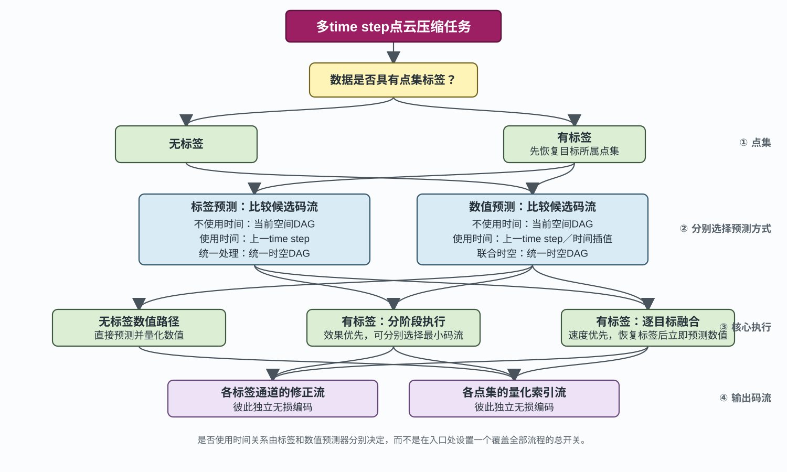

这里把DAG严格分成两类。**非联合DAG**为每个time step使用同一份空间预测结构，空间预测、上一time step预测和时间插值只是这份DAG及其time step遍历框架下的不同预测方法，不称为不同DAG。**联合DAG**把全部时空点放进同一坐标空间，统一生成kd-tree、预测顺序和参考关系。联合处理会同时改变点编号空间、坐标维数、DAG覆盖范围和partition边界，不能简化成一个只改变预测公式的`cross_time`开关。

标签和各数值点集先分别选择联合或非联合DAG，再在所选DAG内选择预测方法。使用相同DAG的部分可以采用不同预测方法，并尽量在同一次目标遍历中同步处理；使用不同DAG的部分具有不同的点组织和执行顺序，当前框架一律分阶段处理。代码中的`prediction_framework_c`先记录是否有标签，再分别记录标签和数值的DAG及时间参与方式，最后选择无标签、分阶段或逐目标融合执行；压缩和解压共用`prediction_framework.tpp`中的同一套解析与兼容性检查。

如果暂时不考虑速度，效果优先版本可以完整压缩每种标签候选并选择总字节数最小的标签码流；标签被精确恢复后，再完整压缩每种数值候选并选择总字节数最小的量化索引码流。标签候选包括空间预测、上一time step预测和统一时空DAG；标签通道是二值分类，时间线性插值不会给出有意义的标签预测，因而不列为候选。数值候选包括空间预测、上一time step预测、时间插值和统一时空DAG。两侧不需要共享DAG或压缩顺序。若由压缩器自动选择，解压端必须从文件头读取所选标签模式和数值模式；每个field只需记录两个很小的模式编号。比较时必须计入各候选独有的码流头和预测结构元数据，而不能只比较Huffman或Zstd的负载。

逐目标融合不要求标签和数值使用相同的预测公式或参考点，但要求它们共同使用同一份DAG：要么都使用公共非联合DAG，要么都使用同一份联合DAG。同一份DAG使目标编号和遍历顺序一致，处理一个目标时先恢复标签，再预测数值；如果预测公式相同，还可能进一步复用参考编号和权重。Katrina的“上一time step预测标签＋当前time step空间预测数值”两侧都使用公共非联合DAG，因此可以融合：处理当前time step前，上一time step的标签已经全部恢复，当前目标的数值仍按照公共空间DAG预测。若一侧使用联合DAG而另一侧使用非联合DAG，则必须分阶段完成。

让所有点集共用一种DAG并同步遍历通常更快，因为只需生成和读取一份预测结构，也更容易复用参考编号与权重；但这不是效果优先模式的硬性限制。如果某个点集使用另一类DAG能显著降低BR，可以为它单独生成预测结构并分阶段处理。相应地，速度优先配置倾向于让全部标签和数值点集共用DAG，效果优先配置则允许按DAG类型分组。无论采用哪种执行方式，各标签修正流和各点集量化索引流始终独立无损编码。

调度条件只在进入核心循环前判断，每层分别放入独立函数或文件。压缩和解压共用同一份执行计划和参数兼容性检查；即使采用逐目标融合，标签修正与各点集量化索引仍保存为独立码流，执行顺序不会强迫无损码流交错。

## 2.2. 当前空间预测实验配置

裸命令行使用随机分轮和默认IDW预测。当前正式空间实验还显式启用反向平均平方距离排序，也就是只用目标点到可用参考点的平均平方距离`D`评价预测难度，后文简称D-only：

```bash
install/bin/s1_compress -data-dir /path/to/data -variable field -time-step '[0,9]' -dim 3 -M REL 1e-3 -reverse-mean-distance-only-order-experimental
```

重要参数如下：

| 参数 | 当前默认值 | 含义 |
|---|---:|---|
| `-max-ref-num` | 4 | 在未知点集标签时保留的候选参考点数 |
| `-actual-ref-num` | 4 | 标签预测使用的候选点数，以及数值预测最多使用的同点集参考点数 |
| `-predict-round-num` | 8 | 预测轮数；五点筛选中，8轮+逐轮EB公比0.8在4个代表field均优于原10轮默认值 |
| `-round-size-growth-ratio-experimental` | 2 | 前两轮等大，此后每轮目标点数相对上一轮的增长比例 |
| `-inverse-distance-power` | 2 | IDW使用的欧氏距离负指数 |
| `-zstd-level` | 3 | 压缩端使用的Zstd等级，可设为1到22；解压端无需指定 |
| `-kd-leaf-size` | 32 | kd-tree叶节点最多保存的点数 |
| `-d-only-cache-refill-threshold-experimental` | 3 | 排序所用的4个缓存参考点少于3个仍有效时重新查询kd-tree；仍有3个时直接复用并重新归一化 |
| `-cache-subpartition-num-experimental` | 关闭 | 将最后3轮按adjust后kd-tree的顶层区域连续处理，并自动启用DAG顺序物理重排；数量必须是2的幂，`1`只启用重排而不改变DAG |
| `-fused-two-point-set-prediction-experimental` | 关闭 | 在串行两点集IDW路径中合并标签与数值预测，减少对同一参考数组的重复访问；压缩和解压可以分别开关，码流不变 |
| `-normalized-weight-experimental` | 关闭 | 公共预处理生成归一化IDW权重；单点集直接使用，多点集融合路径在全部数值参考点同类时使用 |

`rbf_fitting`还需要在压缩和解压端传入相同的`-rbf-kernel`、`-rbf-shape`、`-rbf-nugget`和`-rbf-polynomial-degree`。当前Tsunami momentum_x候选为`matern32/0.03/1e-6/0`。RBF权重只依赖坐标和DAG，程序会在公共预处理中计算一次并由全部time step复用；多点集筛掉部分参考点时则对改变后的参考集合现场求解。Katrina高压缩比配置使用10个参考点、`matern32/0.01/1e-6/0`、`-reference-data-order-experimental {40,80,120}`、`-reference-data-rbf-score-experimental`、`-order-candidate-num-experimental 48`和`-rbf-filtered-fallback-nearest-experimental`。最后一个开关要求压缩和解压两侧同时提供；参考数据和排序参数只在首次生成DAG的压缩端提供。

可以通过`-adjust-coord-matrix`直接提供下三角变换矩阵。三维矩阵按行输入6个非零元素：

```bash
install/bin/s1_compress -data-dir /path/to/data -variable field -time-step '[0,9]' -dim 3 -M REL 1e-3 -adjust-coord-matrix c00 c10 c11 c20 c21 c22 -reverse-mean-distance-only-order-experimental
```

解压时必须提供相同矩阵。仅使用`-adjust-coord`会启用源码中当前硬编码的三维实验矩阵，因此对新数据推荐显式使用`-adjust-coord-matrix`或`-adjust-coord-matrix-file`。

也可以使用独立矩阵文件，避免在源码或命令行中复制矩阵元素：

```bash
install/bin/s1_compress -data-dir /path/to/Katrina -variable attr0 -time-step '[0,9]' -dim 3 -M REL 1e-3 -adjust-coord-matrix-file adjust_coord_matrices/Katrina_attr0_spatial.txt -reverse-mean-distance-only-order-experimental
install/bin/s1_decompress -data-dir /path/to/Katrina -variable attr0 -time-step '[0,9]' -dim 3 -M REL 1e-3 -adjust-coord-matrix-file adjust_coord_matrices/Katrina_attr0_spatial.txt -reverse-mean-distance-only-order-experimental
```

矩阵文件记录数据集、field、维数、下三角元素和训练类型。`training_type=spatial`表示只使用空间坐标训练；`training_type=spatiotemporal`表示把time step作为额外坐标维度进行联合时空训练。当前选定矩阵集中保存在`adjust_coord_matrices/`，格式和文件索引见其中的`README.md`。

## 2.3. Adjust coord

UNSZ根据点之间的距离选择参考点，但原始坐标中的距离不一定能反映数据是否容易互相预测。例如Katrina的z轴被严重拉伸，坐标上最近的点不一定是数值上最接近的点。我们也不能在压缩每个文件时直接查看原始数据，再据此决定预测关系：解压端没有原始数据，想恢复数据必须先知道预测关系，而想重建这种预测关系又必须先知道原始数据。

Adjust coord用少量训练文件提前学习一个下三角矩阵`C`，以后只根据公共坐标和这个矩阵生成预测关系。坐标按照`c'=cC`变换，训练希望两个点的数值差与它们在新坐标中的距离接近：

```text
|v1-v2|≈||(c1-c2)C||₂
```

这个过程是迭代式的，但当前只迭代4轮。

### 2.3.1. 采样

训练不需要读取所有time step，而是在整个时间范围内等间隔选择`sample_file_num`个文件，默认选择3个。例如Katrina共有162个文件时，会读取第27、80和134个文件。

每轮训练要做两次采样。第一次采样决定用哪些点建立近邻树，主要控制建树和查询的规模；第二次采样只从树上的点中挑选一部分作为目标，主要控制交给优化器的点对数量。具体过程如下：

1. 从全部坐标中无放回地随机选择`ceil(point_num×first_sample_ratio)`个点，默认使用25%。选出的编号会排序，因此没有重复且保持原始点编号顺序；所有训练文件使用同一批坐标。第一次采样不能太稀疏，否则树上的“最近点”会离目标太远，无法代表完整点云中的局部关系。
2. 对每个训练文件分别删除这批点中的异常值。当前Python版本只通过`is_abnormal()`把点分为正常和异常两类，并且不让异常点参与训练。由于异常点的位置会随time step改变，每个文件最终留下的点可能不同。
3. 从每个文件剩余的点中再次无放回地随机选择目标，也就是训练点对的第一个点。指定`second_sample_num>0`时，每轮最多选择固定总数的目标并尽量平均分给各训练文件；它可以在点数或time step数量增大时固定优化器的输入规模。默认`second_sample_num=0`，此时兼容原方案，目标总数为`ceil(第一次采样点数×训练文件数×second_sample_ratio)`，默认比例为10%。
4. 对每个文件单独建立一棵`cKDTree`。树上的坐标先经过当前`C`变换；查询时先取`actual_ref_num+1`个近邻，删除目标自身，再保留最近的`actual_ref_num`个点作为参考点，也就是点对的第二个点。当前默认保留4个参考点，因此每个目标产生4个训练点对。
5. 对每个点对记录数值差`Δv`和未经变换的原始坐标差`Δc`。近邻查询使用当前`C`，但训练新矩阵时仍从原始`Δc`开始计算，避免把坐标重复变换。

得到新的`C`后，下一轮会重新进行两次采样、异常点检查、建树和查询。这样近邻关系会随着`C`更新，而不是四轮训练始终使用第一轮找到的点对。随机种子固定，因此相同参数可以复现实验。

采样相关方案如下：

<table class="fixed-layout-table" width="100%">
  <colgroup>
    <col width="20%">
    <col width="10%">
    <col width="42%">
    <col width="28%">
  </colgroup>
  <thead>
    <tr>
      <th width="20%">优化方案</th>
      <th width="10%">状态</th>
      <th width="42%">已有结论</th>
      <th width="28%">下一步</th>
    </tr>
  </thead>
  <tbody>
    <tr>
      <td>分别控制第一次采样密度和第二次目标数量</td>
      <td>待验证</td>
      <td>降低第一次采样率会减少建树、近邻查询的时间和内存，但树中点变稀疏，查询到的近邻会比完整点云中的真实近邻更远，可能使训练矩阵失真。第二次采样只控制作为训练目标的点数；减半可使优化阶段近似加速两倍，但会轻微增加BR。新增固定目标总数后，两项作用可以分离；固定<code>10000</code>个目标的Katrina四维训练仍耗时约72秒，瓶颈已变成least-squares的24～100次函数评估</td>
      <td>第一次采样继续保持足够密；使用固定第二次目标预算，并结合Gauss–Newton或限制max_nfev控制四维训练时间</td>
    </tr>
    <tr>
      <td>随机选定矩形区域作为样本</td>
      <td>待验证</td>
      <td>空间训练中，区域代表性不足：LES velocity_x的2/4区域约改善<code>0.30%</code>，但1/8区域分别退化<code>27.88%/0.49%</code>；定额紧凑L∞区域的同PSNR BR也比随机散点高约<code>0.20%</code>。不过，类似的随机四维矩形区域采样曾在Ocean velocityZonal的31步联合时空训练中起效：4区域方案相对上一时间步同点预测改善<code>8.920%</code> BD-rate。该结果没有单独分离区域采样本身的贡献，而且旧实现还在<code>M=CCᵀ</code>空间平均区域矩阵，因此需要重新确认</td>
      <td>保留实验开关；在相同训练点对预算下比较随机散点和矩形区域，并使用当前直接平均<code>C</code>的后处理方式复测空间与时空训练</td>
    </tr>
    <tr>
      <td>训练时使用4个近邻</td>
      <td>已采纳，可以再验证</td>
      <td>比较了3、4、5和10个训练近邻，4个近邻在LES和Tsunami的多个field上整体最稳定。3个近邻偶尔收益很大，但出现轻微退化的field更多；10个近邻的结果明显依赖field，BR变化范围达到<code>-13.704%～+10.460%</code>；5个近邻也没有表现出相对4个近邻的整体优势</td>
      <td>默认使用4个训练近邻；保留其他近邻数的候选矩阵及筛选脚本。压缩预测也默认最多使用4个参考点</td>
    </tr>
  </tbody>
</table>

### 2.3.2. 训练

汇总所有样本点对的数值差和原始坐标差后，程序训练一个公共的下三角矩阵`C`。当前默认使用平方loss。令第`i`个点对的数值差为`Δv_i=v_i1-v_i2`，原始坐标差为行向量`Δc_i=c_i1-c_i2`，则目标函数为：

```text
L(C)=Σ_i(|Δv_i|-d_i(C))²=Σ_i(|Δv_i|-||Δc_iC||₂)²
```

除了首轮以外，训练会从历史`C`开始。

训练目标和优化器相关方案如下：

<table class="fixed-layout-table" width="100%">
  <colgroup>
    <col width="20%">
    <col width="10%">
    <col width="42%">
    <col width="28%">
  </colgroup>
  <thead>
    <tr>
      <th width="20%">优化方案</th>
      <th width="10%">状态</th>
      <th width="42%">已有结论</th>
      <th width="28%">下一步</th>
    </tr>
  </thead>
  <tbody>
    <tr>
      <td>使用二次方loss</td>
      <td>已采纳</td>
      <td>Katrina相同随机种子的20轮对照中，二次方loss保存点的最佳同PSNR BR为<code>0.215432</code>，优于对数平方的<code>0.219716</code>和四次方的<code>0.236681</code></td>
      <td>作为默认loss</td>
    </tr>
    <tr>
      <td>新矩阵吸收率设为<code>0.5</code></td>
      <td>已采纳</td>
      <td>比较<code>0.3/0.5/0.7/1.0</code>后，<code>0.5</code>在第4轮得到最低BR；更大的吸收率会更早进入优化方向不明确的阶段，<code>1.0</code>明显不稳定</td>
      <td>默认使用<code>0.5</code>；<code>0.7</code>只作为速度候选</td>
    </tr>
    <tr>
      <td>外层训练迭代4轮</td>
      <td>已采纳</td>
      <td>吸收率为<code>0.5</code>时，第4轮BR为<code>0.211122</code>，第5轮回升到<code>0.214531</code>；真实BR通常早于训练loss停止改善</td>
      <td>默认迭代4轮；通用早停条件仍需更多数据验证</td>
    </tr>
    <tr>
      <td>直接优化度量矩阵<code>M=CCᵀ</code></td>
      <td>放弃</td>
      <td>当前直接优化<code>C</code>会自动得到半正定度量<code>CCᵀ</code>，列符号歧义也已通过统一正对角线解决。直接优化<code>M</code>时，平方loss仍包含<code>sqrt(ΔcMΔcᵀ)</code>，不会变成简单的线性最小二乘，反而还要额外施加半正定约束或进行投影</td>
      <td>不实现</td>
    </tr>
    <tr>
      <td>Gauss–Newton快速训练</td>
      <td>已实现，尚未设为命令行默认</td>
      <td>Katrina约<code>1.2 s</code>，相对least-squares约有<code>0.17%</code> RD代价。批量空间矩阵脚本已经显式使用<code>gauss_newton</code>，但<code>t2_adjust_coord.py</code>的<code>-optimizer</code>默认值目前仍是<code>least_squares</code></td>
      <td>先保持代码与文档一致；若要把它设为所有训练入口的默认值，需要在LES、Tsunami和新数据验证后统一修改</td>
    </tr>
    <tr>
      <td>直接近似预测残差码长的训练目标</td>
      <td>部分采纳</td>
      <td>Katrina只比二次方矩阵改善约<code>0.38%</code>；Ocean temperature、velocityZonal、zTop在time step 0/15/30相对原坐标分别改善<code>0.54%～1.29%/7.02%～8.67%/2.37%～4.52%</code></td>
      <td>Ocean这三个field采用码长loss矩阵；其他field继续按实际BR筛选</td>
    </tr>
    <tr>
      <td>使用四次方loss</td>
      <td>放弃</td>
      <td>Katrina相同随机种子的20轮对照中，四次方loss保存点的最佳同PSNR BR为<code>0.236681</code>，弱于二次方loss的<code>0.215432</code></td>
      <td>保留可切换实现作为历史基线，不再作为主线</td>
    </tr>
    <tr>
      <td>外层训练迭代100轮</td>
      <td>放弃</td>
      <td>各种loss的训练值继续下降时，真实BR都可能已经开始退化；旧四次方loss第100轮矩阵也比当前配置差<code>12.182%</code> BD-rate</td>
      <td>不再用固定100轮或训练loss最低点选择矩阵</td>
    </tr>
    <tr>
      <td>对数平方loss作为主线</td>
      <td>放弃</td>
      <td>收敛慢且真实BR弱于二次方loss</td>
      <td>保留可切换实现，不再继续调参</td>
    </tr>
    <tr>
      <td>二次差分loss</td>
      <td>放弃</td>
      <td>定义依赖近似共线三点，适用范围和预期收益都较弱</td>
      <td>不继续实现</td>
    </tr>
  </tbody>
</table>

### 2.3.3. 后处理

一次训练结束后会得到原始下三角矩阵`C_new`，随后按以下顺序处理：

1. **检查优化结果。** 程序首先确认`C_new`的所有元素和loss残差均为有限值。出现NaN或Inf说明优化已经失效，继续建树会传播错误，因此立即终止。
2. **统一列符号。** 把`C_new`中负对角元素对应的整列取反。同一个度量可以由列符号不同的多个`C`表示，因为任意对角元素为`±1`的`D`都满足`(CD)(CD)ᵀ=CCᵀ`；统一为正对角线可以避免等价因子在后续平均时相互抵消，而且列取反本身不改变任何距离。
3. **分离矩阵形状和整体倍率。** 将统一符号后的矩阵写成`C_raw=sC`，其中`||C||_F²=dim`。倍率`s`表示数值差相对于坐标差的总体尺度，归一化矩阵`C`表示真正影响近邻顺序和IDW权重的度量形状；两者在后续步骤中分别缓冲。
4. **缓冲。** 归一化后的变换矩阵和历史上的归一化矩阵加权算数平均，默认新矩阵的权重是0.5，随后再次归一化。倍率`s`和历史倍率加权几何平均，默认新倍率的权重是0.9；实验表明这个倍率权重不会影响最终归一化矩阵、BR或训练时间。

矩阵后处理相关方案如下：

<table class="fixed-layout-table" width="100%">
  <colgroup>
    <col width="20%">
    <col width="10%">
    <col width="42%">
    <col width="28%">
  </colgroup>
  <thead>
    <tr>
      <th width="20%">优化方案</th>
      <th width="10%">状态</th>
      <th width="42%">已有结论</th>
      <th width="28%">下一步</th>
    </tr>
  </thead>
  <tbody>
    <tr>
      <td>在度量矩阵<code>M=CCᵀ</code>上混合新旧训练结果</td>
      <td>放弃</td>
      <td><code>M</code>混合表示平均平方距离，不符合当前“平均新旧变换后坐标”的缓冲定义。使用相同吸收率<code>0.5</code>和4轮时，Katrina全部162步同PSNR比较中，直接混合<code>C</code>为<code>BR=0.231460,PSNR=65.192228</code>，混合<code>M</code>为<code>BR=0.240020,PSNR=65.198746</code></td>
      <td>保留<code>-matrix-mix-space metric</code>仅用于复现；把仍在平均区域<code>M</code>的联合时空区域训练改成统一符号后平均<code>C</code></td>
    </tr>
    <tr>
      <td>修正过小特征值</td>
      <td>放弃</td>
      <td>在Katrina上启用和关闭修正得到的四轮历史矩阵最大只相差<code>3.33e-16</code>，全部162步的BR和PSNR完全相同；修正还需要构造<code>M=CCᵀ</code>并进行特征值分解。关闭后只需统一下三角因子的列符号，四轮累计矩阵处理时间约由<code>1.75 ms</code>降至<code>0.23 ms</code></td>
      <td>默认不修正；保留<code>-small-eigenvalue-correction on</code>仅用于复现</td>
    </tr>
    <tr>
      <td>分离迭代矩阵形状和整体倍率</td>
      <td>已采纳，待验证</td>
      <td>原方案每轮归一化<code>C</code>并丢弃整体倍率，新方案分别缓冲归一化矩阵<code>C</code>和倍率<code>s</code>。平方loss下，固定矩阵形状后的倍率只是一个容易求解的一维最小二乘问题，优化器能迅速重新找到合适倍率；近邻选择又只由归一化矩阵形状决定，因此两种方案在Katrina上的最终归一化矩阵最大只相差<code>4.44e-16</code>，内层评估次数同为<code>6/7/6/6</code>，训练耗时均约14秒，BR和PSNR也几乎不变。新方案不会无故丢弃倍率，算法定义更合理，因此暂时采纳</td>
      <td>默认使用<code>separate</code>；在其他数据尺度和loss上继续验证，保留<code>discard</code>用于复现原方案</td>
    </tr>
    <tr>
      <td>分离矩阵形状和倍率时调整<code>s</code>的采纳率</td>
      <td>不再调优</td>
      <td>平方loss下，固定矩阵形状后只剩一个一维尺度最小二乘问题，优化器可以迅速重新得到合适倍率。采纳率<code>0.7/0.9/1.0</code>得到相同的归一化矩阵和<code>6/7/6/6</code>轮内层评估次数，对BR与时间均无可见影响</td>
      <td>默认固定为<code>0.9</code>，不再把它作为性能参数扫描</td>
    </tr>
  </tbody>
</table>

### 2.3.4. 适用范围与矩阵形式

当前默认方案为一个field训练一个公共常矩阵。下面这些方案改变的是“何时使用adjust coord”“哪些数据共用矩阵”或“矩阵本身采用什么形式”，不属于采样、loss或后处理参数。

<table class="fixed-layout-table" width="100%">
  <colgroup>
    <col width="20%">
    <col width="10%">
    <col width="42%">
    <col width="28%">
  </colgroup>
  <thead>
    <tr>
      <th width="20%">优化方案</th>
      <th width="10%">状态</th>
      <th width="42%">已有结论</th>
      <th width="28%">下一步</th>
    </tr>
  </thead>
  <tbody>
    <tr>
      <td>自动判断是否需要adjust coord</td>
      <td>待实现</td>
      <td>不同field的adjust收益差异明显</td>
      <td>寻找只需少量样本的低成本判据</td>
    </tr>
    <tr>
      <td>让adjust coord支持多个用户定义点集</td>
      <td>待实现</td>
      <td>C++已支持多个点集和<code>n-1</code>个标签通道；Python仍只训练<code>is_abnormal()</code>筛出的单个有效点集。constant点集的距离loss会错误地把矩阵推向零，标签通道与数值流也可能需要不同几何</td>
      <td>读取同一JSON配置。Katrina先把正常数值点集的平方loss和标签码流代理合并训练一个公共矩阵；第二个点集是常量<code>-99999</code>，不参与数值距离训练。虽然当前上一time step标签预测不使用空间矩阵，仍可用空间标签预测或联合预测作高压缩比消融</td>
    </tr>
    <tr>
      <td>让不同压缩partition使用不同的常变换矩阵</td>
      <td>待实现</td>
      <td>当前每个field只使用一个公共线性矩阵</td>
      <td>保证partition之间互不引用，再比较局部收益、边界损失与矩阵元数据成本</td>
    </tr>
    <tr>
      <td>以坐标为自变量的变换矩阵</td>
      <td>暂缓</td>
      <td>令下三角矩阵的每个非零元素都是坐标的一次函数，并以<code>cC(c)</code>变换每个点；三维时参数量由常矩阵的6个增加到24个</td>
      <td>只有公共常矩阵明显不足时再继续</td>
    </tr>
    <tr>
      <td>为每个Ocean field独立训练早停空间矩阵</td>
      <td>部分采纳</td>
      <td>二次方loss初筛中temperature、velocityY、velocityZonal的BR分别改变<code>-0.90%/-3.38%/-5.57%</code>，其余6个field改变<code>+0.25%～+25.59%</code></td>
      <td>velocityY保留二次方矩阵；temperature和velocityZonal已由更好的码长loss矩阵替换</td>
    </tr>
    <tr>
      <td>分区域训练矩阵后仍进行全局预测</td>
      <td>实验作废</td>
      <td>曾把Ocean zTop划成2/4个区域并应用不同矩阵，随后合并坐标建立全局kd-tree；矩阵接缝会产生没有意义的跨区域距离</td>
      <td>该实现不代表互不依赖的压缩partition，结果不能用于判断局部矩阵是否有效</td>
    </tr>
    <tr>
      <td>预先把各坐标维度scale到相同范围</td>
      <td>放弃</td>
      <td>Katrina重新训练后相对原坐标adjust退化<code>22.848%</code> BD-rate</td>
      <td>不在adjust前人为等范围缩放</td>
    </tr>
  </tbody>
</table>

## 2.4. 生成DAG

预测前需要根据公共坐标生成一套所有time step都能复用的有向无环图（DAG）。整体分为四步：

1. 使用经过adjust coord变换的坐标生成kd-tree，为后续的目标搜索和参考点搜索提供空间索引。
2. 将全部点随机分配到若干预测轮。越早的轮越先解码，也更难获得丰富的参考点。
3. 在每一轮内排列预测目标，使解码次序同时兼顾可预测性和空间局部性。
4. 按最终次序逐点选择已经恢复的参考点，并添加“参考点→预测目标”的有向边，形成最终DAG。

默认流程是先随机分轮、再在每轮内排序；实验方案也可以先对全部点生成一个全局顺序，再按照各轮点数切分。因此，分轮和目标排序放在同一小节讨论。

### 2.4.1. 生成kd-tree

程序在变换后的坐标上建立一棵公共kd-tree。树同时用于搜索空间邻近的候选目标和最近参考点，但对外保存的目标与参考点编号仍是原始点编号。公共坐标不随time step变化，因此树的只读拓扑、包围盒和编号映射可以复用。

当前kd-tree的每个叶节点最多保存32个点，并按树内点编号连续存储坐标。需要不同有效点集合时，多棵逻辑树共享只读拓扑，只分别维护自己的有效点计数，从而避免复制整棵树。

<table class="fixed-layout-table" width="100%">
  <colgroup>
    <col width="20%">
    <col width="10%">
    <col width="42%">
    <col width="28%">
  </colgroup>
  <thead>
    <tr>
      <th width="20%">优化方案</th>
      <th width="10%">状态</th>
      <th width="42%">已有结论</th>
      <th width="28%">下一步</th>
    </tr>
  </thead>
  <tbody>
    <tr>
      <td>优化kd-tree的查询与内存布局</td>
      <td>已采纳</td>
      <td>使用容量受控的栈内小数组维护近邻、每个叶节点最多保存32个点、按树内编号连续存储坐标，并让多棵逻辑树共享只读拓扑。32点叶节点在Ocean和Katrina上是最稳定的共同选择；tree-order坐标使两者的总预处理均缩短约<code>4.1%</code>，同时不改变预测结构和BR</td>
      <td>作为当前默认实现</td>
    </tr>
    <tr>
      <td>进一步优化kd-tree查询</td>
      <td>待实现</td>
      <td>当前查询仍使用递归，并在完整树中区分有效目标；尚未测试显式栈和只包含当前目标点的紧凑树</td>
      <td>只有kd-tree查询重新成为瓶颈时再实现并比较遍历时间</td>
    </tr>
  </tbody>
</table>

### 2.4.2. 分轮和预测目标排序

默认将全部点随机分为8轮，前两轮点数相同，此后每轮目标数近似翻倍。`-round-size-growth-ratio-experimental`可以修改增长比例，同时保证所有点恰好属于一轮。

分轮后，程序在每一轮内部使用反向D-only策略排列目标。反向剔除时，只根据坐标计算目标到当前可用参考集合的平均平方距离`D`，并在空间邻近的候选目标中选择；最后反转剔除顺序，使较难建立可靠局部参考的点较早恢复、较容易预测的点留到后面。该顺序只依赖坐标，可以离线生成并复用于所有time step。

<table class="fixed-layout-table" width="100%">
  <colgroup>
    <col width="20%">
    <col width="10%">
    <col width="42%">
    <col width="28%">
  </colgroup>
  <thead>
    <tr>
      <th width="20%">优化方案</th>
      <th width="10%">状态</th>
      <th width="42%">已有结论</th>
      <th width="28%">下一步</th>
    </tr>
  </thead>
  <tbody>
    <tr>
      <td>仅根据平均平方距离<code>D</code>生成公共预测顺序</td>
      <td>已采纳</td>
      <td>不需要参考数据，能跨field复用并由坐标重建，但压缩能力弱于参考数据辅助顺序</td>
      <td>继续作为无参考数据或分布漂移时的默认方案</td>
    </tr>
    <tr>
      <td>先生成全局顺序再按照轮大小切分</td>
      <td>放弃</td>
      <td>相对先随机分轮，LES三个field改善<code>12.22%～12.40%</code> BD-rate，Tsunami四个field改善<code>0.99%～6.42%</code>。当前Katrina五点重测中，4点IDW和8点RBF分别增加<code>0.424%/1.196%</code> BD-rate，但核心压缩加快<code>5.64%/6.46%</code>、解压加快<code>6.05%/7.94%</code></td>
      <td>保留实验开关和结果用于消融；Katrina压缩效果退化，登录节点上的小幅速度收益不足以支持高速版采用，不再继续优化</td>
    </tr>
    <tr>
      <td>利用参考数据搜索公共预测顺序</td>
      <td>效果优先候选</td>
      <td>三组参考/测试划分及全部held-out time step上，Katrina和Ocean temperature的总BD-rate分别稳定为<code>-3.57%～-4.02%</code>和<code>-27.45%～-27.71%</code>；在当前Katrina配置上，4点IDW、5点IDW和8点RBF分别继续改善<code>2.525%/2.707%/1.809%</code></td>
      <td>作为field级离线结果保存；继续测试更多field和分布漂移</td>
    </tr>
    <tr>
      <td>使用RBF的参考数据预测误差搜索RBF公共预测顺序</td>
      <td>Katrina效果优先配置已采纳</td>
      <td>原参考数据辅助顺序始终用IDW估计候选点是否好预测，即使最终数值预测器是RBF。新增开关令排序与最终预测器一致；Katrina的159个held-out time step上，相对RBF的D-only顺序降低<code>4.926%</code> BD-rate，相对IDW评分的参考数据顺序继续降低约<code>3.175%</code></td>
      <td>首次公共DAG预处理由IDW评分的<code>6.52 s</code>增至<code>12.70 s</code>，结构加载及核心执行不变；允许各field分别选择排序参数</td>
    </tr>
    <tr>
      <td>扩大参考数据辅助排序时比较的局部目标候选数</td>
      <td>Katrina效果优先配置已采纳</td>
      <td>10点RBF下把每次比较的局部目标候选数从10增加到<code>16/24/32/48/64</code>，20步筛选的BD-rate依次降低<code>1.03%/2.42%/2.96%/3.73%/3.66%</code>；完整159步五点曲线中48候选仍降低<code>1.761%</code></td>
      <td>Katrina使用48候选；它只增加首次DAG搜索时间，加载DAG后的核心压缩和解压基本不变</td>
    </tr>
    <tr>
      <td>增加参考数据辅助排序所读取的time step数量</td>
      <td>放弃</td>
      <td>相对3个等间隔参考文件，1个文件退化<code>3.986%</code> BD-rate，5个退化<code>0.496%</code>，9个仅改善<code>0.042%</code></td>
      <td>保持3个参考time step，不为不可见收益继续增加离线耗时</td>
    </tr>
    <tr>
      <td>参考数据辅助排序中复用未变化目标的预测误差</td>
      <td>已采纳</td>
      <td>某个目标的有效近邻列表没有变化时，直接复用它在多个参考文件上的动态预测误差。Katrina和Ocean temperature的近邻列表不变率为<code>70.27%/71.55%</code>，分数计算量减少<code>63.24%/64.40%</code>，首次预处理加速<code>1.54/1.49</code>倍；顺序和BR不变</td>
      <td>保留统计输出，在更多数据上观察命中率</td>
    </tr>
    <tr>
      <td>参考数据辅助排序中跨文件复用几何权重</td>
      <td>已采纳</td>
      <td>多个参考文件使用公共坐标，因此同一目标和候选参考点之间的距离及未归一化IDW权重只计算一次。各文件仍独立筛选同点集参考点并重新归一化。在预测误差复用的基础上，Katrina和Ocean temperature继续加速<code>1.18/1.15</code>倍；相对最初实现累计加速<code>1.82/1.72</code>倍，预测结构SHA不变</td>
      <td>作为参考数据辅助排序的默认实现</td>
    </tr>
    <tr>
      <td>参考数据辅助排序中缓存近邻编号和几何权重</td>
      <td>已采纳</td>
      <td>近邻缓存由10点减少到9或8点但尚不需要重新查询时，同时复用剩余近邻的编号和未归一化权重，无需重新计算距离的幂。在前两项优化基础上，Katrina和Ocean temperature相对最初实现累计加速<code>1.98/2.04</code>倍，预测结构SHA不变</td>
      <td>仅在参考数据辅助排序中分配约<code>点数×11×8 B</code>的额外内存</td>
    </tr>
    <tr>
      <td>参考数据辅助排序中改用对数量化误差评分</td>
      <td>放弃</td>
      <td>相对平均绝对误差评分最多只改善Katrina <code>0.287%</code>、Ocean temperature <code>0.083%</code></td>
      <td>活动C++路径已删除，只保留历史脚本和结果</td>
    </tr>
    <tr>
      <td>参考数据辅助排序中改用静态预测误差评分</td>
      <td>放弃</td>
      <td>首次预处理约快<code>2.18～2.27</code>倍，但相对动态分数在Katrina和Ocean temperature增加BD-rate <code>6.336%/42.165%</code></td>
      <td>不以预测质量换取这部分速度</td>
    </tr>
    <tr>
      <td>从更大的空间近邻池中优先选择长期与目标同类的最终参考点</td>
      <td>放弃</td>
      <td>最近同类点回退已经控制了点集不一致的损失；为了提高同类率而舍弃真正近邻会破坏RBF局部几何。候选池从10扩大到<code>12/16/24/32</code>后，BD-rate分别增加<code>7.25%/14.69%/22.76%/26.75%</code></td>
      <td>核心活动路径已删除，只保留实验脚本和结果</td>
    </tr>
    <tr>
      <td>在先随机分轮和先全局排序之间离线选择</td>
      <td>放弃</td>
      <td>先随机分轮能维持各轮空间覆盖；先全局排序再切分在LES和Tsunami较好、Katrina略差</td>
      <td>先全局排序方案已经放弃，因此不再为两者开发自动选择器</td>
    </tr>
    <tr>
      <td>在后几轮按cache子partition生成DAG并重排每个文件</td>
      <td>放弃</td>
      <td>这不是现有的互不引用partition。最后3轮依次处理adjust后kd-tree顶层的互斥区域，仍允许引用全部已恢复点，并直接按新顺序生成参考边、逐点EB和码流。Katrina的<code>2/4/8/16</code>区域相对原DAG的BD-rate分别为<code>-0.110%/-1.006%/-1.205%/-1.147%</code></td>
      <td><code>8</code>区域压缩效果最好，但物理重排后核心压缩仍慢<code>6.16%</code>、解压慢<code>17.86%</code>；收益不足以抵消执行代价，不再继续优化</td>
    </tr>
    <tr>
      <td>把内部数组整体改为DAG预测顺序</td>
      <td>已实现，暂不采纳</td>
      <td><code>-prediction-order-layout-experimental</code>会把坐标、目标编号、参考编号以及每个文件的数值和点集编号映射到DAG预测编号，使目标写入连续；解压后再散射回原始编号。Katrina五点的单区域严格对照保持BR和PSNR不变，但核心压缩慢<code>8.44%</code>、解压慢<code>19.67%</code></td>
      <td>当前上一time step标签仍以原始点号顺序编码，layout路径需要在原始编号与DAG编号之间映射；定位并消除这部分随机访问和复制后再测</td>
    </tr>
    <tr>
      <td>坐标或距离相同时按点编号打破并列</td>
      <td>待验证</td>
      <td>主要路径已有点编号比较，但尚未完成跨机器复现检查</td>
      <td>比较预测结构和压缩文件SHA以及BR、PSNR</td>
    </tr>
    <tr>
      <td>优先让相邻目标复用相同参考点</td>
      <td>放弃</td>
      <td>Ocean temperature的BR退化<code>14.57%</code></td>
      <td>只保留历史实现</td>
    </tr>
    <tr>
      <td>联合使用<code>D</code>、<code>S2</code>或方向集中度排列目标</td>
      <td>暂缓</td>
      <td>两个数据上的完整或小规模实验均未超过只使用<code>D</code></td>
      <td>等更多数据后再决定是否重测</td>
    </tr>
  </tbody>
</table>

### 2.4.3. 生成DAG

分轮和排序给出最终解码次序后，程序按这个次序逐点选择参考点。每个目标只能引用已经恢复的点；一旦当前目标的参考点确定，它就立即成为后续目标可用的参考点，因此同一轮内排在后面的目标也可以依赖本轮较早的目标。

若目标`i`使用参考点`j`，程序就添加一条`j→i`的边。每条边都从较早恢复的点指向较晚恢复的点，所以图中不可能出现环。最终参考点编号连续保存在`pred_ref_ids`中，目标`i`的区间为`pred_ref_ids[pred_ref_begin[i]:pred_ref_begin[i+1]]`；对应权重也使用连续数组保存，避免每个目标单独分配一个小`vector`。

<table class="fixed-layout-table" width="100%">
  <colgroup>
    <col width="20%">
    <col width="10%">
    <col width="42%">
    <col width="28%">
  </colgroup>
  <thead>
    <tr>
      <th width="20%">优化方案</th>
      <th width="10%">状态</th>
      <th width="42%">已有结论</th>
      <th width="28%">下一步</th>
    </tr>
  </thead>
  <tbody>
    <tr>
      <td>每选择完整一轮后再更新可用参考点</td>
      <td>放弃</td>
      <td>该方案禁止同轮内依赖，Katrina attr0前3步BR恶化约<code>20.3%</code>，速度没有明显改善</td>
      <td>实现保存在<code>c_codes/trash</code></td>
    </tr>
    <tr>
      <td>使用连续数组保存参考边和权重</td>
      <td>已采纳</td>
      <td>减少小对象、内存分配和指针跳转，并保持预测结构和BR不变</td>
      <td>作为当前默认存储方式</td>
    </tr>
    <tr>
      <td>将公共预测DAG缓存到本地文件</td>
      <td>已采纳，可选</td>
      <td>第一个REL EB生成结构，后续REL EB及解压直接加载，避免重复预处理；缓存较大，不适合作为必须传输的压缩元数据</td>
      <td>每次数据集测试使用独立临时缓存，测试结束后删除</td>
    </tr>
    <tr>
      <td>压缩保存的公共预测DAG</td>
      <td>待实现</td>
      <td>参考数据辅助顺序不能由解压端仅根据坐标重建，因此需要保存目标顺序、轮边界和参考点编号；当前原始缓存较大</td>
      <td>分别测试目标编号差分、参考数紧凑编码、相对目标或前一参考点的编号差分以及Zstd，统计均摊bit/value和解码时间</td>
    </tr>
  </tbody>
</table>

## 2.5. 数值预测、量化与无损编码

当前通用预测器是inverse-distance weighting：

```text
squared_distanceᵢ=||coord_target-coordᵢ||₂²
prediction=Σ(valueᵢ·squared_distanceᵢ^-1.8)/Σ(squared_distanceᵢ^-1.8)
```

C++的kd-tree查询返回并保存的是欧氏距离的平方，因此当前默认对`squared_distance`使用`-1`次方，即`-inverse_distance_power/2`。这在数学上等价于对欧氏距离使用`-2`次方。

预测只使用已经重建且属于当前点集的参考点。压缩端立即用量化重建值替换原值，解压端因而可以严格复现后续预测。当前默认共有8个预测轮。若轮编号为`r=0,...,7`，第`r`轮开头使用的error bound是用户指定值的`0.8^(7-r)`倍：第一轮从约`0.21`倍开始，后续轮逐渐放宽。在同一轮内，error bound也按照等比数列平滑增加到下一轮的起始值；最后一轮使用完整的用户error bound。公比`0.8`仍是经验参数，需要和预测轮数一起验证。

量化索引使用int32_t，随后采用Huffman编码和Zstd level 3。串行无partition路径使用全局Huffman树和Zstd frame；启用独立partition时，每个partition对各点集分别建立Huffman树和Zstd frame，以支持并行压缩、解压和随机定位。

<table class="fixed-layout-table" width="100%">
  <colgroup>
    <col width="20%">
    <col width="10%">
    <col width="42%">
    <col width="28%">
  </colgroup>
  <thead>
    <tr>
      <th width="20%">优化方案</th>
      <th width="10%">状态</th>
      <th width="42%">已有结论</th>
      <th width="28%">下一步</th>
    </tr>
  </thead>
  <tbody>
    <tr>
      <td>距离权重为<code>d^-2</code>、最多使用4个参考点、有效缓存少于3点时重新查询</td>
      <td>已采纳</td>
      <td>Katrina完整162步五点曲线中，相对4点、指数3.6、cache-4降低<code>1.056%</code> BD-rate，公共预处理快约<code>17.3%</code>，核心压缩略快；跨数据泛化仍待验证</td>
      <td>作为当前速度优先的默认IDW预测配置；效果优先版本另用RBF</td>
    </tr>
    <tr>
      <td>使用多于4个IDW参考点</td>
      <td>暂不采纳</td>
      <td>Katrina全部162步的旧空间五点曲线中，有效缓存少于4点时重查相对10点/cache-8增加<code>2.272%</code> BD-rate，但明显缩短公共预处理和核心预测。加入上一time step标签后的最新五点曲线中，4点、距离指数2、cache-3的组合相对4点、指数3.6、cache-4降低<code>1.056%</code> BD-rate，首次预处理由<code>2.628</code>缩至<code>2.175 s</code>，核心压缩还快约<code>0.8%</code></td>
      <td>保留命令行参数和历史结果，不作为默认方案</td>
    </tr>
    <tr>
      <td>Katrina使用5个参考点并重新选择距离指数</td>
      <td>效果与速度折中候选</td>
      <td>5点、距离指数<code>2.5</code>在全部162步五点曲线中相对当前4点、指数3.6降低<code>2.586%</code> BD-rate，核心压缩时间只增加约<code>2.9%</code>；与上一time step标签方案叠加后，同PSNR压缩率约达到UMC的2倍</td>
      <td>在其他数据验证后决定是否作为折中配置</td>
    </tr>
    <tr>
      <td>Huffman+Zstd level 3</td>
      <td>已采纳</td>
      <td>当前仍是速度和BR较均衡的无损组合</td>
      <td>作为当前默认无损路径</td>
    </tr>
    <tr>
      <td>联合调整轮数、轮大小和逐轮EB</td>
      <td>已完成，不再逐field调优</td>
      <td><code>8轮+EB公比0.8</code>相对原<code>10轮+0.8</code>在4个代表field均改善；轮大小增长比例的field最优值为Katrina/Ocean temperature/Ocean velocityZonal/Tsunami <code>2/4/3.5/1.75</code>，不存在共同最优值</td>
      <td>默认固定8轮、轮大小增长比例2和EB公比0.8；不为每个field单独选择轮大小比例</td>
    </tr>
    <tr>
      <td>根据一个重构点会影响多少后续预测来分配EB</td>
      <td>实验性保留</td>
      <td>8轮五点曲线中，按一次权重影响力直接映射EB的4-field平均BD-rate为<code>-0.214%</code>，按二次权重传播方差影响力为<code>+0.024%</code>；核心压缩约慢<code>1.6～2.1</code>倍</td>
      <td>一次公式优于二次公式但收益很小；若继续，先把单点集影响力缓存为公共预处理</td>
    </tr>
    <tr>
      <td>使用局部仿射拟合代替IDW</td>
      <td>研究候选</td>
      <td>Ocean temperature的BD-rate改善<code>35.202%</code>，但Ocean layerThickness和Katrina分别退化<code>16.175%/17.753%</code>；单文件核心压缩约比IDW慢<code>2.7～6.8</code>倍</td>
      <td>不作为通用默认；保留给适合局部线性模型的平滑field</td>
    </tr>
    <tr>
      <td>使用目标点附近的参考点拟合完整二次多项式</td>
      <td>效果优先候选，待泛化验证</td>
      <td><code>d</code>维模型包含常数项、<code>d</code>个一次项和<code>d(d+1)/2</code>个二次项，共<code>(d+1)(d+2)/2</code>个系数。Tsunami momentum_x为二维，6点刚好定解且严重不稳定；10点过定解拟合配合预测码长loss矩阵时，相对当前UNSZ和UMC分别降低<code>19.811%/23.431%</code> BD-rate，并优于6点<code>hybrid_loo</code>约<code>5.297%</code>。五点平均核心压缩/解压为<code>0.0933/0.0861 s</code>，约比<code>hybrid_loo</code>快2.4倍。矩阵消融中，换回默认二次方loss矩阵后相对当前UNSZ/UMC仍改善<code>15.724%/19.288%</code>；预测码长矩阵额外降低<code>5.131%</code> BD-rate，说明总收益只有一小部分来自更换矩阵，其余来自全局排序和二次拟合；这两者仍需另做固定矩阵的预测器消融才能分开</td>
      <td>在Katrina、Ocean和LES验证10点二次拟合；若收益可泛化，再用定长小矩阵和复用缓冲区优化求解速度</td>
    </tr>
    <tr>
      <td>根据参考点几何关系求RBF插值权重</td>
      <td>Katrina效果优先配置已采纳</td>
      <td>RBF允许正、负权重，并令常量数据被精确重建。Tsunami momentum_x使用10点Matérn-3/2核、shape <code>0.03</code>和nugget <code>1e-6</code>时，相对当前UNSZ、UMC和10点二次拟合分别降低<code>26.836%/30.225%/8.878%</code> BD-rate。Katrina最终使用10点、shape <code>0.01</code>、nugget <code>1e-6</code>和RBF参考数据评分顺序；RBF不能使用完整同类参考集合时，直接采用最近同类参考点。相对8点+IDW回退降低<code>3.956%</code>，再使用48个排序候选后相对4点IDW高速基线累计降低<code>23.298%</code> BD-rate</td>
      <td>159个held-out time step上相对UMC约降低<code>60.938%</code> BD-rate，即同PSNR压缩率约为<code>2.56倍</code>；当前历史测量的核心压缩/解压约为<code>129.1/194.4 MB/s</code>，分别约比UMC慢<code>1.17/1.20倍</code>，冻结结果前仍需独占节点A/B复测</td>
    </tr>
    <tr>
      <td>RBF缺少完整同类参考集合时改用最近同类参考点</td>
      <td>Katrina效果优先配置已采纳</td>
      <td>IDW回退的距离指数从<code>3.6</code>增加到<code>12</code>仍持续改善，说明平滑平均不是合适回退。显式最近同类点回退相对指数3.6和12的IDW回退分别降低约<code>8.83%/2.15%</code> BD-rate；完整159步五点曲线相对原8点RBF+IDW回退降低<code>1.975%</code></td>
      <td>作为Katrina高压缩比配置的一部分；压缩和解压都必须使用相同回退模式</td>
    </tr>
    <tr>
      <td>在参考数据RBF排序中允许缺少部分缓存参考点</td>
      <td>放弃</td>
      <td>10点缓存的重查阈值从10降为<code>9/8/6</code>会使BD-rate增加约<code>1.17%/1.82%/3.66%</code></td>
      <td>效果优先版保持阈值10；离线排序时间不计入核心压缩速度</td>
    </tr>
    <tr>
      <td>逐个移除参考点并比较IDW与局部拟合的预测误差</td>
      <td>效果优先候选</td>
      <td>“留一”是指每次暂时移除一个参考点，把它当作待预测目标，再用其余参考点分别执行IDW和局部拟合；遍历全部参考点后，选择累计绝对误差较小的方法预测真正的目标。解压端可以重复这一过程，无须保存selector。Tsunami momentum_x使用6点时，相对当前UNSZ降低<code>7.310%</code> BD-rate，但核心压缩和解压分别约为<code>0.218/0.212 s</code></td>
      <td>保留为压缩效果优先配置；寻找复用拟合分解和留一中间量的加速方法</td>
    </tr>
    <tr>
      <td>根据留一误差连续混合IDW与距离加权拟合</td>
      <td>研究候选</td>
      <td>由两种预测器的留一误差确定连续权重，不保存selector；Ocean 9-field的1/4-partition平均BR分别改善<code>6.507%/8.351%</code>，但收益集中在少数平滑标量field，代表组合的核心压缩和解压约慢<code>3～4</code>倍</td>
      <td>研究置信回退和中间计算复用，再决定是否纳入效果优先配置</td>
    </tr>
    <tr>
      <td>按空间区域采样并选择预测器</td>
      <td>暂缓</td>
      <td>旧实现把预测器选择区域同时作为互不引用的压缩partition，无法区分局部选择收益与边界损失；固定门槛回退在Ocean 9-field平均/中位仅改善<code>0.050%/0.029%</code></td>
      <td>field级和partition级预测器选择都先等待；恢复时再把线程间独立partition与线程内预测器选择区域分开</td>
    </tr>
    <tr>
      <td>先用IDW预测再拟合IDW残差</td>
      <td>放弃</td>
      <td>在1/4-partition共18个代表组合中没有一次胜出</td>
      <td>停止完整RD测试</td>
    </tr>
    <tr>
      <td>为局部拟合加入ridge正则项</td>
      <td>放弃</td>
      <td>与IDW残差拟合相同，在18个代表组合中没有一次胜出</td>
      <td>停止完整RD测试</td>
    </tr>
    <tr>
      <td>根据训练数据减少相邻量化bin切换</td>
      <td>暂缓</td>
      <td>空间邻近顺序已间接考虑连续性；激进参考复用在Ocean退化<code>14.57%</code>，而数值接近本身不代表Huffman+Zstd码流接近</td>
      <td>只有预测质量优化基本结束后，才考虑直接减少相同bin之间的切换或估计条件码长</td>
    </tr>
    <tr>
      <td>按预测轮或空间分块分别建立多棵Huffman树</td>
      <td>放弃</td>
      <td>正收益field较少且收益不稳定</td>
      <td>当前不再继续投入</td>
    </tr>
    <tr>
      <td>rANS等其他无损编码</td>
      <td>暂缓</td>
      <td>Huffman+Zstd level 3仍是速度和BR的合理折中</td>
      <td>先明确论文更重视速度还是BR</td>
    </tr>
    <tr>
      <td>推导Huffman输出缓冲区上界并检查特殊输入</td>
      <td>待实现</td>
      <td>当前实际数据运行正常，但缺少严格上界证明</td>
      <td>检查空量化索引和极端符号范围</td>
    </tr>
    <tr>
      <td>将<code>d^-3.5</code>、8个参考点、cache-6设为通用默认</td>
      <td>放弃</td>
      <td>在LES三个速度field增加BR <code>2.34%～3.02%</code></td>
      <td>只保留为数据相关或速度优先候选</td>
    </tr>
    <tr>
      <td>将4或5个参考点设为通用默认</td>
      <td>放弃</td>
      <td>Ocean temperature分别退化约<code>18.08%/10.63%</code></td>
      <td>不再作为通用配置测试</td>
    </tr>
  </tbody>
</table>

## 2.6. 点集与标签

不同类型的数据点不一定应该互相预测。当前Katrina实现将`value<-1000`的fill value与正常值划分为两个点集：

- 正常点只使用正常参考点预测。
- fill value点只使用fill value参考点预测；当前全部为`-99999`时自动使用常量编码，没有数值预测误差。
- 额外预测每个点属于哪个点集，只保存标签预测错误位置，并使用Zstd压缩。

每个time step独立生成标签，因此异常点位置可以随时间变化。单点集数据不生成标签流。若总共有`n`个点集，只需使用`n-1`个递进二分类标签通道；已经归入较早点集的点不再产生后续通道的修正bit，但仍作为“不属于当前类型”的参考点参与标签预测。实际只有一或两个点集时继续生成原v7码流，三个及以上点集使用v8多通道容器。

REL error bound根据各点集自身的最大值和最小值转换为ABS error bound，避免fill value扩大正常数据的值域。使用JSON配置时，每个非常量label必须独立指定method以及REL或ABS error bound，不存在沿用命令行全局EB的模式；不使用JSON的单label数据才通过命令行`-predictor`和`-M`配置。容器记录实际method和各点集值域，但用户配置的EB仍需在解压时保持一致。

实验性的融合路径会对每个两点集目标依次恢复标签并立即预测数值。标签和数值都使用空间DAG时，两者复用同一组参考编号和预计算IDW权重，压缩端在一次参考遍历中同时累加标签的两类权重与真实点集的数值加权和。标签使用上一time step同位置预测而数值仍使用空间DAG时，两者没有可复用的预测权重，但仍可合并目标遍历、量化索引收集和部分临时数组操作。它目前只支持串行、非partition、两个点集和IDW数值预测；跨时间数值预测、三个以上点集和局部自适应预测器尚未接入。融合只改变执行方式，不修改标签、量化索引或无损流，因此开关前后的压缩文件逐字节相同。

<table class="fixed-layout-table" width="100%">
  <colgroup>
    <col width="20%">
    <col width="10%">
    <col width="42%">
    <col width="28%">
  </colgroup>
  <thead>
    <tr>
      <th width="20%">优化方案</th>
      <th width="10%">状态</th>
      <th width="42%">已有结论</th>
      <th width="28%">下一步</th>
    </tr>
  </thead>
  <tbody>
    <tr>
      <td>硬0/1预测错误bit、原始编号差分和Zstd</td>
      <td>已采纳</td>
      <td>是当前Katrina标签BR与速度最好的已测组合</td>
      <td>用作每个条件二分类标签通道</td>
    </tr>
    <tr>
      <td>用户定义有序多点集及其完整压缩方式</td>
      <td>已采纳</td>
      <td>已实现运行期JSON有序条件、外部逐点label文件、<code>n-1</code>个递进二分类标签通道及逐label method/REL/ABS EB；一或两个实际label使用v7，三个及以上使用v8</td>
      <td>在新的多异常值数据上统计各标签通道开销</td>
    </tr>
    <tr>
      <td>两点集标签与数值预测共用参考遍历</td>
      <td>实验性保留</td>
      <td>Katrina全部162步、REL <code>1e-3</code>、4参考点/cache-4下重复3次，核心压缩与解压吞吐率分别由<code>55.469/70.068</code>提高到<code>60.954/80.071 MB/s</code>，即提高<code>9.889%/14.275%</code>；BR、PSNR和每次组合码流SHA均相同</td>
      <td>先推广到独立partition；遇到三个以上点集时，需要按目标交错解码递进标签通道，不能直接沿用当前逐通道码流遍历</td>
    </tr>
    <tr>
      <td>上一time step预测标签时逐目标融合空间数值预测</td>
      <td>Katrina已采纳</td>
      <td>标签和数值没有共用权重，但合并目标遍历和量化索引收集后，Katrina全部162步、REL <code>1e-3</code>、4参考点/cache-4下的三次交替重复测试中，核心压缩/解压吞吐率由分阶段路径的<code>119.298/187.105</code>提高到<code>170.885/221.110 MB/s</code>，即提高<code>43.242%/18.174%</code>。两条路径的BR、PSNR、组合码流SHA和独立解压结果完全相同。该差值还包含融合专用循环相对通用分阶段循环的分支、除法、统计和临时数组优化，不能全部解释为同步本身的收益</td>
      <td>当前跨时间标签方案默认使用融合原始权重路径；若要严格量化“同步”本身的收益，需要再构造使用相同数值内核的快速分阶段对照</td>
    </tr>
    <tr>
      <td>按原始编号线性恢复上一time step标签修正流，再单独遍历DAG解压数值</td>
      <td>Katrina解压已采纳到实验路径</td>
      <td>标签修正码流与数值码流本来相互独立。Katrina全部162步、REL <code>1e-3</code>的三次交替测试中，新旧压缩文件SHA与PSNR完全相同；4点、指数3.6时解压由<code>216.232</code>提高到<code>240.358 MB/s</code>，4点、指数2、cache-3的最新三次测试由约<code>220.04</code>提高到<code>233.54 MB/s</code>。压缩端线性扫描没有稳定收益，继续在DAG循环内同步处理标签</td>
      <td>高速版只在解压端启用<code>-linear-previous-label-experimental</code>；压缩端使用同步DAG和预归一化权重</td>
    </tr>
    <tr>
      <td>全部数值参考点同类时直接使用预归一化权重</td>
      <td>实验性保留</td>
      <td>公共DAG的权重由所有time step和标签通道复用。Katrina全部162步、4参考点下，<code>90.836%</code>的正常数值目标命中全同类快速路径；三次交替重复中，融合路径的压缩/解压由<code>61.248/79.213</code>提高到<code>62.890/80.492 MB/s</code>，即提高<code>2.681%/1.615%</code>，BR、PSNR和组合码流SHA均不变</td>
      <td>收益为正但较小，当前继续保存预归一化权重。只保存原始权重和每目标权重和倒数虽然能删除完整归一化权重数组，但命中时仍多一次标量读取和乘法；只有确认内存带宽是瓶颈后再考虑</td>
    </tr>
    <tr>
      <td>为空间或联合标签预测单独选择距离度量、距离指数和参考点数</td>
      <td>高压缩比候选，暂未测试</td>
      <td>Katrina当前采用上一time step同位置标签预测，不使用空间DAG、距离或IDW权重。若改用空间或联合标签预测，独立参数可能降低标签BR，但会失去标签和数值之间的权重复用并增加执行路径</td>
      <td>不纳入高速版；高压缩比版可以完整压缩若干标签候选并按最终标签字节数选择，再与当前上一time step方案比较</td>
    </tr>
    <tr>
      <td>压缩和解压分别选择最快但码流兼容的标签/权重执行路径</td>
      <td>Katrina高速版已采纳</td>
      <td>4点、指数2、cache-3、REL <code>1e-3</code>的三次交替测试中，压缩端同步DAG并使用预归一化权重达到约<code>172.77 MB/s</code>；解压端线性恢复标签并使用原始权重达到约<code>233.54 MB/s</code>。所有组合的BR、PSNR和压缩文件SHA完全相同</td>
      <td><code>t1_start_c_code.py</code>已支持分别追加压缩和解压参数；冻结版本时在独占节点补齐五点测速</td>
    </tr>
    <tr>
      <td>融合压缩时直接把量化索引写入点集和Huffman分组</td>
      <td>已采纳到实验路径</td>
      <td>删除逐点临时量化索引数组及预测后的全点二次扫描。Katrina全部162步上，原始权重和预归一化权重路径的压缩吞吐率分别由<code>61.248/62.890</code>提高到<code>64.152/65.510 MB/s</code>，即提高<code>4.741%/4.166%</code>；BR、PSNR和组合码流SHA均不变</td>
      <td>推广融合路径到独立partition时沿用同样的一趟收集方式</td>
    </tr>
    <tr>
      <td>两个点集和一个分类规则使用专用分类循环</td>
      <td>已采纳</td>
      <td>把规则类型判断移到逐点循环外，使用两组局部计数和极值；其他配置仍使用通用分类。Katrina完整测试约提高<code>2%～4%</code>压缩吞吐率，码流不变</td>
      <td>保留通用有序多点集接口，不再为更多规则展开专用代码</td>
    </tr>
    <tr>
      <td>全部time step复用与数据无关的逐点EB倍率</td>
      <td>已采纳</td>
      <td>默认<code>round_point_ratio</code>过去为每个文件重新生成417642个倍率，Katrina 162步累计约花<code>1.42 s</code>。改为首次生成后复用，结合上述专用分类后，融合且预归一化路径的压缩/解压吞吐率达到<code>107.011/138.288 MB/s</code>，相对缓存前的<code>67.889/80.661 MB/s</code>提高<code>57.626%/71.443%</code>；BR、PSNR和组合码流SHA不变</td>
      <td>依赖当前文件标签的DAG影响力EB模式仍逐文件生成，不能共享该缓存</td>
    </tr>
    <tr>
      <td>运行期点集编号使用<code>uint8_t</code></td>
      <td>已采纳</td>
      <td>点集数量本来最多为256，因此当前文件、上一time step和时间插值历史的点集编号由32位缩为8位。Katrina完整162步的融合、预归一化路径压缩/解压由<code>107.011/138.288</code>提高到<code>111.233/144.599 MB/s</code>，即提高<code>3.945%/4.564%</code>；BR、PSNR和组合码流SHA不变</td>
      <td>暂不使用每字节保存两个标签的4-bit表示；等并行写入方案确定后再判断额外两倍压缩是否值得</td>
    </tr>
    <tr>
      <td>融合两点集的固定4参考点专用循环</td>
      <td>已采纳到实验路径</td>
      <td>标签修正符号改用<code>uint8_t</code>，默认原始编号标签流直接读取，解压按轮遍历而不再生成逐点round数组；当参考点恰好为4个时，直接读取4组编号、标签和预归一化权重，标签一致时立即执行固定4项点积，不再经过通用lambda和逐参考点分支。默认EB倍率的倒数也只生成一次，使压缩量化用乘法代替逐点除法。Katrina完整162步的融合、预归一化路径达到<code>136.984/198.991 MB/s</code>压缩/解压吞吐率，相对<code>uint8_t</code>点集编号版本累计提高<code>23.151%/37.616%</code>；BR、PSNR和组合码流SHA不变</td>
      <td>为独立partition复用相同专用循环；参考点数不是4时继续走通用路径</td>
    </tr>
    <tr>
      <td>删除逐文件重复的大数组写入、复制和检查</td>
      <td>已采纳</td>
      <td>压缩端不再清零随后必定逐点覆盖的重构数组；Huffman输出缓冲由每符号64字节缩为按编码器上界计算的<code>2*sizeof(T)+1</code>字节，并删除密集频率统计中的第二份完整数组；解压Zstd直接读取总容器片段，不再复制压缩输入；逐文件PSNR与主程序已有的误差检查合并，删除核心压缩中的第二次全点扫描。Katrina完整162步的压缩吞吐率由同机旧版<code>136.491</code>提高到<code>144.985 MB/s</code>，约提高<code>6.223%</code>；解压约为<code>199.203 MB/s</code>，没有稳定变化，BR、PSNR和组合SHA不变</td>
      <td>解压端清零重构数组会预热缓存，删除后反而慢约1.3%，因此保留；以后单独处理跨time step历史数组复制</td>
    </tr>
    <tr>
      <td>单Huffman树时把分组判断移出逐点循环，并连续读取预测目标编号</td>
      <td>已采纳，待独占节点定量</td>
      <td>默认路径不再为每个目标比较多Huffman模式字符串，融合循环也不再从多个分轮vector重复读取目标编号；码流SHA保持不变。登录节点负载变化较大，现有交替测试只能确认没有明显退化</td>
      <td>冻结测速时与前一提交做同节点A/B，给出稳定百分比</td>
    </tr>
    <tr>
      <td>高速版将Zstd level 3降至level 1</td>
      <td>暂不采纳</td>
      <td>Katrina五个EB、两次交替测试中，无损阶段由约<code>0.228</code>降至<code>0.221 s</code>，但总吞吐率为<code>157.02/157.21 MB/s</code>，没有可测加速；几何平均BR反而低约<code>0.33%</code></td>
      <td>保留<code>-zstd-level</code>参数，换数据后再判断</td>
    </tr>
    <tr>
      <td>标签预测与编码</td>
      <td>需要更多样本</td>
      <td>当前各条件二分类通道分别保存预测错误bitstream并使用Zstd level 3</td>
      <td>在具有三种以上真实类型的新数据上比较标签BR与预测参考数</td>
    </tr>
    <tr>
      <td>连续空间标签传播</td>
      <td>放弃</td>
      <td>将预测值作为连续标签参与后续预测没有降低最终标签开销</td>
      <td>继续使用每点硬0/1修正</td>
    </tr>
    <tr>
      <td>按位打包、逐字节、游程、按轮或按预测顺序编码标签</td>
      <td>放弃</td>
      <td>均未超过当前原始编号错误位置差分方案。最新版Katrina上一time step标签、4点、指数2、cache-3、REL <code>1e-3</code>的三次交替测试中，改用DAG顺序后标签Zstd字节由<code>157507</code>增至<code>160332</code>，总BR由<code>0.517489</code>增至<code>0.517823</code>；压缩/解压吞吐率由<code>184.28/265.82</code>降至<code>170.84/252.88 MB/s</code></td>
      <td>不再重复这些二分类实验</td>
    </tr>
  </tbody>
</table>

## 2.7. 跨time step预测

当前实现了三类跨时间方案：

1. `previous`：从第二个time step开始，优先使用上一重建time step中同一空间位置的值。
2. `interpolation`：先空间压缩首尾time step，再按层次顺序恢复区间中点，使用两端重建值进行时间线性插值；若点集类型不一致则回退空间预测。
3. 联合四维：把全部time step展平成四维点集，通过四维adjust coord自动平衡空间距离和时间距离，再执行统一空间近邻预测。

此外，`-cross-time-label-predictor-experimental`可以只改变标签预测，数值仍使用当前空间DAG。`previous`令第一个time step使用空间标签预测，后续文件继承上一time step同一空间位置的标签，并只编码预测是否正确。实验路径还保留`lorenzo3`、`lorenzo4`和`endpoint_agreement`：前两者分别计算`Q(3l[t-1]-3l[t-2]+l[t-3])`和`Q(4l[t-1]-6l[t-2]+4l[t-3]-l[t-4])`，其中`Q(x)=1[x>=0.5]`，历史不足时回退`previous`；后者按层次顺序先恢复时间端点，左右端点的当前二分类标签相同时采用该标签，否则回退空间标签预测。二阶Lorenzo的`Q(2l[t-1]-l[t-2])`对二值标签恒等于`l[t-1]`，因此没有单独实现。解压必须使用与压缩相同的time step顺序和开关。

层次时间插值和联合四维方案目前均为实验路径。联合四维数据的准备、矩阵训练和对比由`t5_cross_time.py`完成。

<table class="fixed-layout-table" width="100%">
  <colgroup>
    <col width="20%">
    <col width="10%">
    <col width="42%">
    <col width="28%">
  </colgroup>
  <thead>
    <tr>
      <th width="20%">优化方案</th>
      <th width="10%">状态</th>
      <th width="42%">已有结论</th>
      <th width="28%">下一步</th>
    </tr>
  </thead>
  <tbody>
    <tr>
      <td>上一time step同位置的点集标签预测</td>
      <td>Katrina已采纳</td>
      <td>当前4参考点融合版本在Katrina全部162步的五点曲线中，相对当前逐文件空间标签预测降低<code>22.384%</code> BD-rate，相对UMC NBP-IDW-INP降低<code>48.742%</code> BD-rate，即同PSNR压缩比约为UMC的<code>1.95倍</code>；五点压缩/解压吞吐率几何平均为<code>159.63/216.26 MB/s</code>，数值重构与当前空间版本完全相同。历史10参考点版本相对UMC降低<code>50.105%</code> BD-rate，二者压缩效果接近</td>
      <td>把4参考点跨时间标签预测作为Katrina高压缩比配置；在更多具有动态点集标签的数据上验证</td>
    </tr>
    <tr>
      <td>高阶Lorenzo和时间端点一致标签预测</td>
      <td>Katrina上放弃</td>
      <td>Katrina全部162步、REL <code>1e-3</code>且数值固定为空间预测时，<code>previous/lorenzo3/lorenzo4/endpoint_agreement</code>的总BR分别为<code>0.520777/0.530874/0.530846/0.526853</code>，标签BR分别为<code>0.018625/0.028722/0.028693/0.024700</code>；三、四阶的标签错误率约由<code>0.207%</code>升到<code>0.369%</code>，端点一致方案为<code>0.287%</code>。全部方案独立解压通过且PSNR相同</td>
      <td>保持一阶<code>previous</code>为Katrina配置；实验开关保留到获得其他动态标签数据后再判断泛化性</td>
    </tr>
    <tr>
      <td>上一time step预测使用双缓冲交换</td>
      <td>已采纳</td>
      <td>每个文件完成输出和误差验证后交换当前与历史重构数据、点集编号vector的所有权，删除逐time step全量复制；Katrina 162步压缩—独立解压结果不变</td>
      <td>后续跨时间实验统一使用双缓冲版本</td>
    </tr>
    <tr>
      <td>非因果层次时间插值</td>
      <td>实验性保留</td>
      <td>Ocean velocityZonal上比上一time step预测改善<code>29.065%</code> BD-rate</td>
      <td>在更多多time step数据上验证</td>
    </tr>
    <tr>
      <td>纯空间、纯时间与联合四维比较</td>
      <td>需要更多样本</td>
      <td>Ocean上层次时间插值当前最好；Katrina 162步联合方案在同PSNR下比纯空间和上一时刻标签方案分别增加约<code>62.65%/118.29%</code> BR</td>
      <td>获得更多数据后判断联合方案是否有不可替代收益</td>
    </tr>
    <tr>
      <td>分段层次插值</td>
      <td>待实现</td>
      <td>当前整段首尾作为端点</td>
      <td>测试固定关键帧间隔，权衡随机访问、误差传播和BR</td>
    </tr>
    <tr>
      <td>因果线性外推</td>
      <td>待实现</td>
      <td>尚无实验结果</td>
      <td>比较<code>2*v[t-1]-v[t-2]</code>与非因果插值</td>
    </tr>
    <tr>
      <td>根据解压端可复现的条件在空间预测和时间预测之间切换</td>
      <td>待实现</td>
      <td>点集不一致时已有回退，普通预测失败尚无无需额外标记的判断方法</td>
      <td>设计压缩端和解压端均可复现的判断</td>
    </tr>
    <tr>
      <td>将adjust后的四维时空点集切成互不引用的独立分区</td>
      <td>需要更多样本</td>
      <td>velocityZonal上64/128分区同时改善速度且未损失BR</td>
      <td>在更多field和EB上复查边界效应</td>
    </tr>
    <tr>
      <td>让多个time step共用Huffman频率统计或Zstd字典</td>
      <td>暂缓</td>
      <td>尚不清楚树头或跨时间重复模式占多少BR</td>
      <td>只有占用可观时才测试</td>
    </tr>
    <tr>
      <td>为Ocean field寻找共享adjust矩阵分组</td>
      <td>放弃</td>
      <td>temperature专属矩阵有收益，但共享规则无法跨数据集复用</td>
      <td>每个field独立训练矩阵</td>
    </tr>
    <tr>
      <td>跨field数值预测</td>
      <td>暂缓</td>
      <td>既有研究与当前判断均表明field间相关性通常弱于field内相关性</td>
      <td>除非新数据表现出很强field相关性，否则不修改格式</td>
    </tr>
  </tbody>
</table>

## 2.8. 并行设计

当前OpenMP原型已经支持adjust后独立partition：每个partition只引用本partition内的数据，因而具有独立预测DAG。kd-tree拓扑、包围盒、tree-order坐标和ID映射只保存一份；线程共享这些只读结构，并分别修改互不重叠的partition状态。预测结构生成、标签预测、数值预测、量化、Huffman、Zstd和重建均按partition并行。v9容器使用`partition_payload_begin[P+1]`定位各独立payload，最终只按partition编号串行拼接字节。field级和partition级预测器选择目前暂缓；以后恢复时采用两级边界，不同线程负责的顶层partition完全独立，同一线程内的多个预测器选择区域共享局部DAG并允许相互引用。

并行实验不使用“多线程UNSZ对串行UMC”作为主要速度结论。单线程实验始终比较一核UNSZ与一核UMC。高速版要求核心压缩和核心解压的耗时分别不超过UMC的`1.1倍`，高压缩比版分别不超过`2倍`；在同一节点上交替运行双方的五个EB，并以逐EB耗时倍率的几何平均作判断，暂不把可由全部time step复用的公共预处理计入该限制。对于包含多个独立time step的数据，使用相同数量的进程把不同文件分配给UNSZ和UMC，比较双方相同资源下的总吞吐率；独立进程也避免依赖UMC接口是否线程安全。对于单个大field，单独报告UNSZ从1线程到多线程的strong/weak scaling；UMC官方当前没有通用的单field并行入口，因此只列其官方串行结果，不把二者直接解释为并行算法优劣。如果论文需要同核数的单field比较，再为UMC增加与UNSZ相同partition数量的外部分区，并同时报告两种方法因partition边界造成的BR变化。

<table class="fixed-layout-table" width="100%">
  <colgroup>
    <col width="20%">
    <col width="10%">
    <col width="42%">
    <col width="28%">
  </colgroup>
  <thead>
    <tr>
      <th width="20%">优化方案</th>
      <th width="10%">状态</th>
      <th width="42%">已有结论</th>
      <th width="28%">下一步</th>
    </tr>
  </thead>
  <tbody>
    <tr>
      <td>OpenMP独立partition</td>
      <td>已实现原型</td>
      <td>预测结构、标签、数值、Huffman、Zstd和重建均已并行；Katrina的1/4线程v9码流与重构SHA一致</td>
      <td>在大型数据上测试扩展性并减少小partition调度开销</td>
    </tr>
    <tr>
      <td>每partition独立无损码流</td>
      <td>已实现原型</td>
      <td>Katrina第0步4分区BR为<code>0.200938</code>；1/4线程核心压缩为<code>0.0356/0.0287 s</code>、解压为<code>0.0304/0.0252 s</code></td>
      <td>在更多field和更多partition上统计树头、frame开销与BR变化</td>
    </tr>
    <tr>
      <td>强扩展和弱扩展实验</td>
      <td>暂缓</td>
      <td>依赖并行版本完成</td>
      <td>在独占节点测试增加线程或同步增加数据规模时的加速效率</td>
    </tr>
    <tr>
      <td>端到端性能</td>
      <td>暂缓</td>
      <td>已有单核核心吞吐率，UMC解压仍更快</td>
      <td>并行版本完成后统一统计压缩、传输和解压</td>
    </tr>
    <tr>
      <td>相同资源下的UNSZ/UMC并行比较</td>
      <td>实验口径已确定</td>
      <td>多文件时双方都按文件并行；单个大field当前只比较串行性能，并把UNSZ内部并行作为独立扩展性实验</td>
      <td>若必须比较单field并行吞吐率，为UMC实现相同partition数量的外部分区并同时计入BR代价</td>
    </tr>
  </tbody>
</table>

# 3. 数据集与当前结果

## 3.1. 数据集

当前已经下载、转换为UNSZ输入格式并完成基本压缩实验的数据共有9个。它们覆盖二维与三维坐标、区域与全球网格、单time step与多time step，以及包含和不包含fill value的field。

| 数据集 | 当前测试field原始空间 | field数 | 每步点数 | time step数 |
|---|---:|---:|---:|---:|
| E3SM-h0 | 0.69 MB | 8 | 21600 | 1 |
| Tsunami | 2.73 MB | 6 | 113885 | 1 |
| Tpost20 | 10.49 MB | 1 | 131072 | 20 |
| E3SM-h4 | 124.42 MB | 2 | 21600 | 720 |
| LES | 152.85 MB | 3 | 12737274 | 1 |
| ADCIRC-Haiyan-1.5km | 218.78 MB | 2 | 2187832 | 24 |
| Ocean | 262.44 MB | 9 | 235160 | 31 |
| Katrina | 270.63 MB | 1 | 417642 | 162 |
| TAPS | 448.06 MB | 7 | 16002271 | 1 |

当前测试field原始空间直接汇总表中field满足`<field>.dat.<time_step>`的文件，不包含坐标、connectivity、CSV、NetCDF、压缩结果或预测结构，并使用十进制MB。它不是一次压缩任务的输入大小：空间压缩一次只处理一个field的一个time step，时空联合压缩一次处理一个field的全部time step。各数据的field和网格特点如下：

- E3SM-h0：PS、TREFHT、PRECC、U10、TAUX、FLNS、AODVIS和CLDTOT；与E3SM-h4共用21600点全球大气网格的单步数据，其中AODVIS包含481个fill value。
- Tsunami：momentum_x、momentum_y、velocity_x、velocity_y、bathy和height；UGRID二维cell-centered数据。
- LES：velocity_x、velocity_y和velocity_z；大规模三维非结构CFD数据，目录中的connectivity远大于field本身。
- Ocean：layerThickness、salinity、temperature、velocityMeridional、velocityX、velocityY、velocityZ、velocityZonal和zTop；MPAS全球cell-centered网格，坐标以地心三维米制坐标表示。
- Katrina：attr0；ADCIRC区域三角形finite-element数据，包含值为`-99999`且位置随time step变化的fill value，z方向坐标跨度远大于x和y。
- Tpost20：scalar；四面体网格上的20步小型标量场。
- E3SM-h4：AODDUST和Mass_dst_srf；全球大气cell-centered数据，AODDUST每步约46%的点无效且无效位置随时间变化。
- ADCIRC-Haiyan-1.5km：zeta和depth；具有24步动态zeta和单步静态depth的全球风暴潮三角形网格。
- TAPS：TEMPERATURE、PRESSURE、TKE、VELOCITY_X、RMS_T、CO2和C11H22；1600万个cell center上的单步反应流标量场，当前发布文件没有可供UMC直接使用的connectivity。

下面分别估算逐文件空间压缩和全部time step联合时空压缩的峰值内存及Anvil任务应申请的CPU核数。申请核数按每核附带1.896 GB内存计算，并向上取整到2的幂；额外核主要用于获得内存，不表示当前串行路径会相应加速。

| 数据集 | 空间压缩点数/任务 | 空间压缩内存/申请核数 | 时空联合点数/任务 | 时空联合内存/申请核数 |
|---|---:|---:|---:|---:|
| E3SM-h0 | 21600 | 小于0.1 GB / 1核 | 21600 | 小于0.1 GB / 1核 |
| Tsunami | 113885 | 约0.10 GB / 1核 | 113885 | 约0.10 GB / 1核 |
| Tpost20 | 131072 | 约0.11 GB / 1核 | 2621440 | 约0.9 GB / 1核 |
| E3SM-h4 | 21600 | 小于0.1 GB / 1核 | 15552000 | 约5～6 GB / 4核 |
| Ocean | 235160 | 约0.20 GB / 1核 | 7289960 | 约2.5～3.0 GB / 2核 |
| Katrina | 417642 | 约0.34 GB / 1核 | 67658004 | 约24～26 GB / 16核 |
| ADCIRC-Haiyan-1.5km | 2187832 | 约1.69 GB / 1核 | 52507968 | 约19～21 GB / 16核 |
| LES | 12737274 | 约4.13 GB / 4核 | 12737274 | 约4.13 GB / 4核 |
| TAPS | 16002271 | 约4.36 GB / 4核 | 16002271 | 约4.36 GB / 4核 |

LES、TAPS和Haiyan的空间峰值来自Slurm的MaxRSS，Katrina的0.34 GB来自反向双树排序测量；其余空间峰值按相同数据结构估算。多time step联合峰值尚未实测：表中数值以现有每点内存量级为基础，再计入四维坐标副本和余量。Katrina虽然当前测试field原始空间只比LES大约77%，但联合任务会一次处理6766万个时空点，是LES单个field点数的5.31倍，因此预计需要更多内存。LES、Tsunami和TAPS只有一个time step，所以两种流程相同。上述任务都能放在一个Anvil计算节点内；表中的1/2/4/16表示申请的CPU核数，不是物理计算节点数。

下面的数据目前只作为候选记录，尚未按当前UNSZ实验格式接入，也不参与本章结果比较。总空间来自已有目录、发布压缩包或按float32 field估算，口径并不完全一致。

| 候选数据集 | 预计或已有总空间 | 已知time step数 | 类型与接入价值 |
|---|---:|---:|---|
| Chondrule | 370.29 MB压缩包 | 主模拟6，替代模拟另6 | 需要确认是否包含可直接供UNSZ使用的非结构坐标和field |
| Atrial electrophysiology | 1.41 GB压缩包 | 尚未确认 | 患者特异finite-element网格及跨时间膜电位VTK结果；可用于验证复杂几何和时间预测 |
| ADCIRC Global Storm Tide的其他网格 | 约11.8 GB | Katrina每网格16，Haiyan每网格24 | Haiyan 1.5 km已接入；其余全球三角形网格仍可用于规模扩展 |
| Ocean-large | 约16.13 GB原始field | 12 | MPAS RRS18to6，3693225个cell、91个field；可验证Ocean结论和大规模并行 |
| CAM Global RCE | 16.2 GB压缩包 | 11组模拟，每组22个月 | 当前发布内容主要是处理后的热带气旋轨迹、剖面和降水，需要确认是否保留适合UNSZ的公共非结构坐标field |
| hyuan/pb | 32.03 GB | 1 | 1947154个<code>8³</code>点谱元，约9.97亿个element-local point；high-order finite-element数据 |
| xmdv_data/TGV | 35.25 GB | 6 | Nek high-order spectral-element数据；总空间含ASCII和中间副本，原始Nek约4.03 GB |
| viral-flamespeed | 196.26 GB | 2 | NekRS high-order spectral-element数据，3240264个<code>10³</code>点谱元；适合最终大规模并行实验 |

共享数据目录中的`small datasets.zip`只是Katrina、Ocean、LES和Tsunami的旧归档副本，不作为第五个数据集。

## 3.2. 可能使用的baseline

UNSZ的主要比较对象是同样利用非结构网格邻接或坐标信息的UMC，同时保留SZ3和ZFP作为通用误差有界压缩器baseline。UMC论文的固定误差和rate-distortion实验还比较了SD与PT；关键点保持实验另外使用cpSZ与FPZIP，但这类专项方法与UNSZ当前目标不同。

| 方法 | 类型与作用 | 当前计划 |
|---|---|---|
| UMC | 面向非结构网格、使用邻接关系和邻点预测；与UNSZ最接近 | 主要baseline；小任务使用作者串行实现，大型多文件数据并发运行多个独立串行实例，Ocean-large使用作者原始MPI程序 |
| SZ3 | 通用预测—量化压缩器；UMC论文将线性化后的非结构数据作为一维数组输入SZ3 | 暂缓；它不能直接利用非结构坐标，当前优先与UMC比较，等大规模并行实验时再补充通用baseline |
| ZFP | 通用块变换压缩器，通常速度较快但在UMC论文数据上的压缩率较低 | 暂缓；它不能直接利用非结构坐标，等需要速度侧通用baseline或大规模并行实验时再测试 |
| PT | 利用非结构网格遍历进行预测，与UNSZ和UMC的研究问题直接相关 | 候选非结构baseline；需确认公开实现、数据格式支持和运行成本 |
| SD | 基于set decomposition的非结构数据压缩方法；UMC论文因没有公开源码而自行实现 | 暂不实现；只在需要复现UMC完整baseline集合时考虑 |
| MGARD | 支持非结构网格的多层方法 | 暂缓；UMC论文也因层次细化构造和迭代求解成本而未比较 |
| cpSZ、FPZIP | 用于关键点保持的专项压缩方法 | 仅在未来增加关键点保持实验时使用，不作为当前一般BR/PSNR baseline |

UMC论文的Ocean-large并行端到端实验只比较了其自身的NBP、CBM-SZ3以及外部baseline SZ3、ZFP，没有使用SD、PT或其他并行非结构压缩器。UMC公开仓库虽然包含MPI程序，但其数据路径、组织方式和预处理针对Ocean-large，而且单MPI进程的DPFS也不能复现串行版本。因此，Ocean-large的大规模实验直接使用作者原始MPI程序比较并行UMC。其他数据不重写通用UMC MPI实现：单个压缩任务能由一个CPU处理时直接运行作者串行实现；整个数据集很大但由多个可独立压缩的小文件组成时，并发启动多个原始串行UMC进程，每个进程处理一个文件或一段必须保持状态连续的文件，并汇总全部文件的压缩大小和最长并行运行时间。Katrina的动态异常点路径会在相邻time step间继承label状态，不能把任意time step视为完全独立任务。当前先完成UNSZ与最接近的非结构压缩器UMC之间的比较；SZ3和ZFP不能直接利用非结构坐标，现阶段不继续测试。如果以后在其他数据上使用修改后的通用UMC MPI程序，结果必须明确标为自行适配版本。

以下BR改善均在RD曲线的共同PSNR范围内插值得到，不是比较相同REL error bound。README保留所有已经完成的结果，包括收益较小或发生退化的数据；论文正文可以受篇幅限制重点展示具有代表性且表现较好的数据，但应在附录或补充材料中交代完整测试集合，避免只报告事后挑选的正结果。结果仍属于论文准备阶段，正式投稿前会在冻结版本上统一重测。

## 3.3. 空间预测的rate-distortion

UNSZ中的不少方案形成明确的压缩效果—速度权衡，强行冻结一个折中默认值会掩盖算法边界。论文实验将分别冻结一套“高压缩比版”和一套“高速版”的可复现配置，同时给出两者之间的Pareto关系及关键消融；不会针对测试field事后挑选最优配置。基于参考数据排列公共顺序和复杂预测器属于高压缩比候选，先随机分轮、只使用坐标的D-only顺序、纯IDW和快速adjust训练属于高速候选。最终吞吐率会分开报告一次性公共预处理、adjust训练、逐文件核心压缩和解压，避免把离线成本与逐time step成本混在一起。每次adjust coord实现或默认训练流程发生变化后，都重新训练各field的矩阵并重新生成依赖矩阵的预测结构，旧矩阵只保留为历史结果。高速版的核心压缩和核心解压耗时分别不得超过UMC的`1.1倍`，高压缩比版分别不得超过`2倍`；采用同节点交替运行的五点耗时倍率几何平均判定。现阶段不限制adjust coord、生成公共DAG及其他可由全部time step复用的离线预处理时间。任何必须对每个文件重复执行的参数选择或统计都计入核心时间，不能作为离线预处理排除。

下面统一使用REL`1e-1、1e-2、1e-3、1e-4、1e-5`五点曲线，并在共同PSNR范围内对`ln(BR)`进行三次拟合后计算BD-rate。UNSZ当前速度优先默认使用8轮、轮内反向D-only顺序、最多4个同点集参考点、有效缓存少于3点时重查和欧氏距离负指数`2`，并按`t1_start_c_code.py`为部分field加载已选定的空间adjust coord矩阵；表中较早实验若使用10点和指数3.6会单独注明。Katrina、E3SM AODDUST和ADCIRC Haiyan的UMC使用NBP-IDW-INP、4个邻点和batch 10；其余数据使用普通NBP-IDW和4个邻点。Haiyan网格包含多个连通分量，而UMC的DPFS只遍历0号点所在分量，因此该数据关闭UMC重排并保持原始点编号。

| 数据 | field | UNSZ相对UMC的同PSNR BD-rate |
|---|---|---:|
| E3SM-h4 | AODDUST | `-79.138%` |
| ADCIRC-Haiyan-1.5km | zeta | `-54.994%` |
| Ocean | salinity | `-41.394%` |
| LES | velocity_x | `-40.961%` |
| LES | velocity_y | `-38.755%` |
| LES | velocity_z | `-37.841%` |
| Ocean | temperature | `-35.211%` |
| Katrina | attr0 | `-34.920%` |
| Ocean | zTop | `-32.492%` |
| E3SM-h4 | Mass_dst_srf | `-24.162%` |
| Ocean | velocityZonal | `-20.086%` |
| Ocean | velocityY | `-17.738%` |
| Ocean | velocityZ | `-16.582%` |
| Ocean | velocityMeridional | `-15.595%` |
| Ocean | velocityX | `-14.356%` |
| Tsunami | velocity_y | `-13.661%` |
| Tsunami | velocity_x | `-10.713%` |
| Tpost20 | scalar | `-8.819%` |
| Ocean | layerThickness | `-7.169%` |
| Tsunami | momentum_y | `-6.158%` |
| Tsunami | momentum_x | `-3.775%` |

表格按UNSZ收益从大到小排列。本表中的既有主实验field都取得正收益；3.8节随后列出采用统一默认配置完成的新增单步筛选，其中保留了Tsunami height和Haiyan depth的退化结果。按field等权平均，E3SM-h4、Ocean、LES和Tsunami既有主实验的BD-rate分别为`-51.650%`、`-22.291%`、`-39.186%`和`-8.577%`；field间差异依然很大，Ocean从layerThickness的`-7.169%`到salinity的`-41.394%`，Tsunami从momentum_x的`-3.775%`到velocity_y的`-13.661%`。AODDUST的大幅收益与其约46%的动态无效点以及UMC每10步才更新无效状态直接相关，不能把它单独视为普通连续field上的预测收益。

后续压缩效果优化优先从表格中间选择“已经稳定优于UMC、但尚未达到极大优势”的field作为开发集，例如E3SM Mass_dst_srf和部分Ocean速度field。候选方案在这些field上确定公式和固定参数后，再原样应用到表格靠后的Tpost20、Ocean layerThickness和Tsunami等弱势field，检验它是否具有通用收益；不根据每个测试field分别重新调参。论文正文可以重点展示具有代表性且表现较好的数据，README继续保留包括表尾结果在内的完整记录。

RD图使用从0开始的线性BR横轴。小EB处的相对BR百分比通常会缩小，因为预测残差尺度的固定比例改善更接近于每个值节省固定数量的bit，而两种方法的总BR都会随`-log₂(EB)`增长。例如LES三个field在曲线高BR端的同PSNR绝对节省仍约为`0.27～0.36 bit/value`，但相对比例只有约`5%～7%`。因此需要同时观察完整BD-rate、绝对BR差和码流组成；Tsunami若干field的绝对差也接近0，才代表当前纯空间方案确实只取得很小收益。

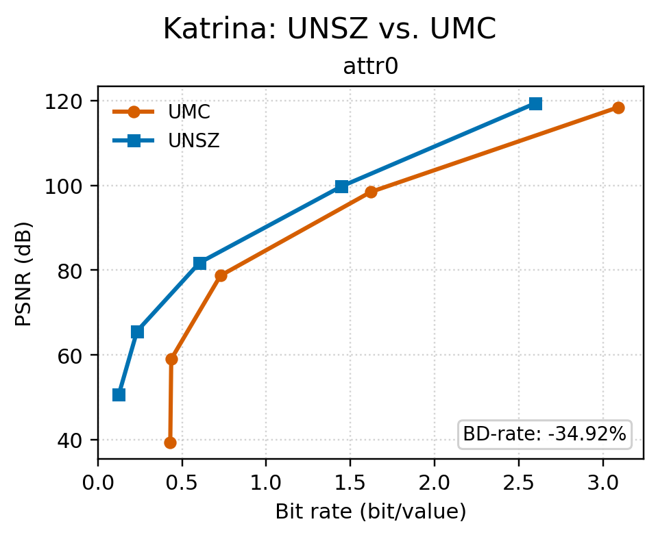

Katrina最新4参考点融合纯空间版本的五点BR为`0.134588/0.239755/0.605492/1.455116/2.606723 bit/value`，相对UMC NBP-IDW-INP的同PSNR BD-rate为`-33.764%`，即同PSNR压缩比约为UMC的`1.51倍`。进一步保持数值空间预测不变，只让第一个time step使用空间标签预测、后续标签由上一time step同位置预测。当前4参考点融合版本的五点BR为`0.049874/0.155040/0.520777/1.370402/2.522009 bit/value`，PSNR与当前空间UNSZ逐点相同；相对当前空间UNSZ和UMC NBP-IDW-INP的同PSNR BD-rate分别为`-22.384%/-48.742%`，即同PSNR压缩比约为UMC的`1.95倍`。历史10参考点版本相对UMC的BD-rate为`-50.105%`，说明改用4参考点几乎保留了原有压缩优势。当前版本的五点压缩/解压吞吐率几何平均为`159.63/216.26 MB/s`；同一组历史UMC结果为`151.59/233.60 MB/s`，即UNSZ压缩约快`5.3%`，UMC解压约快`8.0%`。在REL `1e-3`下进行三次交替重复测试时，融合原始权重路径相比分阶段路径将压缩/解压吞吐率从`119.298/187.105`提高到`170.885/221.110 MB/s`，同时保持BR、PSNR、组合码流SHA和独立解压结果完全一致。这里标签和数值使用不同预测器，并没有复用权重；收益来自合并执行及融合专用循环中的其他热路径优化，不能把`43.2%`压缩加速全部归因于同步本身。启用预归一化空间数值权重后，压缩反而比原始权重路径慢约`3.7%`，解压仅快约`1.8%`，因此该组合默认使用原始权重。

为避免把标签收益和数值预测混在一起，另一个五点实验固定使用上一time step标签流，只替换数值流。统一四维数值流与上一time step标签流组合后的估算BR为`0.025569/0.125678/0.535158/1.317791/2.346592 bit/value`，对应PSNR为`42.464965/56.079583/72.700781/91.343448/110.795295 dB`；相对上一time step标签＋逐time step空间数值的同PSNR BD-rate为`+56.349%`。估算保留联合码流的全部已有头信息，并额外为162个标签子流各计8字节长度，因此不会因忽略标签元数据而虚增收益。这个结果确认Katrina的最终效果优先方案是“标签使用上一time step同位置预测，数值逐time step使用空间DAG”，主要收益来自避免重复保存高度相关的标签，而不是统一四维数值预测。

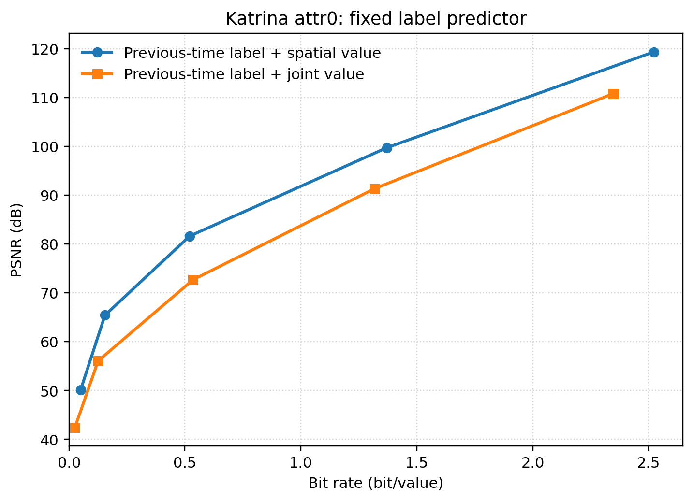

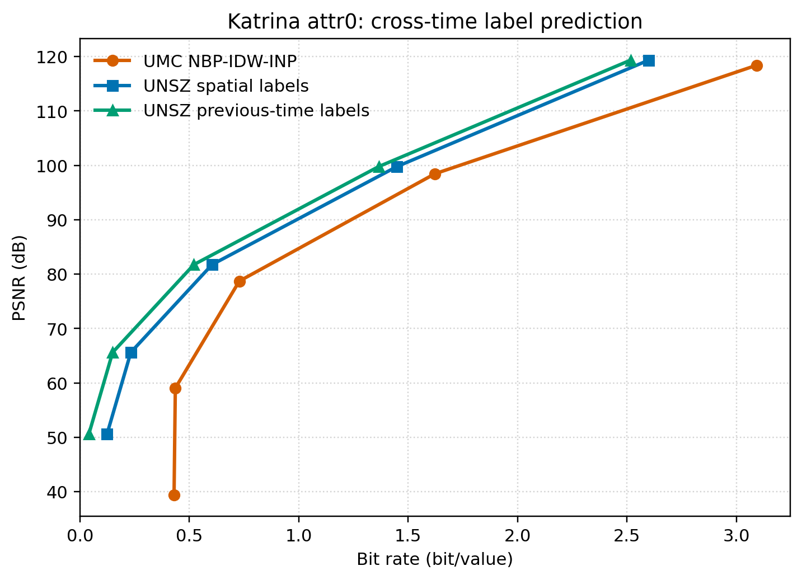

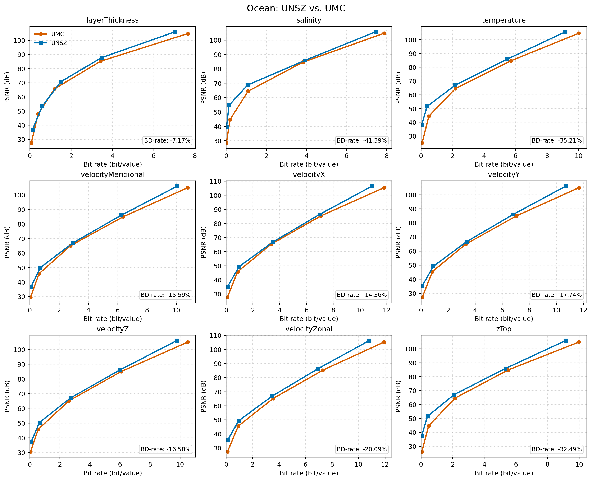

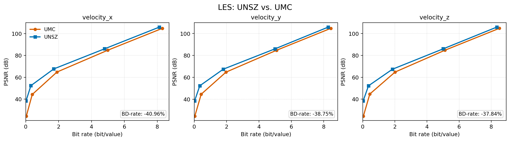

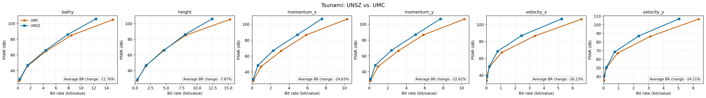

针对当前空间结果最弱的Tsunami momentum_x，进一步联合优化了预测器、adjust coord目标和分轮顺序。快速候选使用预测码长近似loss矩阵、先生成全局顺序再分轮以及`d^-2`的4点IDW；它相对当前UNSZ和UMC分别降低`8.972%/13.805%` BD-rate，五点平均核心压缩和解压时间为`0.0148/0.0078 s`。6点`hybrid_loo`相对当前UNSZ和UMC分别降低`14.512%/19.016%`，但核心压缩和解压时间增加到`0.2168/0.2080 s`。10点局部二次拟合相对当前UNSZ和UMC降低`19.811%/23.431%`。目前效果最好的空间候选是10点Matérn-3/2 RBF；shape为`0.03`、nugget为`1e-6`且不添加多项式趋势时，相对当前UNSZ、UMC和二次拟合分别降低`26.836%/30.225%/8.878%` BD-rate。RBF几何权重预计算后，五点平均核心压缩和解压约为`0.018/0.012 s`，一次公共预计算约`0.561 s`。这使同PSNR下相对UMC的压缩率优势由二次拟合的约30.6%提高到约43.3%；若目标仍是达到UMC的两倍压缩率，现有压缩率还需提高约39.6%。Matérn-5/2、一次趋势和二次趋势均未进一步改善完整RD曲线。Tsunami原本的小收益因此不是不可改善，而是当前通用预测模型没有匹配这个field；RBF仍需在其他field验证，不能根据单个测试field直接设为默认。

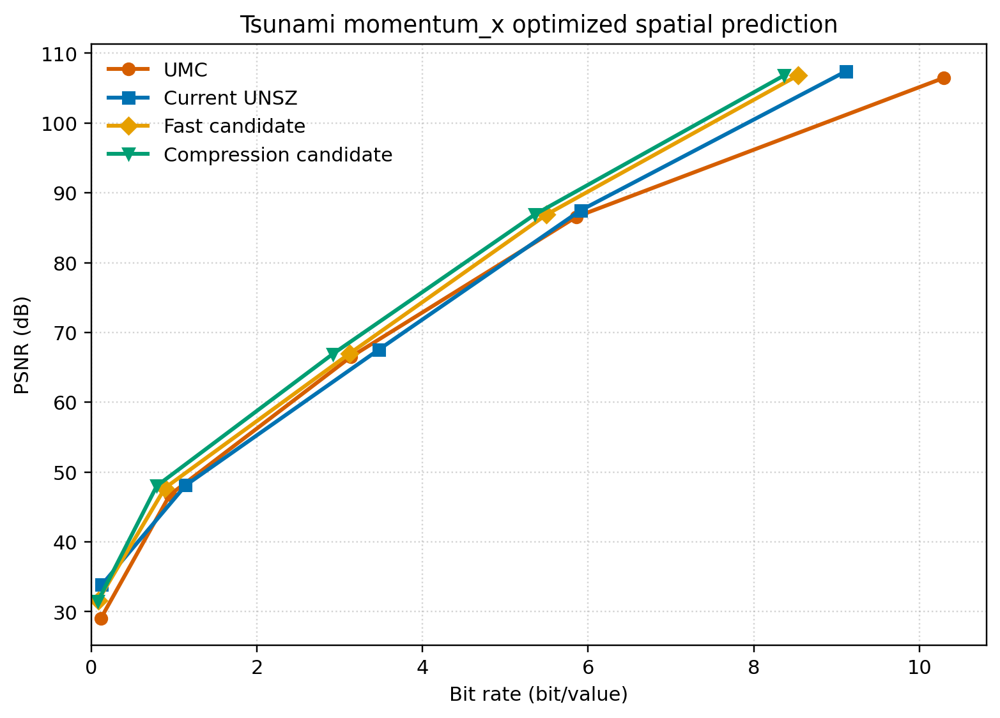

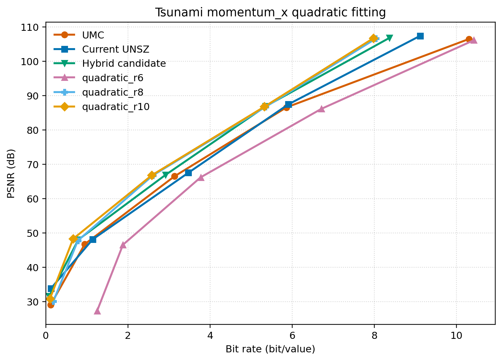

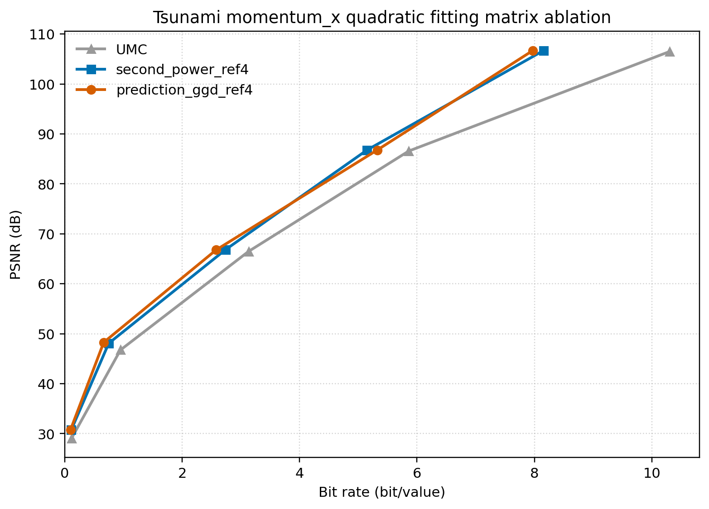

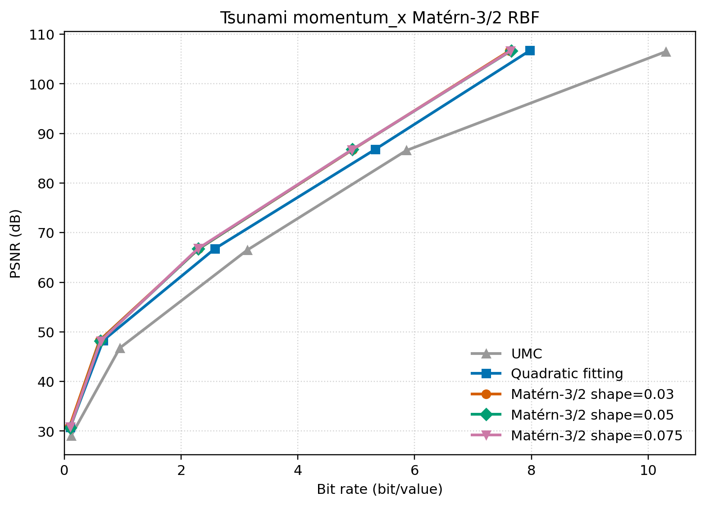

Adjust coord在坐标距离明显失真的数据上尤其重要。Katrina当前二次方loss矩阵相对旧四次方100轮矩阵降低`12.182%` BD-rate；Ocean temperature的新二次方早停矩阵相对不变换降低`2.722%`，说明不同field的收益差异很大。

Katrina前5个time step上的等坐标范围消融进一步比较了三种策略。各维范围以x轴范围为目标，scale系数为`[1,1.40891484,0.00466570]`：

| 坐标策略 | REL=0.01 BR | PSNR | 相对原坐标adjust的BD-rate |
|---|---:|---:|---:|
| 原坐标直接adjust | `0.204324` | `59.4311` | 基准 |
| 仅等范围scale | `0.227640` | `60.3536` | `+2.350%` |
| 等范围scale后直接使用原adjust矩阵 | `0.262361` | `60.4821` | `+12.876%` |
| 等范围scale后重新训练adjust矩阵 | `0.282496` | `60.2860` | `+22.848%` |

因此，显示时让各坐标轴具有相近跨度不能替代针对可预测性学习的adjust coord；在Katrina上预先等范围scale还会干扰后续训练。该小实验的脚本和五点RD结果分别为`py_codes/trash/t64_benchmark_katrina_coord_scale.py`和`py_codes/trash/results/katrina_coord_scale_rd.csv`。

## 3.4. 先生成全局顺序再分轮

| 数据 | 相对先随机分轮的BD-rate |
|---|---:|
| LES velocity_x | `-12.218%` |
| LES velocity_y | `-12.292%` |
| LES velocity_z | `-12.395%` |
| Tsunami momentum_x | `-5.585%` |
| Tsunami momentum_y | `-6.422%` |
| Tsunami velocity_x | `-0.987%` |
| Tsunami velocity_y | `-5.696%` |
| Katrina attr0，time step 0 | `+1.683%` |

先生成全局顺序再分轮的首次预处理比先随机分轮慢约`23%～32%`。当前Katrina五点重测中，4点IDW和8点RBF分别增加`0.424%/1.196%` BD-rate；登录节点观察到约`5%～8%`的核心速度提升，但可能混有运行波动。由于压缩收益不稳定、Katrina还出现退化，该方案已经放弃，只保留开关和结果用于消融。

## 3.5. 利用参考数据搜索公共预测顺序

参考数据辅助顺序保留随机分轮和反向“好点后置”框架，但用多个参考time step上动态IDW预测的平均归一化绝对误差代替纯几何D。用于搜索顺序和用于评估的time step严格分离，生成的预测结构随后供所有测试文件复用。

| field | 参考time step | 测试time step | 相对仅使用`D`排序的BD-rate | 仅使用`D`的首次预处理 | 参考数据辅助搜索的首次预处理 |
|---|---|---|---:|---:|---:|
| Katrina attr0 | 三组，每组3步 | 每组其余159步 | `-3.571%～-4.024%` | `4.65 s` | `9.50～9.68 s` |
| Ocean temperature | 三组，每组3步 | 每组其余28步 | `-27.451%～-27.713%` | `2.19 s` | `4.94～5.08 s` |

Katrina三组参考数据顺序分别改善154/159、159/159和155/159个held-out time step，最差单步退化`0.880%`；Ocean三组均改善28/28步，最差单步仍改善`25.917%`。相同实验中的“先全局排序再分轮”在Katrina总BD-rate退化`0.964%～1.041%`，在Ocean改善`12.236%～12.272%`，说明参考数据辅助顺序并非仅仅复现全局几何排序。仅使用平均平方距离`D`的优势仍是无需读取参考数据、可以跨field共用、没有参考/测试划分和分布漂移风险、可由坐标重新生成，以及首次预处理更快。参考数据辅助顺序一旦保存，逐文件核心压缩没有明显时间代价；但它通常是field相关的，而且解压端必须获得保存好的公共预测结构。

缓存动态预测误差、让多个参考文件共用一次距离权重计算、再把原始IDW权重与缓存近邻编号一起保存后，Katrina/Ocean temperature单次首次预处理已从`9.532/4.879 s`降至`4.803/2.387 s`，累计加速`1.98/2.04`倍。相同版本的D-only为`4.316/2.015 s`，参考数据辅助搜索目前只慢约`11.3%/18.5%`；这些数字来自共享登录节点单次运行，主要用于判断优化方向。新旧预测结构SHA完全一致。

固定相同held-out集合后，Katrina使用1/2/3个参考文件的总BD-rate依次为`-2.546%/-3.354%/-4.024%`，首次预处理为`6.51/7.94/9.54 s`；Ocean temperature依次为`-26.246%/-27.267%/-27.613%`，首次预处理为`3.21/4.20/5.02 s`。三个文件仍得到最低BR，适合作为效果优先配置；两个文件已分别获得三文件约83.3%和98.7%的收益，可作为更快的离线搜索候选。

Ocean layerThickness进一步使用time step `8/16/24`搜索顺序，并在其余28步上测试。相对当前4点IDW+D-only，4点IDW+参考数据顺序和10点RBF+参考数据RBF评分分别降低`22.330%/22.877%` BD-rate；两者只相差约`0.55`个百分点。相反，10点RBF+D-only退化`8.960%`。参考数据顺序下，RBF相对IDW的核心压缩/解压时间约增加`8.1%/10.5%`，首次公共预处理由约`3.41 s`增至`11.61 s`，之后每次加载结构还需约`1.35 s`预计算RBF权重，而IDW只需约`0.04 s`。因此该field的收益主要来自参考数据辅助顺序，而不是RBF；当前优先保留4点IDW。与历史全部31步UMC曲线近似对齐时，当前28步IDW参考数据曲线约降低`32.39%` BD-rate，但训练步排除口径不同，正式数值仍需统一重测。实验入口和结果为`py_codes/benchmark_field_reference_order.py`与`results/ocean_layerThickness_reference_order.csv`。

## 3.6. 跨time step结果

Ocean velocityZonal全部31步的层次时间插值，相对其他方案的BD-rate为：

| 基线 | BR变化 |
|---|---:|
| 逐time step空间预测 | `-61.170%` |
| 上一time step同位置预测 | `-29.065%` |
| 4区域联合四维预测 | `-22.455%` |

层次时间插值是当前最强的跨时间基线。是否仍存在联合四维方案不可替代的数据，需要在更多具有不同时间相关性的field和数据集上验证。

联合四维预测可以在adjust后的坐标上独立分区。velocityZonal、31步、REL`1e-3`下，64分区相对不分区使BR降低`0.498%`、预处理加快`17.14%`、压缩加快`14.75%`；128分区使BR降低`0.373%`、预处理加快`19.27%`、压缩加快`15.85%`。这为后续一分区一任务的并行实现提供了基础。

Katrina attr0全部162步使用当前4参考点配置、128个独立partition和16线程的联合四维筛选得到`BR=0.582223,PSNR=72.699202 dB`。在该PSNR处，当前纯空间、上一time step标签和UMC五点曲线的插值BR约为`0.357962/0.266721/0.604674 bit/value`；联合方案比前两个UNSZ方案分别高`62.65%/118.29%`，只比UMC低`3.71%`。联合核心压缩/解压为`87.386/108.641 MB/s`，公共DAG预处理`88.984 s`，矩阵训练`72.989 s`，峰值内存约`30.2 GB`。后续固定上一time step标签并为统一四维数值补齐五点曲线后，其同PSNR BD-rate仍比空间数值高`56.349%`，因此Katrina继续采用空间数值预测和上一time step标签预测。

## 3.7. 串行吞吐率

以下为程序内部记录的核心吞吐率，不包含文件I/O、误差统计和结果重排。Katrina的UNSZ数字来自当前4参考点融合快速路径，UMC数字来自已有NBP-IDW-INP五点测试；Ocean、LES和Tsunami来自较早版本在Slurm shared partition上的测试。表中的倍数是全部field和五个EB上`UMC/UNSZ`吞吐率比的几何平均，大于1表示UMC更快。

| 数据 | field×EB数 | UNSZ压缩MB/s | UMC压缩MB/s | UMC/UNSZ |
|---|---:|---:|---:|---:|
| Katrina | 5 | `96.00～174.45` | `131.35～167.69` | `1.026×` |
| Ocean | 45 | `16.30～37.92` | `74.30～135.01` | `3.707×` |
| LES | 15 | `14.91～19.26` | `111.22～142.02` | `6.901×` |
| Tsunami | 20 | `16.73～32.60` | `63.32～114.31` | `3.320×` |

| 数据 | field×EB数 | UNSZ解压MB/s | UMC解压MB/s | UMC/UNSZ |
|---|---:|---:|---:|---:|
| Katrina | 5 | `167.63～235.74` | `190.30～285.84` | `1.133×` |
| Ocean | 45 | `30.05～48.91` | `106.66～407.02` | `5.561×` |
| LES | 15 | `17.78～24.88` | `141.28～474.45` | `12.058×` |
| Tsunami | 20 | `33.20～48.36` | `97.07～396.81` | `5.544×` |

Katrina最近的热循环优化已把此前约3～4倍的速度差缩小到压缩约`2.6%`、解压约`13.3%`；但这些数字不是同一独占节点上的交替测试，冻结版本后仍需统一复测。Ocean、LES和Tsunami的历史结果仍显示明显速度代价，尤其是LES解压。shared partition和登录节点的绝对吞吐率都会受其他任务的内存带宽影响。

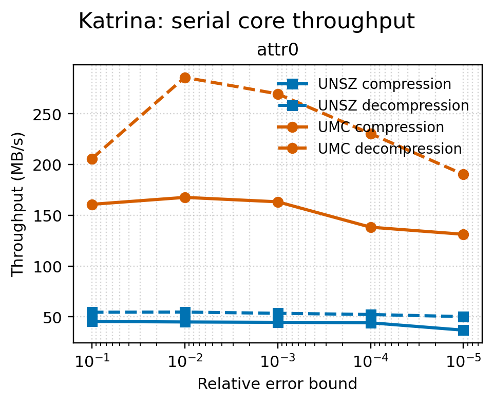

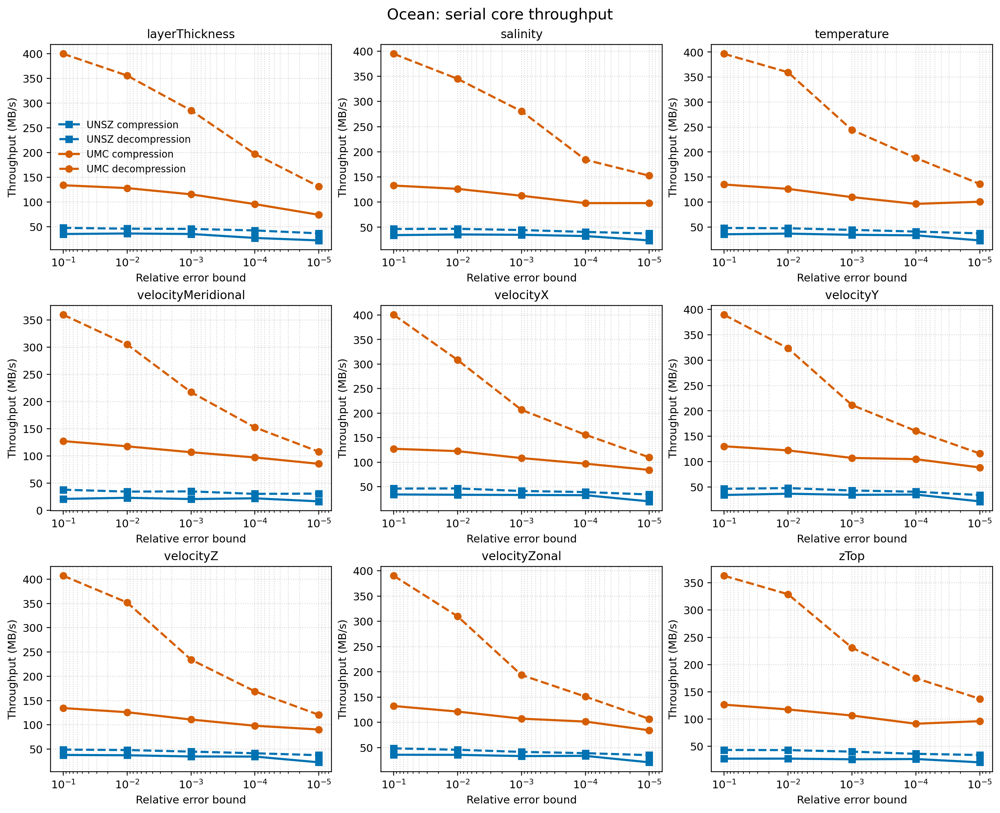

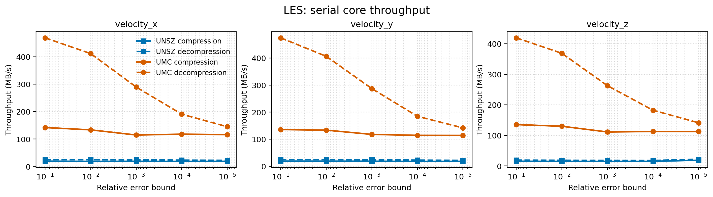

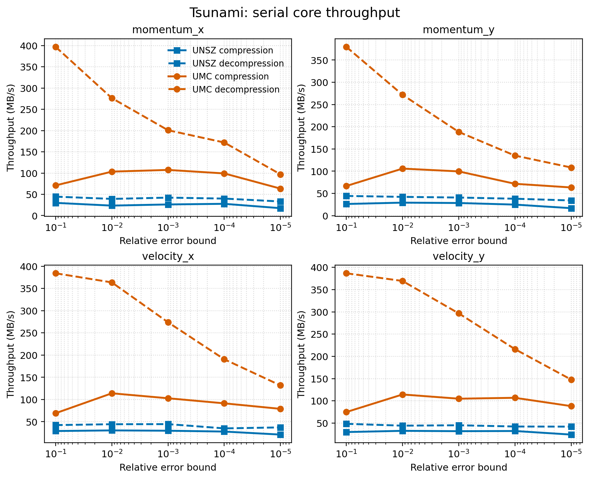

## 3.8. 新数据补充结果

Tpost20、E3SM-h4和ADCIRC Haiyan zeta已经补齐多time step五点RD；下表同时保留REL`1e-3`的直接结果，便于观察相同用户输入下的BR和PSNR。Tpost20完整测试20步，E3SM-h4完整测试720步，Haiyan zeta完整测试24步。

| 数据与field | 同PSNR BD-rate | REL`1e-3` UNSZ BR/PSNR | REL`1e-3` UMC BR/PSNR | 主要观察 |
|---|---:|---:|---:|---|
| E3SM-h4 AODDUST | `-79.138%` | `1.645/77.61 dB` | `7.038/77.30 dB` | 动态无效点约占46%，UNSZ逐步标签明显优于UMC每10步更新状态 |
| ADCIRC-Haiyan-1.5km zeta | `-54.994%` | `0.906/72.40 dB` | `1.177/68.28 dB` | UMC必须关闭只支持单连通分量的DPFS重排 |
| E3SM-h4 Mass_dst_srf | `-24.162%` | `1.652/76.45 dB` | `1.717/72.33 dB` | 普通连续field上也取得稳定收益，适合作为后续优化对象 |
| Tpost20 scalar | `-8.819%` | `3.721/66.61 dB` | `3.432/65.53 dB` | 总体收益较小，适合检验优化能否推广到弱势数据 |
| TAPS TEMPERATURE | — | `2.469/67.53 dB` | — | 核心压缩为23.93 MB/s，但生成1600万点DAG耗时229.2 s |

新增单步field统一使用REL`1e-1～1e-5`五点曲线进行首轮筛选。每个field都比较原坐标与按当前默认流程重新训练的field专属空间矩阵；负BD-rate表示前者所列UNSZ方案使用更少bit。这里保留矩阵造成退化的结果，不按测试field事后只选择较好的方案。

| 数据与field | 原坐标UNSZ相对UMC | 最新矩阵UNSZ相对UMC | 最新矩阵相对原坐标 |
|---|---:|---:|---:|
| E3SM-h0 AODVIS | `-18.479%` | `-18.442%` | `+0.120%` |
| E3SM-h0 PS | `-17.685%` | `-13.182%` | `+5.505%` |
| E3SM-h0 TREFHT | `-16.563%` | `-11.147%` | `+7.048%` |
| E3SM-h0 TAUX | `-15.239%` | `-15.818%` | `-0.662%` |
| E3SM-h0 PRECC | `-13.664%` | `-14.261%` | `-0.683%` |
| E3SM-h0 FLNS | `-13.092%` | `-13.609%` | `-0.593%` |
| E3SM-h0 CLDTOT | `-11.896%` | `-12.371%` | `-0.534%` |
| E3SM-h0 U10 | `-11.325%` | `-11.816%` | `-0.552%` |
| Tsunami bathy | `-1.230%` | `-1.382%` | `-0.165%` |
| ADCIRC-Haiyan-1.5km depth | `+1.665%` | `+3.462%` | `+1.781%` |
| Tsunami height | `+3.927%` | `+4.538%` | `+0.598%` |

E3SM-h0的8个field在原坐标上全部优于UMC，改善范围为`11.325%～18.479%`，说明UNSZ的收益不只来自Katrina坐标拉伸或动态点集标签。不过，当前二次方距离loss矩阵只让其中5个field改善约`0.53%～0.68%`，AODVIS近似不变，并使PS和TREFHT分别退化`5.505%/7.048%`；“是否启用adjust coord”需要field级离线判断。Tsunami height和Haiyan depth则是新的反例，原坐标UNSZ仍比UMC多用约`3.9%/1.7%` bit。

TAPS没有可供UMC直接使用的connectivity，因此下面只比较最新矩阵和原坐标UNSZ。每个field含16002271个点；表中吞吐率是五个EB的算术平均，均为程序内部记录的核心时间。

| TAPS field | 最新矩阵相对原坐标BD-rate | 原坐标/矩阵压缩MB/s | 原坐标/矩阵解压MB/s |
|---|---:|---:|---:|
| C11H22 | `-13.186%` | `24.81/24.33` | `34.34/33.89` |
| VELOCITY_X | `-9.731%` | `23.45/22.78` | `30.27/29.47` |
| CO2 | `-5.300%` | `21.37/21.38` | `27.17/28.30` |
| RMS_T | `-3.345%` | `23.48/23.40` | `33.12/33.02` |
| TKE | `-3.014%` | `22.40/23.21` | `30.96/31.69` |
| PRESSURE | `+0.354%` | `23.48/23.85` | `30.95/31.49` |

六个新增TAPS field的平均/中位BD-rate变化为`-5.704%/-4.322%`。矩阵前后的平均核心压缩吞吐率为`23.17/23.16 MB/s`，解压为`31.14/31.31 MB/s`，说明矩阵训练和重新生成DAG属于离线成本，逐文件预测速度基本不受影响。一次field训练只需约`21～25 s`，但原坐标与变换坐标各生成一套1600万点DAG分别需要约`152～168 s`；五点压缩和解压随后复用各自的公共结构。六个Slurm任务用时`11:51～13:01`，峰值内存为`4.56～4.64 GB`。

# 4. TODO

## 4.1. 投稿前主线

- [ ] Katrina和Ocean temperature的三组参考/测试划分、全部held-out time step及1/2/3个参考文件已经验证；继续测试更多field和分布漂移。
- [ ] 按同PSNR BD-rate对field排序；优先在稳定正收益但优势仍有限的中间梯队开发压缩优化，固定方案和参数后再应用到表尾弱势field，区分通用收益与单数据过拟合。
- [ ] 为E3SM AODDUST补测UMC-INP的batch `1/2/5/10`，确认其大幅优势中有多少来自UMC每10步才更新动态无效状态。
- [x] 用当前Katrina 4点IDW高速版和RBF高压缩比版重测“先生成全局顺序再分轮”；两者分别增加`0.424%/1.196%` BD-rate。登录节点上的小幅速度收益不足以抵消不稳定的压缩效果，方案已放弃。
- [x] 实现后3轮cache子partition DAG及逐文件物理重排。Katrina以8个区域得到`-1.205%` BD-rate，但压缩/解压仍慢`6.16%/17.86%`，方案已放弃。
- [ ] 寻找更多具有不同网格结构、坐标尺度、点集分布和时间相关性的非结构数据，验证UNSZ、adjust coord和跨时间结论的普适性。
- [ ] 获取并接入Ocean-large，在同一数据和进程规模上比较UNSZ与UMC作者原始MPI程序的RD、吞吐率及端到端时间；SZ3和ZFP暂缓。
- [x] 用户定义的有序多点集、`n-1`个条件标签通道及逐点集codec/error bound已经形成压缩—解压闭环。
- [ ] 冻结串行参数、bitstream和实验脚本，在统一版本上重新生成五点RD、吞吐率以及各阶段流长度。
- [x] 完成adjust后独立partition的OpenMP原型：预测结构、标签、数值、Huffman、Zstd和重建均已按partition并行，v9格式保存独立payload及偏移表。
- [ ] 完成single-core throughput、strong/weak scaling和端到端压缩—传输—解压实验，再决定DCC或IPDPS投稿路线。

详细参数、完整消融结果和已经否定的方案见`TODO_DETAIL.md`；面向日常决策的精简状态见`TODO.md`。
